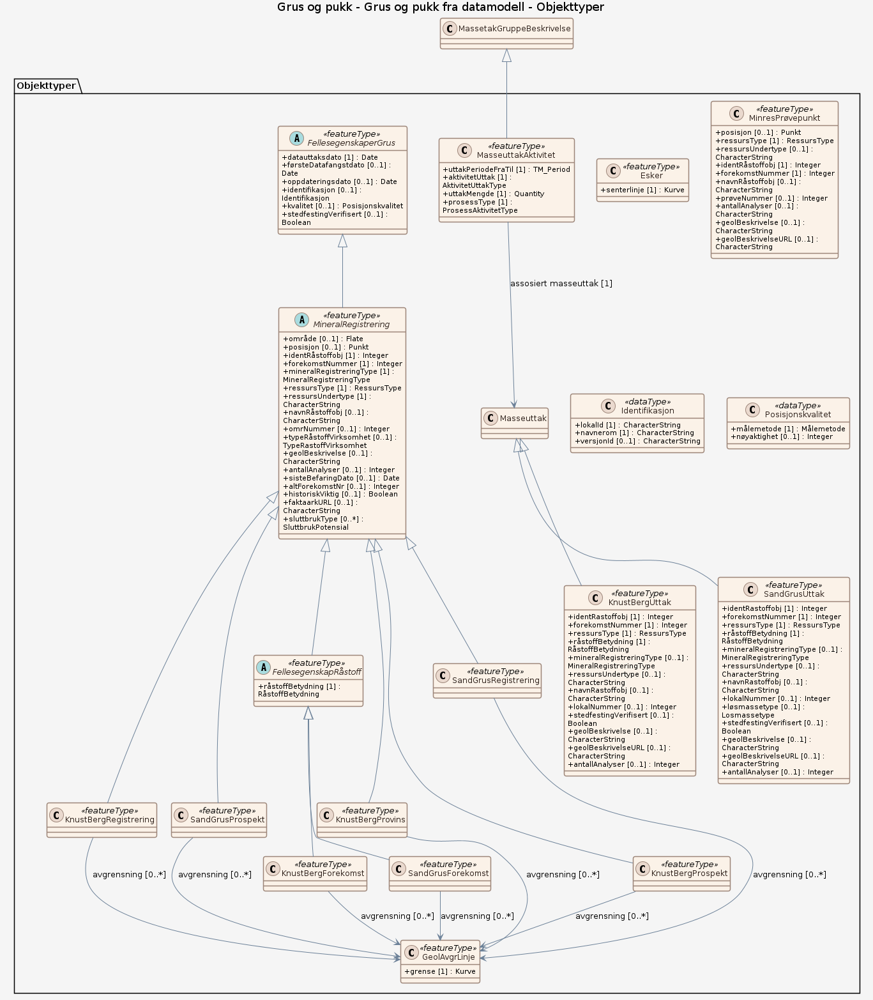

### Datamodell

**Kilde:** [SOSI UML XMI-fil](https://sosi.geonorge.no/svn/SOSI/SOSI%20Del%203/NGU/Grus-4.0_Utkast.xml)

#### KnustBergRegistrering

Ethvert volum av økonomisk interessant bergart til byggeråstoff  --Definition-- Any volume of rock applicable for construction purposes.

Egenskaper

(ingen)

Relasjoner

**Arv**
MineralRegistrering

**Assosiasjoner**
GeolAvgrLinje – rolle: avgrensning – kardinalitet: 0..*

#### GeolAvgrLinje

generell avgrensning av geologisk objekt   -- Definition -- general delimitation of geological object

Egenskaper

<table class="feature-attribute-table">
  <colgroup>
    <col style="width: 35%;" />
    <col style="width: 65%;" />
  </colgroup>
  <tbody>
    <tr>
      <th scope="row">Navn:</th>
      <td><strong>grense</strong></td>
    </tr>
    <tr>
      <th scope="row">Definisjon:</th>
      <td>forløp som følger overgang mellom ulike fenomener  -- Definition -- course follwing the transition between different real world phenomena</td>
    </tr>
    <tr>
      <th scope="row">Multiplisitet:</th>
      <td>1</td>
    </tr>
    <tr>
      <th scope="row">Type:</th>
      <td>Kurve</td>
    </tr>
  </tbody>
</table>

#### KnustBergForekomst

En ansamling av bergarter som har eller kan få en økonomisk verdi som byggeråstoff. En forekomst må ha et estimat eller en beregning av volum og kvalitet.  --Definition-- A volume of naturally occurring rocks usually of economic value as construction material

Egenskaper

(ingen)

Relasjoner

**Arv**
FellesegenskapRåstoff

**Assosiasjoner**
GeolAvgrLinje – rolle: avgrensning – kardinalitet: 0..*

#### KnustBergUttak

uttakssted for produksjon av knust berg (pukk)  -- Definition -- Crushed rock aggregate extraction site

Egenskaper

<table class="feature-attribute-table">
  <colgroup>
    <col style="width: 35%;" />
    <col style="width: 65%;" />
  </colgroup>
  <tbody>
    <tr>
      <th scope="row">Navn:</th>
      <td><strong>identRastoffobj</strong></td>
    </tr>
    <tr>
      <th scope="row">Definisjon:</th>
      <td>forekomstobjektets identifikasjonskode  Merknad: Består av kommunenummer (4 siffer), og et løpenummer (7 siffer). Ideelt sett består løpenummeret av et område nummer (3 siffer), lokalitetsnummer (2 siffer) og prøvenummer (2 siffer).  Eksempel: 17290010101</td>
    </tr>
    <tr>
      <th scope="row">Multiplisitet:</th>
      <td>1</td>
    </tr>
    <tr>
      <th scope="row">Type:</th>
      <td>Integer</td>
    </tr>
  </tbody>
</table>

<table class="feature-attribute-table">
  <colgroup>
    <col style="width: 35%;" />
    <col style="width: 65%;" />
  </colgroup>
  <tbody>
    <tr>
      <th scope="row">Navn:</th>
      <td><strong>forekomstNummer</strong></td>
    </tr>
    <tr>
      <th scope="row">Definisjon:</th>
      <td>unik nummerering av forekomsten som råstoffobjektet tilhører  Merknad: Benyttes som koplingsnøkkel mellom de ulike objektene i forekomsten. Mange viktige egenskaper finnes kun på områdeobjektet som er hovedobjektet til forekomsten  Eks. 1729001</td>
    </tr>
    <tr>
      <th scope="row">Multiplisitet:</th>
      <td>1</td>
    </tr>
    <tr>
      <th scope="row">Type:</th>
      <td>Integer</td>
    </tr>
  </tbody>
</table>

<table class="feature-attribute-table">
  <colgroup>
    <col style="width: 35%;" />
    <col style="width: 65%;" />
  </colgroup>
  <tbody>
    <tr>
      <th scope="row">Navn:</th>
      <td><strong>ressursType</strong></td>
    </tr>
    <tr>
      <th scope="row">Definisjon:</th>
      <td>hvilken type råstoff som kan være/er gjenstand for utvinning. NB: Kodelisten er kun delvis harmonisert med Inspire CommodityCode  -- Definition -- Values indicating the type of commodity. what type of raw material that may be/is subject to extraction -- Description -- EXAMPLE: Cu, Au, Dimension Stone etc.</td>
    </tr>
    <tr>
      <th scope="row">Multiplisitet:</th>
      <td>1</td>
    </tr>
    <tr>
      <th scope="row">Type:</th>
      <td>RessursType</td>
    </tr>
    <tr>
      <th scope="row">Tillatte verdier:</th>
      <td>- edelmetaller – Edelmetaller (Au,Ag,PGE); Gull, sølv og metaller i platinagruppen (Ru, Ro, Pd, Os, Ir, Pt) og rhenium.

Precious metals: gold, silver and platinum group metals and rhenium; ruthenium, rhodium, palladium, osmium, iridium, and platinum - jernmetaller – Jernmetaller (Fe, Mn, Ti); jern, mangan og titan

Ores of iron, manganese and titanium. - jernlegeringMetaller – Jernlegeringsmetaller (Cr, Ni, Co, V, Mo, W); krom, nikkel, kobolt, vanadium, molybden og wolfram.

Metals that are mined for their alloying properties with iron in the manufacture of steel; chromium, nickel, cobalt, vanadium, molybdenum and wolfram. - basemetaller – Basemetaller (Cu, Zn, Pb inkl. Fe-sulfider, As, Sb, Bi, Sn); kobber, sink, bly, jern-sulfider, arsen, antimon, vismut og tinn

Base metals; copper, zink, lead, iron-sulphides, arsenic, antimony, bismuth and tin.
In chemistry, the term base metal is used informally to refer to a metal that oxidizes or corrodes relatively easily and reacts variably with diluted hydrochloric acid (HCl) to form hydrogen. Examples include iron, nickel, lead and zinc. Copper is also considered a base metal because it oxidizes relatively easily, although it does not react with HCl. - <a href="http://en.wikipedia.org/wiki/Base_metal"><http://en.wikipedia.org/wiki/Base_metal></a> - energimetaller – Energimetaller (U, Th); uran og thorium
Energy minerals; uranium and thorium - spesialmetaller – Spesialmetaller omfatter metaller og grunnstoffer som normalt ikke passer inn i krystallstrukturen til vanlige mineraler (Nb, Ta, Be, Li, Sc, REE); niob, tantal, beryllium, litium, scandium og sjeldne jordartsmetaller.

Special metals and incompatible elements (Nb, Ta, Be, Li, Sc, and REE). - andreMetaller – Andre metaller.

Other metals: Cs, Ga, Ge, Hf, In, Cd, Hg, Re, Rb, Se, Si, Sr, S, Te, Tl, Zr, Mg and metallic elements used for non-metallic products: Ba, K, Ca, Na, Rb
Commodity is a metal that is extracted from an ore material mined from the Earth - karbonatMineraler – Karbonatmineraler; Kalkstein, dolomittstein, kalkspatmarmor, dolomittmarmor og blandingsbergarter mellom disse. Ofte brukte forkortelser er kalk for både kalkstein og kalkspatmarmor og dolomitt for både dolomittstein og dolomittmarmor.

Limestone, dolomite and calcite and dolomite marble.

A trigonal calcium carbonate mineral CaCO3 used in large crystal form for optics and as compound additive for soil remediation, soil stabilization and concrete repair. <a href="http://www.webmineral.com/data/Calcite.shtml"><http://www.webmineral.com/data/Calcite.shtml></a> <a href="http://en.wikipedia.org/wiki/Calcite"><http://en.wikipedia.org/wiki/Calcite></a> - silika – Kvarts: kvartssand, kvartssandstein, kvartsitt og hydrotermal kvarts.

Quartz, quartz sand, quartz sandstone, quartzite and hydrothermal quartz.
Silicon dioxide, also known as silica (from the Latin silex), is a chemical compound that is a dioxide of silicon with the chemical formula SiO2 - <a href="http://en.wikipedia.org/wiki/Silica"><http://en.wikipedia.org/wiki/Silica></a> - talk – Talk og serpentin-førende bergarter

Talc and serpentinite.
Talc is an important industrialMineral. Its resistance to heat, electricity and acids make it an ideal surface for lab counter tops and electrical switchboards. It is also an important filler material for paints, rubber and insecticides. Even with all these uses, most people only know talc as the primary ingredient in talcum powder.- <a href="http://www.galleries.com/Talc"><http://www.galleries.com/Talc></a> - feltspat – Feltspatmineraler; pegmatittisk feltspat og anortositt
Feldspar minerals; pegmatittic feldspar og anorthosite

Feldspars (KAlSi3O8 – NaAlSi3O8 – CaAl2Si2O8) are a group of rock-forming tectosilicate minerals that make up as much as 60% of the Earth's crust. - <a href="http://en.wikipedia.org/wiki/Feldspar"><http://en.wikipedia.org/wiki/Feldspar></a> - olivin – Olivin

Olivine - grafitt – Grafitt; flak-grafitt eller amorf grafitt.

Graphite
Graphite is a polymorph of the element carbon. Diamond is another polymorph. The two share the same chemistry, carbon, but have very different structures and very different properties. - <a href="http://www.galleries.com/Graphite"><http://www.galleries.com/Graphite></a> - fossiltBrensel – Fossilt brensel

Fossil fuel - nefelinSyenitt – Nefelin syenitt

Nepheline syenite - magnesiumMineraler – Magnesium-mineraler; magnesitt og brucitt.

Magnesium minerals.; Magnesite and brucite - zirkon – Zirkon

Zirkon - berylliumMineraler – Beryllium-førende mineraler - glimmermineraler – Glimmermineraler; muskovitt, biotitt m.m.

Mica minerals; muscovite, biotite and more. - andreIndustrimineraler – Andre industrimineraler

Other industrial minerals
A compound Earth material, or rock product that is directly used for industrial purposes. Not a specific mineral constituent in the mined material. - sandsteinOgKonglomerat – Uomdannete sedimentære bergarter inklusiv sandstein og konglomerat, samt kvartsitt, benyttet som naturstein. Er i INSPIRE inkludert i «sandstone» &lt;a href="<a href="https://inspire.ec.europa.eu/codelist/CommodityCodeValue/sandstone"&gt;&lt;font"><https://inspire.ec.europa.eu/codelist/CommodityCodeValue/sandstone"&gt;&lt;font></a> color="#0563c1"&gt;&lt;u&gt;<a href="https://inspire.ec.europa.eu/codelist/CommodityCodeValue/sandstone&lt;/u&gt;&lt;/font&gt;&lt;/a&gt"><https://inspire.ec.europa.eu/codelist/CommodityCodeValue/sandstone&lt;/u&gt;&lt;/font&gt;&lt;/a&gt></a>; - skiferOgHellestein – Alle typer omdannete bergarter som kan splittes etter naturlige sjikt til plater og benyttes som naturstein. Inkluderer leirskifer, fyllitt, glimmerskifer, kvartsskifer og grønnskifer. Leirskifer er i INSPIRE inkludert i «slate»
&lt;a href="<a href="https://inspire.ec.europa.eu/codelist/CommodityCodeValue/slate"&gt;&lt;font"><https://inspire.ec.europa.eu/codelist/CommodityCodeValue/slate"&gt;&lt;font></a> color="#0563c1"&gt;&lt;u&gt;<a href="https://inspire.ec.europa.eu/codelist/CommodityCodeValue/slate&lt;/u&gt;&lt;/font&gt;&lt;/a&gt"><https://inspire.ec.europa.eu/codelist/CommodityCodeValue/slate&lt;/u&gt;&lt;/font&gt;&lt;/a&gt></a>;, grønnskifer i «greenstone» &lt;a href="<a href="https://inspire.ec.europa.eu/codelist/CommodityCodeValue/greenstone"&gt;&lt;font"><https://inspire.ec.europa.eu/codelist/CommodityCodeValue/greenstone"&gt;&lt;font></a> color="#0563c1"&gt;&lt;u&gt;<a href="https://inspire.ec.europa.eu/codelist/CommodityCodeValue/greenstone&lt;/u&gt;&lt;/font&gt;&lt;/a&gt"><https://inspire.ec.europa.eu/codelist/CommodityCodeValue/greenstone&lt;/u&gt;&lt;/font&gt;&lt;/a&gt></a>; og resten i  «miscellaneous dimension stones» &lt;a href="<a href="https://inspire.ec.europa.eu/codelist/CommodityCodeValue/miscellaneousDimensionStones"&gt;&lt;font"><https://inspire.ec.europa.eu/codelist/CommodityCodeValue/miscellaneousDimensionStones"&gt;&lt;font></a> color="#0563c1"&gt;&lt;u&gt;<a href="https://inspire.ec.europa.eu/codelist/CommodityCodeValue/miscellaneousDimensionStones&lt;/u&gt;&lt;/font&gt;&lt;/a&gt"><https://inspire.ec.europa.eu/codelist/CommodityCodeValue/miscellaneousDimensionStones&lt;/u&gt;&lt;/font&gt;&lt;/a&gt></a>; - kvernstein – Bergarter som historisk er benyttet til produksjon av kvernstein, inklusiv glimmerskifer, amfibolitt og gneis - brynestein – Bergarter som historisk er benyttet til produksjon av brynestein, inklusiv siltstein, kvartsskifer og fyllitt - murestein – Uspesifiserte bergarter som benyttes til produksjon av tørrmurstein. Kan inkludere kvartsskifer og gneis - spodumen – Spodumen er et mineral i pyroksengruppa, et litiumaluminium-silikat, LiAlSi2O6. Det finnes på granittpegmatitter og er et viktig råstoff for framstilling av litiumsambindinger. - gneis – Gneis benyttet som naturstein. Inkluderer alle typer gneis. Er i INSPIRE inkludert i «granite» &lt;a href="<a href="https://inspire.ec.europa.eu/codelist/CommodityCodeValue/granite"&gt;&lt;font"><https://inspire.ec.europa.eu/codelist/CommodityCodeValue/granite"&gt;&lt;font></a> color="#0563c1"&gt;&lt;u&gt;<a href="https://inspire.ec.europa.eu/codelist/CommodityCodeValue/granite&lt;/u&gt;&lt;/font&gt;&lt;/a&gt"><https://inspire.ec.europa.eu/codelist/CommodityCodeValue/granite&lt;/u&gt;&lt;/font&gt;&lt;/a&gt></a>; - marmorOgKalkstein – Karbonatrike bergarter benyttet som naturstein. Inkluderer marmor, dolomitt og kalkstein. Marmor er i INSPIRE inkludert i «marble» &lt;a href="<a href="https://inspire.ec.europa.eu/codelist/CommodityCodeValue/marble"&gt;&lt;font"><https://inspire.ec.europa.eu/codelist/CommodityCodeValue/marble"&gt;&lt;font></a> color="#0563c1"&gt;&lt;u&gt;<a href="https://inspire.ec.europa.eu/codelist/CommodityCodeValue/marble&lt;/u&gt;&lt;/font&gt;&lt;/a&gt"><https://inspire.ec.europa.eu/codelist/CommodityCodeValue/marble&lt;/u&gt;&lt;/font&gt;&lt;/a&gt></a>;
og kalkstein i «limestone» &lt;a href="<a href="https://inspire.ec.europa.eu/codelist/CommodityCodeValue/limestone"&gt;&lt;font"><https://inspire.ec.europa.eu/codelist/CommodityCodeValue/limestone"&gt;&lt;font></a> color="#0563c1"&gt;&lt;u&gt;<a href="https://inspire.ec.europa.eu/codelist/CommodityCodeValue/limestone&lt;/u&gt;&lt;/font&gt;&lt;/a&gt"><https://inspire.ec.europa.eu/codelist/CommodityCodeValue/limestone&lt;/u&gt;&lt;/font&gt;&lt;/a&gt></a>; - klebersteinOgSerpentinitt – Kleberstein og serpentinitt benyttet som naturstein. Kleberstein er i INSPIRE inkludert i «miscellaneous dimension stones» &lt;a href="<a href="https://inspire.ec.europa.eu/codelist/CommodityCodeValue/miscellaneousDimensionStones"&gt;&lt;font"><https://inspire.ec.europa.eu/codelist/CommodityCodeValue/miscellaneousDimensionStones"&gt;&lt;font></a> color="#0563c1"&gt;&lt;u&gt;<a href="https://inspire.ec.europa.eu/codelist/CommodityCodeValue/miscellaneousDimensionStones&lt;/u&gt;&lt;/font&gt;&lt;/a&gt"><https://inspire.ec.europa.eu/codelist/CommodityCodeValue/miscellaneousDimensionStones&lt;/u&gt;&lt;/font&gt;&lt;/a&gt></a>; og serpentinitt i «marble»
&lt;a href="<a href="https://inspire.ec.europa.eu/codelist/CommodityCodeValue/marble"&gt;&lt;font"><https://inspire.ec.europa.eu/codelist/CommodityCodeValue/marble"&gt;&lt;font></a> color="#0563c1"&gt;&lt;u&gt;<a href="https://inspire.ec.europa.eu/codelist/CommodityCodeValue/marble&lt;/u&gt;&lt;/font&gt;&lt;/a&gt"><https://inspire.ec.europa.eu/codelist/CommodityCodeValue/marble&lt;/u&gt;&lt;/font&gt;&lt;/a&gt></a>; - granittOgAndreStørkningsbergarter – Alle dyp- og gangbergarter, inklusiv granitt, gabbro, syenitt, monzonitt, doleritt, larvikitt, anortositt, dioritt, mangeritt, tonalitt og trondhjemitt benyttet som naturstein. Er i INSPIRE inkludert i «granite»
&lt;a href="<a href="https://inspire.ec.europa.eu/codelist/CommodityCodeValue/granite"&gt;&lt;font"><https://inspire.ec.europa.eu/codelist/CommodityCodeValue/granite"&gt;&lt;font></a> color="#0563c1"&gt;&lt;u&gt;<a href="https://inspire.ec.europa.eu/codelist/CommodityCodeValue/granite&lt;/u&gt;&lt;/font&gt;&lt;/a&gt"><https://inspire.ec.europa.eu/codelist/CommodityCodeValue/granite&lt;/u&gt;&lt;/font&gt;&lt;/a&gt></a>; - knustBerg – Knust berg

Broad category for coarse particulate material used in construction, including sand, gravel, crushed stone, slag, recycled concrete and geosynthetic aggregates. - <a href="http://en.wikipedia.org/wiki/Construction_aggregate"><http://en.wikipedia.org/wiki/Construction_aggregate></a> - sandOgGrus – Sand og grus

Durable rock fragments (silicates, flints, etc) with a size range: 0.063 mm - 80mm, derived from the weathering, erosion and transport of rocks by glacial or fluvial processes. Used for aggregate purposes and construction fill. - grusOgAndreLøsmasser – Grus og andre løsmasser

Sand and gravel and crushed rock extracted from the ground - skredOgForvitring – Skred og forvitringsmateriale - skjellsand – Skjellsand - steintipp – Steintipp - leire – Leire

End use is determined by the properties of the material therefore it is a valid commodity type - torv – Torv

An accumulation of partially decayed vegetation or organic matter that forms in wetland conditions, where flooding obstructs flows of oxygen from the atmosphere, slowing rates of decomposition. Peat is commonly harvested as an important source of fuel in certain parts of the world. <a href="http://en.wikipedia.org/wiki/Peat"><http://en.wikipedia.org/wiki/Peat></a> - annenNaturstein – Annen naturstein utenom kategoriene, inklusiv eklogitt, thulitt og amfibolitt. Er i INSPIRE inkludert i «miscellaneous dimension stones» &lt;a href="<a href="https://inspire.ec.europa.eu/codelist/CommodityCodeValue/miscellaneousDimensionStones"&gt;&lt;font"><https://inspire.ec.europa.eu/codelist/CommodityCodeValue/miscellaneousDimensionStones"&gt;&lt;font></a> color="#0563c1"&gt;&lt;u&gt;<a href="https://inspire.ec.europa.eu/codelist/CommodityCodeValue/miscellaneousDimensionStones&lt;/u&gt;&lt;/font&gt;&lt;/a&gt"><https://inspire.ec.europa.eu/codelist/CommodityCodeValue/miscellaneousDimensionStones&lt;/u&gt;&lt;/font&gt;&lt;/a&gt></a>; - uspesifisert – Uspesifisert</td>
    </tr>
  </tbody>
</table>

<table class="feature-attribute-table">
  <colgroup>
    <col style="width: 35%;" />
    <col style="width: 65%;" />
  </colgroup>
  <tbody>
    <tr>
      <th scope="row">Navn:</th>
      <td><strong>råstoffBetydning</strong></td>
    </tr>
    <tr>
      <th scope="row">Definisjon:</th>
      <td>hvilken betydning en mineralforekomst har med tanke på mulig økonomisk utnyttelse nå eller for framtiden. Skal begrunnes.  -- Definition -- how important a geological resource or registration is as regards potential commercial exploitation now or in the future</td>
    </tr>
    <tr>
      <th scope="row">Multiplisitet:</th>
      <td>1</td>
    </tr>
    <tr>
      <th scope="row">Type:</th>
      <td>RåstoffBetydning</td>
    </tr>
    <tr>
      <th scope="row">Tillatte verdier:</th>
      <td>- internasjonalBetydning – 1. Metall- og industrimineralforekomster med dokumenterte ressurser som kan gi et signifikant bidrag til internasjonale behov
- herunder forekomster med meget høy dokumentert in situ-verdi basert på kvalitet og tonnasje
- herunder forekomster med potensial for årsproduksjon som dekker signifikant andel av behov i EU/EØS

2. Forekomster av strategisk viktige eller «kritiske» råstoff
- herunder dokumenterte forekomster av mineraler på EU liste over kritiske råstoffer som utnyttes eller har potensial for framtidig utnyttelse

3. Forekomster av byggeråstoffer med verdi eller potensial for eksport på minst 1 millioner tonn årlig - nasjonalBetydning – 1. Mineralforekomster som har et bekreftet eller sannsynlig, betydelig fremtidig verdiskapingspotensial
- herunder forekomster med betydelig in-situ verdi
- herunder byggeråstoffer med betydelig potensial for eksport

2. Mineralforekomster som har unike kvaliteter som gjør dem særlig egnet til foredlende industri
- herunder industrimineraler og spesialmetaller av særlig høy kvalitet

3. Mineralforekomster som har unike kvaliteter som byggeråstoff
- herunder knust berg (pukk)- og grusforekomster med unike fysiske egenskaper
- herunder natursteinsforekomster med unike egenskaper og attraktivitet i det internasjonale markedet
- herunder forekomster av metaller og industrimineraler som har dokumentert eller sannsynlig framtidig betydning som råstoff til andre viktige samfunnsområder

4. Forekomster av strategisk viktige eller «kritiske» råstoff
- herunder forekomster av metaller og industrimineraler som har dokumentert eller sannsynlig framtidig betydning som råstoff til viktige norske samfunnsområder

5. Forekomster som er særdeles viktig for Norges nasjonale infrastruktur
- herunder grus- og knust berg (pukk)-forekomster som er særlig viktig for forsyninger til større befolkningssentra i Norge - regionalBetydning – 1. Mineralforekomster som har et bekreftet eller sannsynlig fremtidig verdiskapingspotensial med in situ-verdi på mellom 100 og 1000 millioner kroner

2. Mineralforekomster som er særdeles viktig for regional infrastruktur
- herunder industrimineral-, naturstein-, grus- og knust berg (pukk)-forekomster som er særlig viktig for forsyninger innen en region
- herunder natursteinsforekomster som har eller har hatt særlig betydning for byggeskikk og arkitektur i en region - lokalBetydning – Mineralforekomster som er viktig for lokal infrastruktur
- herunder industrimineral-, naturstein-, grus- og knust berg (pukk)-forekomster som kan være viktig for forsyninger innen en kommune - litenBetydning – Forekomsten har liten eller ingen økonomisk betydning - ikkeVurdert – Forekomstens økonomiske betydning er ikke vurdert</td>
    </tr>
  </tbody>
</table>

<table class="feature-attribute-table">
  <colgroup>
    <col style="width: 35%;" />
    <col style="width: 65%;" />
  </colgroup>
  <tbody>
    <tr>
      <th scope="row">Navn:</th>
      <td><strong>mineralRegistreringType</strong></td>
    </tr>
    <tr>
      <th scope="row">Definisjon:</th>
      <td>hvilken type mineralregistrering dette er inndelt etter kunnskapsnivå. Eksempler på dette er prospekt, registrering og forekomst.  -- Definition -- The type of mineral occurrence.  -- Description -- EXAMPLE: prospect, occurrence, mineral deposit, ore deposit</td>
    </tr>
    <tr>
      <th scope="row">Multiplisitet:</th>
      <td>0..1</td>
    </tr>
    <tr>
      <th scope="row">Type:</th>
      <td>MineralRegistreringType</td>
    </tr>
    <tr>
      <th scope="row">Tillatte verdier:</th>
      <td>- forekomst – Et punkt med et arealfestet område (polygon) der det finnes en dokumentert eller estimert ressurs, som antas å være økonomisk interessant og som enten er eller kan være utnyttbare i fremtida. En forekomst må ha et estimat eller en beregning av volum og kvalitet. For forekomster under bakken vil arealet definere projeksjon til overflaten.
Området omkranser en dokumentert (målt) reserve/ressurs eller antatt ressurs. Kan omfatte malmer, industrimineraler, og naturstein.

INSPIRE Description:
A mass of naturally occurring mineral material, e.g. metal ores or non-metallic minerals, usually of economic value, without regard to mode of origin. Accumulations of coal and petroleum may or may not be included. - registrering – Et punkt med eller uten et arealfestet område (polygon) der det er observert og/eller analysert forhøyete verdier av utvinnbare mineraler og bergarter. Kan inneholde lite eller mye informasjon og kan også inkludere gamle steinbrudd, skjerp og nedlagte gruver og massetak. Kan omfatte malmer, industrimineraler og naturstein.

INSPIRE Description:
Any ore or economic mineral in any concentration found in bedrock or as float. - prospekt – Et punkt med et arealfestet område (polygon) med høy sannsynlighet for funn av hittil lite eller ikke dokumenterte økonomisk interessante mineralressurser. Arealet kan være basert på kartlagt geologi, lovende analyser av borkjerner og andre prøver, geofysiske anomalier og lignende. Ytterligere ressursgeologiske undersøkelser er nødvendig for å avklare potensialet.

INSPIRE Description:
An area that is a potential site of mineral deposits, based on preliminary exploration, previous exploration. A geologic or geophysical anomaly, especially one recommended for additional exploration. - provins – En mineralprovins er et eller flere arealfestete områder (polygoner) der det finnes forhøyete muligheter for funn av angitte mineralressurser. En mineralprovins kan omkranse en eller flere forekomster, prospekter og registreringer

INSPIRE Description:
Geologic provinces classified by mineral resources.</td>
    </tr>
  </tbody>
</table>

<table class="feature-attribute-table">
  <colgroup>
    <col style="width: 35%;" />
    <col style="width: 65%;" />
  </colgroup>
  <tbody>
    <tr>
      <th scope="row">Navn:</th>
      <td><strong>ressursUndertype</strong></td>
    </tr>
    <tr>
      <th scope="row">Definisjon:</th>
      <td>underinndeling av materialtypene som kan være/er gjenstand for utvinning Merknad: Er en mer detaljert inndeling av det råstoff som utvinnes (hovedsakelig kjemiske elementer (Cu, Pb, Zn osv.) og mineralnavn)  sub-classification of material types that may be/are subject to extraction Note: a more detailed classification of the raw material that is extracted (mainly chemical elements (Cu,Pb, Zn, etc.) and names of minerals)</td>
    </tr>
    <tr>
      <th scope="row">Multiplisitet:</th>
      <td>0..1</td>
    </tr>
    <tr>
      <th scope="row">Type:</th>
      <td>CharacterString</td>
    </tr>
  </tbody>
</table>

<table class="feature-attribute-table">
  <colgroup>
    <col style="width: 35%;" />
    <col style="width: 65%;" />
  </colgroup>
  <tbody>
    <tr>
      <th scope="row">Navn:</th>
      <td><strong>navnRastoffobj</strong></td>
    </tr>
    <tr>
      <th scope="row">Definisjon:</th>
      <td>navn på forekomsten</td>
    </tr>
    <tr>
      <th scope="row">Multiplisitet:</th>
      <td>0..1</td>
    </tr>
    <tr>
      <th scope="row">Type:</th>
      <td>CharacterString</td>
    </tr>
  </tbody>
</table>

<table class="feature-attribute-table">
  <colgroup>
    <col style="width: 35%;" />
    <col style="width: 65%;" />
  </colgroup>
  <tbody>
    <tr>
      <th scope="row">Navn:</th>
      <td><strong>lokalNummer</strong></td>
    </tr>
    <tr>
      <th scope="row">Definisjon:</th>
      <td>nummerering av lokalitet i forekomsten  Merknad: Er en del av FOREKOM_ID: Eks: 1729001(01)01</td>
    </tr>
    <tr>
      <th scope="row">Multiplisitet:</th>
      <td>0..1</td>
    </tr>
    <tr>
      <th scope="row">Type:</th>
      <td>Integer</td>
    </tr>
  </tbody>
</table>

<table class="feature-attribute-table">
  <colgroup>
    <col style="width: 35%;" />
    <col style="width: 65%;" />
  </colgroup>
  <tbody>
    <tr>
      <th scope="row">Navn:</th>
      <td><strong>stedfestingVerifisert</strong></td>
    </tr>
    <tr>
      <th scope="row">Definisjon:</th>
      <td>angir om stedfestingen (koordinatene) er kontrollert og funnet i orden (verifisert)</td>
    </tr>
    <tr>
      <th scope="row">Multiplisitet:</th>
      <td>0..1</td>
    </tr>
    <tr>
      <th scope="row">Type:</th>
      <td>Boolean</td>
    </tr>
  </tbody>
</table>

<table class="feature-attribute-table">
  <colgroup>
    <col style="width: 35%;" />
    <col style="width: 65%;" />
  </colgroup>
  <tbody>
    <tr>
      <th scope="row">Navn:</th>
      <td><strong>geolBeskrivelse</strong></td>
    </tr>
    <tr>
      <th scope="row">Definisjon:</th>
      <td>tekstlig beskrivelse av objektet</td>
    </tr>
    <tr>
      <th scope="row">Multiplisitet:</th>
      <td>0..1</td>
    </tr>
    <tr>
      <th scope="row">Type:</th>
      <td>CharacterString</td>
    </tr>
  </tbody>
</table>

<table class="feature-attribute-table">
  <colgroup>
    <col style="width: 35%;" />
    <col style="width: 65%;" />
  </colgroup>
  <tbody>
    <tr>
      <th scope="row">Navn:</th>
      <td><strong>geolBeskrivelseURL</strong></td>
    </tr>
    <tr>
      <th scope="row">Multiplisitet:</th>
      <td>0..1</td>
    </tr>
    <tr>
      <th scope="row">Type:</th>
      <td>CharacterString</td>
    </tr>
  </tbody>
</table>

<table class="feature-attribute-table">
  <colgroup>
    <col style="width: 35%;" />
    <col style="width: 65%;" />
  </colgroup>
  <tbody>
    <tr>
      <th scope="row">Navn:</th>
      <td><strong>antallAnalyser</strong></td>
    </tr>
    <tr>
      <th scope="row">Definisjon:</th>
      <td>antallet utførte kjemiske og/eller mekaniske analyser</td>
    </tr>
    <tr>
      <th scope="row">Multiplisitet:</th>
      <td>0..1</td>
    </tr>
    <tr>
      <th scope="row">Type:</th>
      <td>Integer</td>
    </tr>
  </tbody>
</table>

Relasjoner

**Arv**
Masseuttak

#### MineralRegistrering (abstrakt)

registrering av en mineralansamling (opphopning, konsentrering) i naturen.  -- Definition -- A mineral accumulation in the lithosphere.

Egenskaper

<table class="feature-attribute-table">
  <colgroup>
    <col style="width: 35%;" />
    <col style="width: 65%;" />
  </colgroup>
  <tbody>
    <tr>
      <th scope="row">Navn:</th>
      <td><strong>område</strong></td>
    </tr>
    <tr>
      <th scope="row">Definisjon:</th>
      <td>objektets utstrekning</td>
    </tr>
    <tr>
      <th scope="row">Multiplisitet:</th>
      <td>0..1</td>
    </tr>
    <tr>
      <th scope="row">Type:</th>
      <td>Flate</td>
    </tr>
  </tbody>
</table>

<table class="feature-attribute-table">
  <colgroup>
    <col style="width: 35%;" />
    <col style="width: 65%;" />
  </colgroup>
  <tbody>
    <tr>
      <th scope="row">Navn:</th>
      <td><strong>posisjon</strong></td>
    </tr>
    <tr>
      <th scope="row">Definisjon:</th>
      <td>sted objektet eksisterer på</td>
    </tr>
    <tr>
      <th scope="row">Multiplisitet:</th>
      <td>0..1</td>
    </tr>
    <tr>
      <th scope="row">Type:</th>
      <td>Punkt</td>
    </tr>
  </tbody>
</table>

<table class="feature-attribute-table">
  <colgroup>
    <col style="width: 35%;" />
    <col style="width: 65%;" />
  </colgroup>
  <tbody>
    <tr>
      <th scope="row">Navn:</th>
      <td><strong>identRåstoffobj</strong></td>
    </tr>
    <tr>
      <th scope="row">Definisjon:</th>
      <td>forekomstobjektets identifikasjonskode  Merknad: Består av kommunenummer (4 siffer), og et løpenummer (7 siffer). Ideelt sett består løpenummeret av et område nummer (3 siffer), lokalitetsnummer (2 siffer) og prøvenummer (2 siffer). Eksempel: 17290010101  deposit object identification code   Note: Consists of a municipality number (4 digits) and a serial number (7 digits). Ideally the serial number should consist of an area number (3 digits), a location number (2 digits) and a test number (2 digits). For example: 17290010101</td>
    </tr>
    <tr>
      <th scope="row">Multiplisitet:</th>
      <td>1</td>
    </tr>
    <tr>
      <th scope="row">Type:</th>
      <td>Integer</td>
    </tr>
  </tbody>
</table>

<table class="feature-attribute-table">
  <colgroup>
    <col style="width: 35%;" />
    <col style="width: 65%;" />
  </colgroup>
  <tbody>
    <tr>
      <th scope="row">Navn:</th>
      <td><strong>forekomstNummer</strong></td>
    </tr>
    <tr>
      <th scope="row">Definisjon:</th>
      <td>unik nummerering av forekomsten som råstoffobjektet tilhører  Merknad: Benyttes som koplingsnøkkel mellom de ulike objektene i forekomsten. Mange viktige egenskaper finnes kun på områdeobjektet som er hovedobjektet til forekomsten  Eks. 1729001</td>
    </tr>
    <tr>
      <th scope="row">Multiplisitet:</th>
      <td>1</td>
    </tr>
    <tr>
      <th scope="row">Type:</th>
      <td>Integer</td>
    </tr>
  </tbody>
</table>

<table class="feature-attribute-table">
  <colgroup>
    <col style="width: 35%;" />
    <col style="width: 65%;" />
  </colgroup>
  <tbody>
    <tr>
      <th scope="row">Navn:</th>
      <td><strong>mineralRegistreringType</strong></td>
    </tr>
    <tr>
      <th scope="row">Definisjon:</th>
      <td>hvilken type mineralregistrering dette er inndelt etter kunnskapsnivå. Eksempler på dette er prospekt, registrering og forekomst.  -- Definition -- The type of mineral occurrence.  -- Description -- EXAMPLE: prospect, occurrence, mineral deposit, ore deposit</td>
    </tr>
    <tr>
      <th scope="row">Multiplisitet:</th>
      <td>1</td>
    </tr>
    <tr>
      <th scope="row">Type:</th>
      <td>MineralRegistreringType</td>
    </tr>
    <tr>
      <th scope="row">Tillatte verdier:</th>
      <td>- forekomst – Et punkt med et arealfestet område (polygon) der det finnes en dokumentert eller estimert ressurs, som antas å være økonomisk interessant og som enten er eller kan være utnyttbare i fremtida. En forekomst må ha et estimat eller en beregning av volum og kvalitet. For forekomster under bakken vil arealet definere projeksjon til overflaten.
Området omkranser en dokumentert (målt) reserve/ressurs eller antatt ressurs. Kan omfatte malmer, industrimineraler, og naturstein.

INSPIRE Description:
A mass of naturally occurring mineral material, e.g. metal ores or non-metallic minerals, usually of economic value, without regard to mode of origin. Accumulations of coal and petroleum may or may not be included. - registrering – Et punkt med eller uten et arealfestet område (polygon) der det er observert og/eller analysert forhøyete verdier av utvinnbare mineraler og bergarter. Kan inneholde lite eller mye informasjon og kan også inkludere gamle steinbrudd, skjerp og nedlagte gruver og massetak. Kan omfatte malmer, industrimineraler og naturstein.

INSPIRE Description:
Any ore or economic mineral in any concentration found in bedrock or as float. - prospekt – Et punkt med et arealfestet område (polygon) med høy sannsynlighet for funn av hittil lite eller ikke dokumenterte økonomisk interessante mineralressurser. Arealet kan være basert på kartlagt geologi, lovende analyser av borkjerner og andre prøver, geofysiske anomalier og lignende. Ytterligere ressursgeologiske undersøkelser er nødvendig for å avklare potensialet.

INSPIRE Description:
An area that is a potential site of mineral deposits, based on preliminary exploration, previous exploration. A geologic or geophysical anomaly, especially one recommended for additional exploration. - provins – En mineralprovins er et eller flere arealfestete områder (polygoner) der det finnes forhøyete muligheter for funn av angitte mineralressurser. En mineralprovins kan omkranse en eller flere forekomster, prospekter og registreringer

INSPIRE Description:
Geologic provinces classified by mineral resources.</td>
    </tr>
  </tbody>
</table>

<table class="feature-attribute-table">
  <colgroup>
    <col style="width: 35%;" />
    <col style="width: 65%;" />
  </colgroup>
  <tbody>
    <tr>
      <th scope="row">Navn:</th>
      <td><strong>ressursType</strong></td>
    </tr>
    <tr>
      <th scope="row">Definisjon:</th>
      <td>hvilken type råstoff som kan være/er gjenstand for utvinning.  NB: Kodelisten er kun delvis harmonisert med Inspire CommodityCode  -- Definition -- Values indicating the type of commodity. what type of raw material that may be/is subject to extraction -- Description -- EXAMPLE: Cu, Au, Dimension Stone etc.</td>
    </tr>
    <tr>
      <th scope="row">Multiplisitet:</th>
      <td>1</td>
    </tr>
    <tr>
      <th scope="row">Type:</th>
      <td>RessursType</td>
    </tr>
    <tr>
      <th scope="row">Tillatte verdier:</th>
      <td>- edelmetaller – Edelmetaller (Au,Ag,PGE); Gull, sølv og metaller i platinagruppen (Ru, Ro, Pd, Os, Ir, Pt) og rhenium.

Precious metals: gold, silver and platinum group metals and rhenium; ruthenium, rhodium, palladium, osmium, iridium, and platinum - jernmetaller – Jernmetaller (Fe, Mn, Ti); jern, mangan og titan

Ores of iron, manganese and titanium. - jernlegeringMetaller – Jernlegeringsmetaller (Cr, Ni, Co, V, Mo, W); krom, nikkel, kobolt, vanadium, molybden og wolfram.

Metals that are mined for their alloying properties with iron in the manufacture of steel; chromium, nickel, cobalt, vanadium, molybdenum and wolfram. - basemetaller – Basemetaller (Cu, Zn, Pb inkl. Fe-sulfider, As, Sb, Bi, Sn); kobber, sink, bly, jern-sulfider, arsen, antimon, vismut og tinn

Base metals; copper, zink, lead, iron-sulphides, arsenic, antimony, bismuth and tin.
In chemistry, the term base metal is used informally to refer to a metal that oxidizes or corrodes relatively easily and reacts variably with diluted hydrochloric acid (HCl) to form hydrogen. Examples include iron, nickel, lead and zinc. Copper is also considered a base metal because it oxidizes relatively easily, although it does not react with HCl. - <a href="http://en.wikipedia.org/wiki/Base_metal"><http://en.wikipedia.org/wiki/Base_metal></a> - energimetaller – Energimetaller (U, Th); uran og thorium
Energy minerals; uranium and thorium - spesialmetaller – Spesialmetaller omfatter metaller og grunnstoffer som normalt ikke passer inn i krystallstrukturen til vanlige mineraler (Nb, Ta, Be, Li, Sc, REE); niob, tantal, beryllium, litium, scandium og sjeldne jordartsmetaller.

Special metals and incompatible elements (Nb, Ta, Be, Li, Sc, and REE). - andreMetaller – Andre metaller.

Other metals: Cs, Ga, Ge, Hf, In, Cd, Hg, Re, Rb, Se, Si, Sr, S, Te, Tl, Zr, Mg and metallic elements used for non-metallic products: Ba, K, Ca, Na, Rb
Commodity is a metal that is extracted from an ore material mined from the Earth - karbonatMineraler – Karbonatmineraler; Kalkstein, dolomittstein, kalkspatmarmor, dolomittmarmor og blandingsbergarter mellom disse. Ofte brukte forkortelser er kalk for både kalkstein og kalkspatmarmor og dolomitt for både dolomittstein og dolomittmarmor.

Limestone, dolomite and calcite and dolomite marble.

A trigonal calcium carbonate mineral CaCO3 used in large crystal form for optics and as compound additive for soil remediation, soil stabilization and concrete repair. <a href="http://www.webmineral.com/data/Calcite.shtml"><http://www.webmineral.com/data/Calcite.shtml></a> <a href="http://en.wikipedia.org/wiki/Calcite"><http://en.wikipedia.org/wiki/Calcite></a> - silika – Kvarts: kvartssand, kvartssandstein, kvartsitt og hydrotermal kvarts.

Quartz, quartz sand, quartz sandstone, quartzite and hydrothermal quartz.
Silicon dioxide, also known as silica (from the Latin silex), is a chemical compound that is a dioxide of silicon with the chemical formula SiO2 - <a href="http://en.wikipedia.org/wiki/Silica"><http://en.wikipedia.org/wiki/Silica></a> - talk – Talk og serpentin-førende bergarter

Talc and serpentinite.
Talc is an important industrialMineral. Its resistance to heat, electricity and acids make it an ideal surface for lab counter tops and electrical switchboards. It is also an important filler material for paints, rubber and insecticides. Even with all these uses, most people only know talc as the primary ingredient in talcum powder.- <a href="http://www.galleries.com/Talc"><http://www.galleries.com/Talc></a> - feltspat – Feltspatmineraler; pegmatittisk feltspat og anortositt
Feldspar minerals; pegmatittic feldspar og anorthosite

Feldspars (KAlSi3O8 – NaAlSi3O8 – CaAl2Si2O8) are a group of rock-forming tectosilicate minerals that make up as much as 60% of the Earth's crust. - <a href="http://en.wikipedia.org/wiki/Feldspar"><http://en.wikipedia.org/wiki/Feldspar></a> - olivin – Olivin

Olivine - grafitt – Grafitt; flak-grafitt eller amorf grafitt.

Graphite
Graphite is a polymorph of the element carbon. Diamond is another polymorph. The two share the same chemistry, carbon, but have very different structures and very different properties. - <a href="http://www.galleries.com/Graphite"><http://www.galleries.com/Graphite></a> - fossiltBrensel – Fossilt brensel

Fossil fuel - nefelinSyenitt – Nefelin syenitt

Nepheline syenite - magnesiumMineraler – Magnesium-mineraler; magnesitt og brucitt.

Magnesium minerals.; Magnesite and brucite - zirkon – Zirkon

Zirkon - berylliumMineraler – Beryllium-førende mineraler - glimmermineraler – Glimmermineraler; muskovitt, biotitt m.m.

Mica minerals; muscovite, biotite and more. - andreIndustrimineraler – Andre industrimineraler

Other industrial minerals
A compound Earth material, or rock product that is directly used for industrial purposes. Not a specific mineral constituent in the mined material. - sandsteinOgKonglomerat – Uomdannete sedimentære bergarter inklusiv sandstein og konglomerat, samt kvartsitt, benyttet som naturstein. Er i INSPIRE inkludert i «sandstone» &lt;a href="<a href="https://inspire.ec.europa.eu/codelist/CommodityCodeValue/sandstone"&gt;&lt;font"><https://inspire.ec.europa.eu/codelist/CommodityCodeValue/sandstone"&gt;&lt;font></a> color="#0563c1"&gt;&lt;u&gt;<a href="https://inspire.ec.europa.eu/codelist/CommodityCodeValue/sandstone&lt;/u&gt;&lt;/font&gt;&lt;/a&gt"><https://inspire.ec.europa.eu/codelist/CommodityCodeValue/sandstone&lt;/u&gt;&lt;/font&gt;&lt;/a&gt></a>; - skiferOgHellestein – Alle typer omdannete bergarter som kan splittes etter naturlige sjikt til plater og benyttes som naturstein. Inkluderer leirskifer, fyllitt, glimmerskifer, kvartsskifer og grønnskifer. Leirskifer er i INSPIRE inkludert i «slate»
&lt;a href="<a href="https://inspire.ec.europa.eu/codelist/CommodityCodeValue/slate"&gt;&lt;font"><https://inspire.ec.europa.eu/codelist/CommodityCodeValue/slate"&gt;&lt;font></a> color="#0563c1"&gt;&lt;u&gt;<a href="https://inspire.ec.europa.eu/codelist/CommodityCodeValue/slate&lt;/u&gt;&lt;/font&gt;&lt;/a&gt"><https://inspire.ec.europa.eu/codelist/CommodityCodeValue/slate&lt;/u&gt;&lt;/font&gt;&lt;/a&gt></a>;, grønnskifer i «greenstone» &lt;a href="<a href="https://inspire.ec.europa.eu/codelist/CommodityCodeValue/greenstone"&gt;&lt;font"><https://inspire.ec.europa.eu/codelist/CommodityCodeValue/greenstone"&gt;&lt;font></a> color="#0563c1"&gt;&lt;u&gt;<a href="https://inspire.ec.europa.eu/codelist/CommodityCodeValue/greenstone&lt;/u&gt;&lt;/font&gt;&lt;/a&gt"><https://inspire.ec.europa.eu/codelist/CommodityCodeValue/greenstone&lt;/u&gt;&lt;/font&gt;&lt;/a&gt></a>; og resten i  «miscellaneous dimension stones» &lt;a href="<a href="https://inspire.ec.europa.eu/codelist/CommodityCodeValue/miscellaneousDimensionStones"&gt;&lt;font"><https://inspire.ec.europa.eu/codelist/CommodityCodeValue/miscellaneousDimensionStones"&gt;&lt;font></a> color="#0563c1"&gt;&lt;u&gt;<a href="https://inspire.ec.europa.eu/codelist/CommodityCodeValue/miscellaneousDimensionStones&lt;/u&gt;&lt;/font&gt;&lt;/a&gt"><https://inspire.ec.europa.eu/codelist/CommodityCodeValue/miscellaneousDimensionStones&lt;/u&gt;&lt;/font&gt;&lt;/a&gt></a>; - kvernstein – Bergarter som historisk er benyttet til produksjon av kvernstein, inklusiv glimmerskifer, amfibolitt og gneis - brynestein – Bergarter som historisk er benyttet til produksjon av brynestein, inklusiv siltstein, kvartsskifer og fyllitt - murestein – Uspesifiserte bergarter som benyttes til produksjon av tørrmurstein. Kan inkludere kvartsskifer og gneis - spodumen – Spodumen er et mineral i pyroksengruppa, et litiumaluminium-silikat, LiAlSi2O6. Det finnes på granittpegmatitter og er et viktig råstoff for framstilling av litiumsambindinger. - gneis – Gneis benyttet som naturstein. Inkluderer alle typer gneis. Er i INSPIRE inkludert i «granite» &lt;a href="<a href="https://inspire.ec.europa.eu/codelist/CommodityCodeValue/granite"&gt;&lt;font"><https://inspire.ec.europa.eu/codelist/CommodityCodeValue/granite"&gt;&lt;font></a> color="#0563c1"&gt;&lt;u&gt;<a href="https://inspire.ec.europa.eu/codelist/CommodityCodeValue/granite&lt;/u&gt;&lt;/font&gt;&lt;/a&gt"><https://inspire.ec.europa.eu/codelist/CommodityCodeValue/granite&lt;/u&gt;&lt;/font&gt;&lt;/a&gt></a>; - marmorOgKalkstein – Karbonatrike bergarter benyttet som naturstein. Inkluderer marmor, dolomitt og kalkstein. Marmor er i INSPIRE inkludert i «marble» &lt;a href="<a href="https://inspire.ec.europa.eu/codelist/CommodityCodeValue/marble"&gt;&lt;font"><https://inspire.ec.europa.eu/codelist/CommodityCodeValue/marble"&gt;&lt;font></a> color="#0563c1"&gt;&lt;u&gt;<a href="https://inspire.ec.europa.eu/codelist/CommodityCodeValue/marble&lt;/u&gt;&lt;/font&gt;&lt;/a&gt"><https://inspire.ec.europa.eu/codelist/CommodityCodeValue/marble&lt;/u&gt;&lt;/font&gt;&lt;/a&gt></a>;
og kalkstein i «limestone» &lt;a href="<a href="https://inspire.ec.europa.eu/codelist/CommodityCodeValue/limestone"&gt;&lt;font"><https://inspire.ec.europa.eu/codelist/CommodityCodeValue/limestone"&gt;&lt;font></a> color="#0563c1"&gt;&lt;u&gt;<a href="https://inspire.ec.europa.eu/codelist/CommodityCodeValue/limestone&lt;/u&gt;&lt;/font&gt;&lt;/a&gt"><https://inspire.ec.europa.eu/codelist/CommodityCodeValue/limestone&lt;/u&gt;&lt;/font&gt;&lt;/a&gt></a>; - klebersteinOgSerpentinitt – Kleberstein og serpentinitt benyttet som naturstein. Kleberstein er i INSPIRE inkludert i «miscellaneous dimension stones» &lt;a href="<a href="https://inspire.ec.europa.eu/codelist/CommodityCodeValue/miscellaneousDimensionStones"&gt;&lt;font"><https://inspire.ec.europa.eu/codelist/CommodityCodeValue/miscellaneousDimensionStones"&gt;&lt;font></a> color="#0563c1"&gt;&lt;u&gt;<a href="https://inspire.ec.europa.eu/codelist/CommodityCodeValue/miscellaneousDimensionStones&lt;/u&gt;&lt;/font&gt;&lt;/a&gt"><https://inspire.ec.europa.eu/codelist/CommodityCodeValue/miscellaneousDimensionStones&lt;/u&gt;&lt;/font&gt;&lt;/a&gt></a>; og serpentinitt i «marble»
&lt;a href="<a href="https://inspire.ec.europa.eu/codelist/CommodityCodeValue/marble"&gt;&lt;font"><https://inspire.ec.europa.eu/codelist/CommodityCodeValue/marble"&gt;&lt;font></a> color="#0563c1"&gt;&lt;u&gt;<a href="https://inspire.ec.europa.eu/codelist/CommodityCodeValue/marble&lt;/u&gt;&lt;/font&gt;&lt;/a&gt"><https://inspire.ec.europa.eu/codelist/CommodityCodeValue/marble&lt;/u&gt;&lt;/font&gt;&lt;/a&gt></a>; - granittOgAndreStørkningsbergarter – Alle dyp- og gangbergarter, inklusiv granitt, gabbro, syenitt, monzonitt, doleritt, larvikitt, anortositt, dioritt, mangeritt, tonalitt og trondhjemitt benyttet som naturstein. Er i INSPIRE inkludert i «granite»
&lt;a href="<a href="https://inspire.ec.europa.eu/codelist/CommodityCodeValue/granite"&gt;&lt;font"><https://inspire.ec.europa.eu/codelist/CommodityCodeValue/granite"&gt;&lt;font></a> color="#0563c1"&gt;&lt;u&gt;<a href="https://inspire.ec.europa.eu/codelist/CommodityCodeValue/granite&lt;/u&gt;&lt;/font&gt;&lt;/a&gt"><https://inspire.ec.europa.eu/codelist/CommodityCodeValue/granite&lt;/u&gt;&lt;/font&gt;&lt;/a&gt></a>; - knustBerg – Knust berg

Broad category for coarse particulate material used in construction, including sand, gravel, crushed stone, slag, recycled concrete and geosynthetic aggregates. - <a href="http://en.wikipedia.org/wiki/Construction_aggregate"><http://en.wikipedia.org/wiki/Construction_aggregate></a> - sandOgGrus – Sand og grus

Durable rock fragments (silicates, flints, etc) with a size range: 0.063 mm - 80mm, derived from the weathering, erosion and transport of rocks by glacial or fluvial processes. Used for aggregate purposes and construction fill. - grusOgAndreLøsmasser – Grus og andre løsmasser

Sand and gravel and crushed rock extracted from the ground - skredOgForvitring – Skred og forvitringsmateriale - skjellsand – Skjellsand - steintipp – Steintipp - leire – Leire

End use is determined by the properties of the material therefore it is a valid commodity type - torv – Torv

An accumulation of partially decayed vegetation or organic matter that forms in wetland conditions, where flooding obstructs flows of oxygen from the atmosphere, slowing rates of decomposition. Peat is commonly harvested as an important source of fuel in certain parts of the world. <a href="http://en.wikipedia.org/wiki/Peat"><http://en.wikipedia.org/wiki/Peat></a> - annenNaturstein – Annen naturstein utenom kategoriene, inklusiv eklogitt, thulitt og amfibolitt. Er i INSPIRE inkludert i «miscellaneous dimension stones» &lt;a href="<a href="https://inspire.ec.europa.eu/codelist/CommodityCodeValue/miscellaneousDimensionStones"&gt;&lt;font"><https://inspire.ec.europa.eu/codelist/CommodityCodeValue/miscellaneousDimensionStones"&gt;&lt;font></a> color="#0563c1"&gt;&lt;u&gt;<a href="https://inspire.ec.europa.eu/codelist/CommodityCodeValue/miscellaneousDimensionStones&lt;/u&gt;&lt;/font&gt;&lt;/a&gt"><https://inspire.ec.europa.eu/codelist/CommodityCodeValue/miscellaneousDimensionStones&lt;/u&gt;&lt;/font&gt;&lt;/a&gt></a>; - uspesifisert – Uspesifisert</td>
    </tr>
  </tbody>
</table>

<table class="feature-attribute-table">
  <colgroup>
    <col style="width: 35%;" />
    <col style="width: 65%;" />
  </colgroup>
  <tbody>
    <tr>
      <th scope="row">Navn:</th>
      <td><strong>ressursUndertype</strong></td>
    </tr>
    <tr>
      <th scope="row">Definisjon:</th>
      <td>underinndeling av materialtypene som kan være/er gjenstand for utvinning Merknad: Er en mer detaljert inndeling av det råstoff som utvinnes (hovedsakelig kjemiske elementer (Cu, Pb, Zn osv.) og mineralnavn)  sub-classification of material types that may be/are subject to extraction Note: a more detailed classification of the raw material that is extracted (mainly chemical elements (Cu,Pb, Zn, etc.) and names of minerals)</td>
    </tr>
    <tr>
      <th scope="row">Multiplisitet:</th>
      <td>1</td>
    </tr>
    <tr>
      <th scope="row">Type:</th>
      <td>CharacterString</td>
    </tr>
  </tbody>
</table>

<table class="feature-attribute-table">
  <colgroup>
    <col style="width: 35%;" />
    <col style="width: 65%;" />
  </colgroup>
  <tbody>
    <tr>
      <th scope="row">Navn:</th>
      <td><strong>navnRåstoffobj</strong></td>
    </tr>
    <tr>
      <th scope="row">Definisjon:</th>
      <td>navn på mineralressursobjektet  INSPIRE: name of raw material object</td>
    </tr>
    <tr>
      <th scope="row">Multiplisitet:</th>
      <td>0..1</td>
    </tr>
    <tr>
      <th scope="row">Type:</th>
      <td>CharacterString</td>
    </tr>
  </tbody>
</table>

<table class="feature-attribute-table">
  <colgroup>
    <col style="width: 35%;" />
    <col style="width: 65%;" />
  </colgroup>
  <tbody>
    <tr>
      <th scope="row">Navn:</th>
      <td><strong>omrNummer</strong></td>
    </tr>
    <tr>
      <th scope="row">Definisjon:</th>
      <td>nummerering av forekomsten (forekomstområdet) i kommunen. Merknad: Er en del av FOREKOM_ID. Eksempel 1729(001)01101.  deposit numbering (deposit area) in the municipality   Note: part of DEPOSIT_ID   For example: 1729(001)0101</td>
    </tr>
    <tr>
      <th scope="row">Multiplisitet:</th>
      <td>0..1</td>
    </tr>
    <tr>
      <th scope="row">Type:</th>
      <td>Integer</td>
    </tr>
  </tbody>
</table>

<table class="feature-attribute-table">
  <colgroup>
    <col style="width: 35%;" />
    <col style="width: 65%;" />
  </colgroup>
  <tbody>
    <tr>
      <th scope="row">Navn:</th>
      <td><strong>typeRåstoffVirksomhet</strong></td>
    </tr>
    <tr>
      <th scope="row">Definisjon:</th>
      <td>angir type på eventuell aktivitet  indicates type of any activities</td>
    </tr>
    <tr>
      <th scope="row">Multiplisitet:</th>
      <td>0..1</td>
    </tr>
    <tr>
      <th scope="row">Type:</th>
      <td>TypeRastoffVirksomhet</td>
    </tr>
    <tr>
      <th scope="row">Tillatte verdier:</th>
      <td>- prospektering - røsking - skjerp - prøvedrift - gruvedrift - steinbrudd - muligFremtidigUttaksområde - typelokalitet - grustakMassetak - utplanertMassetakEllerEndretArealbruk - observasjonslokalitet - leirtak</td>
    </tr>
  </tbody>
</table>

<table class="feature-attribute-table">
  <colgroup>
    <col style="width: 35%;" />
    <col style="width: 65%;" />
  </colgroup>
  <tbody>
    <tr>
      <th scope="row">Navn:</th>
      <td><strong>geolBeskrivelse</strong></td>
    </tr>
    <tr>
      <th scope="row">Definisjon:</th>
      <td>beskrivende tekstfelt eller link (URL) til tekstlig beskrivelse  descriptive text field or link (URL) to textual description</td>
    </tr>
    <tr>
      <th scope="row">Multiplisitet:</th>
      <td>0..1</td>
    </tr>
    <tr>
      <th scope="row">Type:</th>
      <td>CharacterString</td>
    </tr>
  </tbody>
</table>

<table class="feature-attribute-table">
  <colgroup>
    <col style="width: 35%;" />
    <col style="width: 65%;" />
  </colgroup>
  <tbody>
    <tr>
      <th scope="row">Navn:</th>
      <td><strong>antallAnalyser</strong></td>
    </tr>
    <tr>
      <th scope="row">Definisjon:</th>
      <td>antallet utførte kjemiske og/eller mekaniske analyser  the number of chemical and/or mechanical analyses performed</td>
    </tr>
    <tr>
      <th scope="row">Multiplisitet:</th>
      <td>0..1</td>
    </tr>
    <tr>
      <th scope="row">Type:</th>
      <td>Integer</td>
    </tr>
  </tbody>
</table>

<table class="feature-attribute-table">
  <colgroup>
    <col style="width: 35%;" />
    <col style="width: 65%;" />
  </colgroup>
  <tbody>
    <tr>
      <th scope="row">Navn:</th>
      <td><strong>sisteBefaringDato</strong></td>
    </tr>
    <tr>
      <th scope="row">Definisjon:</th>
      <td>dato for siste feltbefaring av forekomsten</td>
    </tr>
    <tr>
      <th scope="row">Multiplisitet:</th>
      <td>0..1</td>
    </tr>
    <tr>
      <th scope="row">Type:</th>
      <td>Date</td>
    </tr>
  </tbody>
</table>

<table class="feature-attribute-table">
  <colgroup>
    <col style="width: 35%;" />
    <col style="width: 65%;" />
  </colgroup>
  <tbody>
    <tr>
      <th scope="row">Navn:</th>
      <td><strong>altForekomstNr</strong></td>
    </tr>
    <tr>
      <th scope="row">Definisjon:</th>
      <td>alternativ nummerering av forekomsten Merknad: Kan ha en bestemt form innen den enkelte forekomstdatabasen, og behøver ikke være unikt. Benyttes ofte for å peke tilbake på nummereringssystemer i eldre registre.  alternative numbering of the deposit    Note: May have a specific form in the individual deposit database and does not need to be unique. Often used to refer back to numbering systems in older registers</td>
    </tr>
    <tr>
      <th scope="row">Multiplisitet:</th>
      <td>0..1</td>
    </tr>
    <tr>
      <th scope="row">Type:</th>
      <td>Integer</td>
    </tr>
  </tbody>
</table>

<table class="feature-attribute-table">
  <colgroup>
    <col style="width: 35%;" />
    <col style="width: 65%;" />
  </colgroup>
  <tbody>
    <tr>
      <th scope="row">Navn:</th>
      <td><strong>historiskViktig</strong></td>
    </tr>
    <tr>
      <th scope="row">Definisjon:</th>
      <td>angivelse om forekomsten er historisk viktig</td>
    </tr>
    <tr>
      <th scope="row">Multiplisitet:</th>
      <td>0..1</td>
    </tr>
    <tr>
      <th scope="row">Type:</th>
      <td>Boolean</td>
    </tr>
  </tbody>
</table>

<table class="feature-attribute-table">
  <colgroup>
    <col style="width: 35%;" />
    <col style="width: 65%;" />
  </colgroup>
  <tbody>
    <tr>
      <th scope="row">Navn:</th>
      <td><strong>faktaarkURL</strong></td>
    </tr>
    <tr>
      <th scope="row">Definisjon:</th>
      <td>link (URL) til forekomstens oppdaterte faktaark ifra NGUs database</td>
    </tr>
    <tr>
      <th scope="row">Multiplisitet:</th>
      <td>0..1</td>
    </tr>
    <tr>
      <th scope="row">Type:</th>
      <td>CharacterString</td>
    </tr>
  </tbody>
</table>

<table class="feature-attribute-table">
  <colgroup>
    <col style="width: 35%;" />
    <col style="width: 65%;" />
  </colgroup>
  <tbody>
    <tr>
      <th scope="row">Navn:</th>
      <td><strong>sluttbrukType</strong></td>
    </tr>
    <tr>
      <th scope="row">Definisjon:</th>
      <td>hva mineralet/bergarten kan brukes til. Eksempler på dette er byggeråstoffer, miljøkalk, slaggdanner etc.  -- Definition -- The end-use potential of the mineral. -- Description -- EXAMPLE: for energy, fertilizer, building raw material.</td>
    </tr>
    <tr>
      <th scope="row">Multiplisitet:</th>
      <td>0..*</td>
    </tr>
    <tr>
      <th scope="row">Type:</th>
      <td>SluttbrukPotensial</td>
    </tr>
    <tr>
      <th scope="row">Tillatte verdier:</th>
      <td>- Kodeliste: <a href="http://inspire.ec.europa.eu/codelist/EndusePotentialValue">http://inspire.ec.europa.eu/codelist/EndusePotentialValue</a> - metaller - edelmetaller – INSPIRE - Silver; Gold; Platinoids
general (Pt, Pd ..) - jernlegeringsmetaller - naturstein – INSPIRE - Building and dimension stone.
Natural Stone used in a block, flag or slate form for construction or decorative purposes, or artifacts, e.g. millstones. - spesialmetaller – Beryllium; Bismuth;
Cadmium; Germanium,
Gallium; Hafnium; Mercury;
Indium; Lithium; Rubidium,
Cesium; Rhenium; Rare
Earths (undifferentiated);
Antimony; Selenium;
Tantalum; Tellurium;
Titanium (ilmenite, rutile);
Zirconium (zircon,
baddeleyite) - industrimineraler – INSPIRE - Industrial minerals - byggeråstoffer – INSPIRE - Construction aggregates.
Any of several hard, inert materials, such as sand, gravel, slag, or crushed stone, used for mixing with a cementing or bituminous material to form concrete or asphalt or used alone, as in railroad ballast or graded fill. Excludes materials for cement making and plaster making.</td>
    </tr>
  </tbody>
</table>

Relasjoner

**Arv**
FellesegenskaperGrus

#### Esker

langstrakt, smal og ofte slynget rygg eller ås av lagdelt og sortert sand, grus eller rullestein, dannet ved avsetning fra smeltevannelver i en tunnel under eller inne i en isbre

Egenskaper

<table class="feature-attribute-table">
  <colgroup>
    <col style="width: 35%;" />
    <col style="width: 65%;" />
  </colgroup>
  <tbody>
    <tr>
      <th scope="row">Navn:</th>
      <td><strong>senterlinje</strong></td>
    </tr>
    <tr>
      <th scope="row">Definisjon:</th>
      <td>forløp som følger objektets sentrale del</td>
    </tr>
    <tr>
      <th scope="row">Multiplisitet:</th>
      <td>1</td>
    </tr>
    <tr>
      <th scope="row">Type:</th>
      <td>Kurve</td>
    </tr>
  </tbody>
</table>

#### SandGrusForekomst

En ansamling av naturlig avsatt sand og grus  som har eller kan få en økonomisk verdi. En forekomst må ha et estimat eller en beregning av volum og kvalitet.  --Definition-- A mass of naturally occurring sand and gravel, usually of economic value, without regard to mode of origin.

Egenskaper

(ingen)

Relasjoner

**Arv**
FellesegenskapRåstoff

**Assosiasjoner**
GeolAvgrLinje – rolle: avgrensning – kardinalitet: 0..*

#### SandGrusProspekt

område der det er potensial for en eller flere forekomster av naturlig avsatt sand og grus basert på tidligere undersøkelser eller observasjoner, og der det anbefales videre undersøkelser. Prospekter kan anses som hensynssoner for mineralressurser.  --Definition-- An  area  that  is  a  potential  site  of  mineral  deposits,  based  on  preliminary exploration, previous exploration. A geologic or geophysical anomaly, especially one recommended for additional exploration.

Egenskaper

(ingen)

Relasjoner

**Arv**
MineralRegistrering

**Assosiasjoner**
GeolAvgrLinje – rolle: avgrensning – kardinalitet: 0..*

#### MasseuttakAktivitet

hvilken aktivitet det er i masseuttaket  -- Definition -- The process of extracting metallic, non-metallic mineral, or industrial rock deposits from the Earth.  -- Description -- The term may also include preliminary treatment eg. cleaning or sizing.

Egenskaper

<table class="feature-attribute-table">
  <colgroup>
    <col style="width: 35%;" />
    <col style="width: 65%;" />
  </colgroup>
  <tbody>
    <tr>
      <th scope="row">Navn:</th>
      <td><strong>uttakPeriodeFraTil</strong></td>
    </tr>
    <tr>
      <th scope="row">Definisjon:</th>
      <td>den perioden masseuttaket/mineralutvinningen foregikk i -- Definition -- Period, or extent in time, of  the mining activity.  -- Description -- The beginning of the activity links the TM_Period to the TM_Instant at which it starts.  The ending links the TM_Period to the TM_Instant at which it ends.  For a variety of reasons, the position of the TM_Instant designated by 'begin' or 'end' may be inderterminate.</td>
    </tr>
    <tr>
      <th scope="row">Multiplisitet:</th>
      <td>1</td>
    </tr>
    <tr>
      <th scope="row">Type:</th>
      <td>TM_Period</td>
    </tr>
  </tbody>
</table>

<table class="feature-attribute-table">
  <colgroup>
    <col style="width: 35%;" />
    <col style="width: 65%;" />
  </colgroup>
  <tbody>
    <tr>
      <th scope="row">Navn:</th>
      <td><strong>aktivitetUttak</strong></td>
    </tr>
    <tr>
      <th scope="row">Definisjon:</th>
      <td>hvilken driftsmetode som er brukt ved uttaket  -- Definition -- The type of mining activity.  -- Description -- EXAMPLE: Open Pit, Underground Mine, multiple, unspecified) or processing activity (eg Ore Processing) or production. Using activity to distinguish between the extraction, processing and production activities allows distinguishing between ore mined/grade/recovery, ore treated/grade/recovery and produced payable/plant recovery.</td>
    </tr>
    <tr>
      <th scope="row">Multiplisitet:</th>
      <td>1</td>
    </tr>
    <tr>
      <th scope="row">Type:</th>
      <td>AktivitetUttakType</td>
    </tr>
  </tbody>
</table>

<table class="feature-attribute-table">
  <colgroup>
    <col style="width: 35%;" />
    <col style="width: 65%;" />
  </colgroup>
  <tbody>
    <tr>
      <th scope="row">Navn:</th>
      <td><strong>uttakMengde</strong></td>
    </tr>
    <tr>
      <th scope="row">Definisjon:</th>
      <td>hvor mye som er utvunnet  -- Definition -- The amount of ore processed by the activity.</td>
    </tr>
    <tr>
      <th scope="row">Multiplisitet:</th>
      <td>1</td>
    </tr>
    <tr>
      <th scope="row">Type:</th>
      <td>Quantity</td>
    </tr>
  </tbody>
</table>

<table class="feature-attribute-table">
  <colgroup>
    <col style="width: 35%;" />
    <col style="width: 65%;" />
  </colgroup>
  <tbody>
    <tr>
      <th scope="row">Navn:</th>
      <td><strong>prosessType</strong></td>
    </tr>
    <tr>
      <th scope="row">Definisjon:</th>
      <td>hvilken type prosesser som er benyttet ved uttaket  -- Definition -- The type of processing carried out during the mining activity.</td>
    </tr>
    <tr>
      <th scope="row">Multiplisitet:</th>
      <td>1</td>
    </tr>
    <tr>
      <th scope="row">Type:</th>
      <td>ProsessAktivitetType</td>
    </tr>
  </tbody>
</table>

Relasjoner

**Arv**
MassetakGruppeBeskrivelse

**Assosiasjoner**
Masseuttak – rolle: assosiert masseuttak – kardinalitet: 1

#### FellesegenskapRåstoff (abstrakt)

fellesegenskaper for natursteinforekomster, industrimineralforekomster og malmforekomster

Egenskaper

<table class="feature-attribute-table">
  <colgroup>
    <col style="width: 35%;" />
    <col style="width: 65%;" />
  </colgroup>
  <tbody>
    <tr>
      <th scope="row">Navn:</th>
      <td><strong>råstoffBetydning</strong></td>
    </tr>
    <tr>
      <th scope="row">Definisjon:</th>
      <td>hvilken betydning en mineralforekomst har med tanke på mulig økonomisk utnyttelse nå eller for framtiden.  Skal begrunnes.  -- Definition -- how important a geological resource or registration is as regards potential commercial exploitation now or in the future</td>
    </tr>
    <tr>
      <th scope="row">Multiplisitet:</th>
      <td>1</td>
    </tr>
    <tr>
      <th scope="row">Type:</th>
      <td>RåstoffBetydning</td>
    </tr>
    <tr>
      <th scope="row">Tillatte verdier:</th>
      <td>- internasjonalBetydning – 1. Metall- og industrimineralforekomster med dokumenterte ressurser som kan gi et signifikant bidrag til internasjonale behov
- herunder forekomster med meget høy dokumentert in situ-verdi basert på kvalitet og tonnasje
- herunder forekomster med potensial for årsproduksjon som dekker signifikant andel av behov i EU/EØS

2. Forekomster av strategisk viktige eller «kritiske» råstoff
- herunder dokumenterte forekomster av mineraler på EU liste over kritiske råstoffer som utnyttes eller har potensial for framtidig utnyttelse

3. Forekomster av byggeråstoffer med verdi eller potensial for eksport på minst 1 millioner tonn årlig - nasjonalBetydning – 1. Mineralforekomster som har et bekreftet eller sannsynlig, betydelig fremtidig verdiskapingspotensial
- herunder forekomster med betydelig in-situ verdi
- herunder byggeråstoffer med betydelig potensial for eksport

2. Mineralforekomster som har unike kvaliteter som gjør dem særlig egnet til foredlende industri
- herunder industrimineraler og spesialmetaller av særlig høy kvalitet

3. Mineralforekomster som har unike kvaliteter som byggeråstoff
- herunder knust berg (pukk)- og grusforekomster med unike fysiske egenskaper
- herunder natursteinsforekomster med unike egenskaper og attraktivitet i det internasjonale markedet
- herunder forekomster av metaller og industrimineraler som har dokumentert eller sannsynlig framtidig betydning som råstoff til andre viktige samfunnsområder

4. Forekomster av strategisk viktige eller «kritiske» råstoff
- herunder forekomster av metaller og industrimineraler som har dokumentert eller sannsynlig framtidig betydning som råstoff til viktige norske samfunnsområder

5. Forekomster som er særdeles viktig for Norges nasjonale infrastruktur
- herunder grus- og knust berg (pukk)-forekomster som er særlig viktig for forsyninger til større befolkningssentra i Norge - regionalBetydning – 1. Mineralforekomster som har et bekreftet eller sannsynlig fremtidig verdiskapingspotensial med in situ-verdi på mellom 100 og 1000 millioner kroner

2. Mineralforekomster som er særdeles viktig for regional infrastruktur
- herunder industrimineral-, naturstein-, grus- og knust berg (pukk)-forekomster som er særlig viktig for forsyninger innen en region
- herunder natursteinsforekomster som har eller har hatt særlig betydning for byggeskikk og arkitektur i en region - lokalBetydning – Mineralforekomster som er viktig for lokal infrastruktur
- herunder industrimineral-, naturstein-, grus- og knust berg (pukk)-forekomster som kan være viktig for forsyninger innen en kommune - litenBetydning – Forekomsten har liten eller ingen økonomisk betydning - ikkeVurdert – Forekomstens økonomiske betydning er ikke vurdert</td>
    </tr>
  </tbody>
</table>

Relasjoner

**Arv**
MineralRegistrering

#### SandGrusUttak

lokalitet hvor naturlig avsatt sand og grus tas ut  Merknad:  (massetak)

Egenskaper

<table class="feature-attribute-table">
  <colgroup>
    <col style="width: 35%;" />
    <col style="width: 65%;" />
  </colgroup>
  <tbody>
    <tr>
      <th scope="row">Navn:</th>
      <td><strong>identRastoffobj</strong></td>
    </tr>
    <tr>
      <th scope="row">Definisjon:</th>
      <td>forekomstobjektets identifikasjonskode  Merknad: Består av kommunenummer (4 siffer), og et løpenummer (7 siffer). Ideelt sett består løpenummeret av et område nummer (3 siffer), lokalitetsnummer (2 siffer) og prøvenummer (2 siffer).  Eksempel: 17290010101</td>
    </tr>
    <tr>
      <th scope="row">Multiplisitet:</th>
      <td>1</td>
    </tr>
    <tr>
      <th scope="row">Type:</th>
      <td>Integer</td>
    </tr>
  </tbody>
</table>

<table class="feature-attribute-table">
  <colgroup>
    <col style="width: 35%;" />
    <col style="width: 65%;" />
  </colgroup>
  <tbody>
    <tr>
      <th scope="row">Navn:</th>
      <td><strong>forekomstNummer</strong></td>
    </tr>
    <tr>
      <th scope="row">Definisjon:</th>
      <td>unik nummerering av forekomsten som råstoffobjektet tilhører  Merknad: Benyttes som koplingsnøkkel mellom de ulike objektene i forekomsten. Mange viktige egenskaper finnes kun på områdeobjektet som er hovedobjektet til forekomsten  Eks. 1729001</td>
    </tr>
    <tr>
      <th scope="row">Multiplisitet:</th>
      <td>1</td>
    </tr>
    <tr>
      <th scope="row">Type:</th>
      <td>Integer</td>
    </tr>
  </tbody>
</table>

<table class="feature-attribute-table">
  <colgroup>
    <col style="width: 35%;" />
    <col style="width: 65%;" />
  </colgroup>
  <tbody>
    <tr>
      <th scope="row">Navn:</th>
      <td><strong>ressursType</strong></td>
    </tr>
    <tr>
      <th scope="row">Definisjon:</th>
      <td>hvilken type råstoff som kan være/er gjenstand for utvinning. NB: Kodelisten er kun delvis harmonisert med Inspire CommodityCode  -- Definition -- Values indicating the type of commodity. what type of raw material that may be/is subject to extraction -- Description -- EXAMPLE: Cu, Au, Dimension Stone etc.</td>
    </tr>
    <tr>
      <th scope="row">Multiplisitet:</th>
      <td>1</td>
    </tr>
    <tr>
      <th scope="row">Type:</th>
      <td>RessursType</td>
    </tr>
    <tr>
      <th scope="row">Tillatte verdier:</th>
      <td>- edelmetaller – Edelmetaller (Au,Ag,PGE); Gull, sølv og metaller i platinagruppen (Ru, Ro, Pd, Os, Ir, Pt) og rhenium.

Precious metals: gold, silver and platinum group metals and rhenium; ruthenium, rhodium, palladium, osmium, iridium, and platinum - jernmetaller – Jernmetaller (Fe, Mn, Ti); jern, mangan og titan

Ores of iron, manganese and titanium. - jernlegeringMetaller – Jernlegeringsmetaller (Cr, Ni, Co, V, Mo, W); krom, nikkel, kobolt, vanadium, molybden og wolfram.

Metals that are mined for their alloying properties with iron in the manufacture of steel; chromium, nickel, cobalt, vanadium, molybdenum and wolfram. - basemetaller – Basemetaller (Cu, Zn, Pb inkl. Fe-sulfider, As, Sb, Bi, Sn); kobber, sink, bly, jern-sulfider, arsen, antimon, vismut og tinn

Base metals; copper, zink, lead, iron-sulphides, arsenic, antimony, bismuth and tin.
In chemistry, the term base metal is used informally to refer to a metal that oxidizes or corrodes relatively easily and reacts variably with diluted hydrochloric acid (HCl) to form hydrogen. Examples include iron, nickel, lead and zinc. Copper is also considered a base metal because it oxidizes relatively easily, although it does not react with HCl. - <a href="http://en.wikipedia.org/wiki/Base_metal"><http://en.wikipedia.org/wiki/Base_metal></a> - energimetaller – Energimetaller (U, Th); uran og thorium
Energy minerals; uranium and thorium - spesialmetaller – Spesialmetaller omfatter metaller og grunnstoffer som normalt ikke passer inn i krystallstrukturen til vanlige mineraler (Nb, Ta, Be, Li, Sc, REE); niob, tantal, beryllium, litium, scandium og sjeldne jordartsmetaller.

Special metals and incompatible elements (Nb, Ta, Be, Li, Sc, and REE). - andreMetaller – Andre metaller.

Other metals: Cs, Ga, Ge, Hf, In, Cd, Hg, Re, Rb, Se, Si, Sr, S, Te, Tl, Zr, Mg and metallic elements used for non-metallic products: Ba, K, Ca, Na, Rb
Commodity is a metal that is extracted from an ore material mined from the Earth - karbonatMineraler – Karbonatmineraler; Kalkstein, dolomittstein, kalkspatmarmor, dolomittmarmor og blandingsbergarter mellom disse. Ofte brukte forkortelser er kalk for både kalkstein og kalkspatmarmor og dolomitt for både dolomittstein og dolomittmarmor.

Limestone, dolomite and calcite and dolomite marble.

A trigonal calcium carbonate mineral CaCO3 used in large crystal form for optics and as compound additive for soil remediation, soil stabilization and concrete repair. <a href="http://www.webmineral.com/data/Calcite.shtml"><http://www.webmineral.com/data/Calcite.shtml></a> <a href="http://en.wikipedia.org/wiki/Calcite"><http://en.wikipedia.org/wiki/Calcite></a> - silika – Kvarts: kvartssand, kvartssandstein, kvartsitt og hydrotermal kvarts.

Quartz, quartz sand, quartz sandstone, quartzite and hydrothermal quartz.
Silicon dioxide, also known as silica (from the Latin silex), is a chemical compound that is a dioxide of silicon with the chemical formula SiO2 - <a href="http://en.wikipedia.org/wiki/Silica"><http://en.wikipedia.org/wiki/Silica></a> - talk – Talk og serpentin-førende bergarter

Talc and serpentinite.
Talc is an important industrialMineral. Its resistance to heat, electricity and acids make it an ideal surface for lab counter tops and electrical switchboards. It is also an important filler material for paints, rubber and insecticides. Even with all these uses, most people only know talc as the primary ingredient in talcum powder.- <a href="http://www.galleries.com/Talc"><http://www.galleries.com/Talc></a> - feltspat – Feltspatmineraler; pegmatittisk feltspat og anortositt
Feldspar minerals; pegmatittic feldspar og anorthosite

Feldspars (KAlSi3O8 – NaAlSi3O8 – CaAl2Si2O8) are a group of rock-forming tectosilicate minerals that make up as much as 60% of the Earth's crust. - <a href="http://en.wikipedia.org/wiki/Feldspar"><http://en.wikipedia.org/wiki/Feldspar></a> - olivin – Olivin

Olivine - grafitt – Grafitt; flak-grafitt eller amorf grafitt.

Graphite
Graphite is a polymorph of the element carbon. Diamond is another polymorph. The two share the same chemistry, carbon, but have very different structures and very different properties. - <a href="http://www.galleries.com/Graphite"><http://www.galleries.com/Graphite></a> - fossiltBrensel – Fossilt brensel

Fossil fuel - nefelinSyenitt – Nefelin syenitt

Nepheline syenite - magnesiumMineraler – Magnesium-mineraler; magnesitt og brucitt.

Magnesium minerals.; Magnesite and brucite - zirkon – Zirkon

Zirkon - berylliumMineraler – Beryllium-førende mineraler - glimmermineraler – Glimmermineraler; muskovitt, biotitt m.m.

Mica minerals; muscovite, biotite and more. - andreIndustrimineraler – Andre industrimineraler

Other industrial minerals
A compound Earth material, or rock product that is directly used for industrial purposes. Not a specific mineral constituent in the mined material. - sandsteinOgKonglomerat – Uomdannete sedimentære bergarter inklusiv sandstein og konglomerat, samt kvartsitt, benyttet som naturstein. Er i INSPIRE inkludert i «sandstone» &lt;a href="<a href="https://inspire.ec.europa.eu/codelist/CommodityCodeValue/sandstone"&gt;&lt;font"><https://inspire.ec.europa.eu/codelist/CommodityCodeValue/sandstone"&gt;&lt;font></a> color="#0563c1"&gt;&lt;u&gt;<a href="https://inspire.ec.europa.eu/codelist/CommodityCodeValue/sandstone&lt;/u&gt;&lt;/font&gt;&lt;/a&gt"><https://inspire.ec.europa.eu/codelist/CommodityCodeValue/sandstone&lt;/u&gt;&lt;/font&gt;&lt;/a&gt></a>; - skiferOgHellestein – Alle typer omdannete bergarter som kan splittes etter naturlige sjikt til plater og benyttes som naturstein. Inkluderer leirskifer, fyllitt, glimmerskifer, kvartsskifer og grønnskifer. Leirskifer er i INSPIRE inkludert i «slate»
&lt;a href="<a href="https://inspire.ec.europa.eu/codelist/CommodityCodeValue/slate"&gt;&lt;font"><https://inspire.ec.europa.eu/codelist/CommodityCodeValue/slate"&gt;&lt;font></a> color="#0563c1"&gt;&lt;u&gt;<a href="https://inspire.ec.europa.eu/codelist/CommodityCodeValue/slate&lt;/u&gt;&lt;/font&gt;&lt;/a&gt"><https://inspire.ec.europa.eu/codelist/CommodityCodeValue/slate&lt;/u&gt;&lt;/font&gt;&lt;/a&gt></a>;, grønnskifer i «greenstone» &lt;a href="<a href="https://inspire.ec.europa.eu/codelist/CommodityCodeValue/greenstone"&gt;&lt;font"><https://inspire.ec.europa.eu/codelist/CommodityCodeValue/greenstone"&gt;&lt;font></a> color="#0563c1"&gt;&lt;u&gt;<a href="https://inspire.ec.europa.eu/codelist/CommodityCodeValue/greenstone&lt;/u&gt;&lt;/font&gt;&lt;/a&gt"><https://inspire.ec.europa.eu/codelist/CommodityCodeValue/greenstone&lt;/u&gt;&lt;/font&gt;&lt;/a&gt></a>; og resten i  «miscellaneous dimension stones» &lt;a href="<a href="https://inspire.ec.europa.eu/codelist/CommodityCodeValue/miscellaneousDimensionStones"&gt;&lt;font"><https://inspire.ec.europa.eu/codelist/CommodityCodeValue/miscellaneousDimensionStones"&gt;&lt;font></a> color="#0563c1"&gt;&lt;u&gt;<a href="https://inspire.ec.europa.eu/codelist/CommodityCodeValue/miscellaneousDimensionStones&lt;/u&gt;&lt;/font&gt;&lt;/a&gt"><https://inspire.ec.europa.eu/codelist/CommodityCodeValue/miscellaneousDimensionStones&lt;/u&gt;&lt;/font&gt;&lt;/a&gt></a>; - kvernstein – Bergarter som historisk er benyttet til produksjon av kvernstein, inklusiv glimmerskifer, amfibolitt og gneis - brynestein – Bergarter som historisk er benyttet til produksjon av brynestein, inklusiv siltstein, kvartsskifer og fyllitt - murestein – Uspesifiserte bergarter som benyttes til produksjon av tørrmurstein. Kan inkludere kvartsskifer og gneis - spodumen – Spodumen er et mineral i pyroksengruppa, et litiumaluminium-silikat, LiAlSi2O6. Det finnes på granittpegmatitter og er et viktig råstoff for framstilling av litiumsambindinger. - gneis – Gneis benyttet som naturstein. Inkluderer alle typer gneis. Er i INSPIRE inkludert i «granite» &lt;a href="<a href="https://inspire.ec.europa.eu/codelist/CommodityCodeValue/granite"&gt;&lt;font"><https://inspire.ec.europa.eu/codelist/CommodityCodeValue/granite"&gt;&lt;font></a> color="#0563c1"&gt;&lt;u&gt;<a href="https://inspire.ec.europa.eu/codelist/CommodityCodeValue/granite&lt;/u&gt;&lt;/font&gt;&lt;/a&gt"><https://inspire.ec.europa.eu/codelist/CommodityCodeValue/granite&lt;/u&gt;&lt;/font&gt;&lt;/a&gt></a>; - marmorOgKalkstein – Karbonatrike bergarter benyttet som naturstein. Inkluderer marmor, dolomitt og kalkstein. Marmor er i INSPIRE inkludert i «marble» &lt;a href="<a href="https://inspire.ec.europa.eu/codelist/CommodityCodeValue/marble"&gt;&lt;font"><https://inspire.ec.europa.eu/codelist/CommodityCodeValue/marble"&gt;&lt;font></a> color="#0563c1"&gt;&lt;u&gt;<a href="https://inspire.ec.europa.eu/codelist/CommodityCodeValue/marble&lt;/u&gt;&lt;/font&gt;&lt;/a&gt"><https://inspire.ec.europa.eu/codelist/CommodityCodeValue/marble&lt;/u&gt;&lt;/font&gt;&lt;/a&gt></a>;
og kalkstein i «limestone» &lt;a href="<a href="https://inspire.ec.europa.eu/codelist/CommodityCodeValue/limestone"&gt;&lt;font"><https://inspire.ec.europa.eu/codelist/CommodityCodeValue/limestone"&gt;&lt;font></a> color="#0563c1"&gt;&lt;u&gt;<a href="https://inspire.ec.europa.eu/codelist/CommodityCodeValue/limestone&lt;/u&gt;&lt;/font&gt;&lt;/a&gt"><https://inspire.ec.europa.eu/codelist/CommodityCodeValue/limestone&lt;/u&gt;&lt;/font&gt;&lt;/a&gt></a>; - klebersteinOgSerpentinitt – Kleberstein og serpentinitt benyttet som naturstein. Kleberstein er i INSPIRE inkludert i «miscellaneous dimension stones» &lt;a href="<a href="https://inspire.ec.europa.eu/codelist/CommodityCodeValue/miscellaneousDimensionStones"&gt;&lt;font"><https://inspire.ec.europa.eu/codelist/CommodityCodeValue/miscellaneousDimensionStones"&gt;&lt;font></a> color="#0563c1"&gt;&lt;u&gt;<a href="https://inspire.ec.europa.eu/codelist/CommodityCodeValue/miscellaneousDimensionStones&lt;/u&gt;&lt;/font&gt;&lt;/a&gt"><https://inspire.ec.europa.eu/codelist/CommodityCodeValue/miscellaneousDimensionStones&lt;/u&gt;&lt;/font&gt;&lt;/a&gt></a>; og serpentinitt i «marble»
&lt;a href="<a href="https://inspire.ec.europa.eu/codelist/CommodityCodeValue/marble"&gt;&lt;font"><https://inspire.ec.europa.eu/codelist/CommodityCodeValue/marble"&gt;&lt;font></a> color="#0563c1"&gt;&lt;u&gt;<a href="https://inspire.ec.europa.eu/codelist/CommodityCodeValue/marble&lt;/u&gt;&lt;/font&gt;&lt;/a&gt"><https://inspire.ec.europa.eu/codelist/CommodityCodeValue/marble&lt;/u&gt;&lt;/font&gt;&lt;/a&gt></a>; - granittOgAndreStørkningsbergarter – Alle dyp- og gangbergarter, inklusiv granitt, gabbro, syenitt, monzonitt, doleritt, larvikitt, anortositt, dioritt, mangeritt, tonalitt og trondhjemitt benyttet som naturstein. Er i INSPIRE inkludert i «granite»
&lt;a href="<a href="https://inspire.ec.europa.eu/codelist/CommodityCodeValue/granite"&gt;&lt;font"><https://inspire.ec.europa.eu/codelist/CommodityCodeValue/granite"&gt;&lt;font></a> color="#0563c1"&gt;&lt;u&gt;<a href="https://inspire.ec.europa.eu/codelist/CommodityCodeValue/granite&lt;/u&gt;&lt;/font&gt;&lt;/a&gt"><https://inspire.ec.europa.eu/codelist/CommodityCodeValue/granite&lt;/u&gt;&lt;/font&gt;&lt;/a&gt></a>; - knustBerg – Knust berg

Broad category for coarse particulate material used in construction, including sand, gravel, crushed stone, slag, recycled concrete and geosynthetic aggregates. - <a href="http://en.wikipedia.org/wiki/Construction_aggregate"><http://en.wikipedia.org/wiki/Construction_aggregate></a> - sandOgGrus – Sand og grus

Durable rock fragments (silicates, flints, etc) with a size range: 0.063 mm - 80mm, derived from the weathering, erosion and transport of rocks by glacial or fluvial processes. Used for aggregate purposes and construction fill. - grusOgAndreLøsmasser – Grus og andre løsmasser

Sand and gravel and crushed rock extracted from the ground - skredOgForvitring – Skred og forvitringsmateriale - skjellsand – Skjellsand - steintipp – Steintipp - leire – Leire

End use is determined by the properties of the material therefore it is a valid commodity type - torv – Torv

An accumulation of partially decayed vegetation or organic matter that forms in wetland conditions, where flooding obstructs flows of oxygen from the atmosphere, slowing rates of decomposition. Peat is commonly harvested as an important source of fuel in certain parts of the world. <a href="http://en.wikipedia.org/wiki/Peat"><http://en.wikipedia.org/wiki/Peat></a> - annenNaturstein – Annen naturstein utenom kategoriene, inklusiv eklogitt, thulitt og amfibolitt. Er i INSPIRE inkludert i «miscellaneous dimension stones» &lt;a href="<a href="https://inspire.ec.europa.eu/codelist/CommodityCodeValue/miscellaneousDimensionStones"&gt;&lt;font"><https://inspire.ec.europa.eu/codelist/CommodityCodeValue/miscellaneousDimensionStones"&gt;&lt;font></a> color="#0563c1"&gt;&lt;u&gt;<a href="https://inspire.ec.europa.eu/codelist/CommodityCodeValue/miscellaneousDimensionStones&lt;/u&gt;&lt;/font&gt;&lt;/a&gt"><https://inspire.ec.europa.eu/codelist/CommodityCodeValue/miscellaneousDimensionStones&lt;/u&gt;&lt;/font&gt;&lt;/a&gt></a>; - uspesifisert – Uspesifisert</td>
    </tr>
  </tbody>
</table>

<table class="feature-attribute-table">
  <colgroup>
    <col style="width: 35%;" />
    <col style="width: 65%;" />
  </colgroup>
  <tbody>
    <tr>
      <th scope="row">Navn:</th>
      <td><strong>råstoffBetydning</strong></td>
    </tr>
    <tr>
      <th scope="row">Definisjon:</th>
      <td>hvilken betydning en mineralforekomst har med tanke på mulig økonomisk utnyttelse nå eller for framtiden. Skal begrunnes.  -- Definition -- how important a geological resource or registration is as regards potential commercial exploitation now or in the future</td>
    </tr>
    <tr>
      <th scope="row">Multiplisitet:</th>
      <td>1</td>
    </tr>
    <tr>
      <th scope="row">Type:</th>
      <td>RåstoffBetydning</td>
    </tr>
    <tr>
      <th scope="row">Tillatte verdier:</th>
      <td>- internasjonalBetydning – 1. Metall- og industrimineralforekomster med dokumenterte ressurser som kan gi et signifikant bidrag til internasjonale behov
- herunder forekomster med meget høy dokumentert in situ-verdi basert på kvalitet og tonnasje
- herunder forekomster med potensial for årsproduksjon som dekker signifikant andel av behov i EU/EØS

2. Forekomster av strategisk viktige eller «kritiske» råstoff
- herunder dokumenterte forekomster av mineraler på EU liste over kritiske råstoffer som utnyttes eller har potensial for framtidig utnyttelse

3. Forekomster av byggeråstoffer med verdi eller potensial for eksport på minst 1 millioner tonn årlig - nasjonalBetydning – 1. Mineralforekomster som har et bekreftet eller sannsynlig, betydelig fremtidig verdiskapingspotensial
- herunder forekomster med betydelig in-situ verdi
- herunder byggeråstoffer med betydelig potensial for eksport

2. Mineralforekomster som har unike kvaliteter som gjør dem særlig egnet til foredlende industri
- herunder industrimineraler og spesialmetaller av særlig høy kvalitet

3. Mineralforekomster som har unike kvaliteter som byggeråstoff
- herunder knust berg (pukk)- og grusforekomster med unike fysiske egenskaper
- herunder natursteinsforekomster med unike egenskaper og attraktivitet i det internasjonale markedet
- herunder forekomster av metaller og industrimineraler som har dokumentert eller sannsynlig framtidig betydning som råstoff til andre viktige samfunnsområder

4. Forekomster av strategisk viktige eller «kritiske» råstoff
- herunder forekomster av metaller og industrimineraler som har dokumentert eller sannsynlig framtidig betydning som råstoff til viktige norske samfunnsområder

5. Forekomster som er særdeles viktig for Norges nasjonale infrastruktur
- herunder grus- og knust berg (pukk)-forekomster som er særlig viktig for forsyninger til større befolkningssentra i Norge - regionalBetydning – 1. Mineralforekomster som har et bekreftet eller sannsynlig fremtidig verdiskapingspotensial med in situ-verdi på mellom 100 og 1000 millioner kroner

2. Mineralforekomster som er særdeles viktig for regional infrastruktur
- herunder industrimineral-, naturstein-, grus- og knust berg (pukk)-forekomster som er særlig viktig for forsyninger innen en region
- herunder natursteinsforekomster som har eller har hatt særlig betydning for byggeskikk og arkitektur i en region - lokalBetydning – Mineralforekomster som er viktig for lokal infrastruktur
- herunder industrimineral-, naturstein-, grus- og knust berg (pukk)-forekomster som kan være viktig for forsyninger innen en kommune - litenBetydning – Forekomsten har liten eller ingen økonomisk betydning - ikkeVurdert – Forekomstens økonomiske betydning er ikke vurdert</td>
    </tr>
  </tbody>
</table>

<table class="feature-attribute-table">
  <colgroup>
    <col style="width: 35%;" />
    <col style="width: 65%;" />
  </colgroup>
  <tbody>
    <tr>
      <th scope="row">Navn:</th>
      <td><strong>mineralRegistreringType</strong></td>
    </tr>
    <tr>
      <th scope="row">Definisjon:</th>
      <td>hvilken type mineralregistrering dette er inndelt etter kunnskapsnivå. Eksempler på dette er prospekt, registrering og forekomst.  -- Definition -- The type of mineral occurrence.  -- Description -- EXAMPLE: prospect, occurrence, mineral deposit, ore deposit</td>
    </tr>
    <tr>
      <th scope="row">Multiplisitet:</th>
      <td>0..1</td>
    </tr>
    <tr>
      <th scope="row">Type:</th>
      <td>MineralRegistreringType</td>
    </tr>
    <tr>
      <th scope="row">Tillatte verdier:</th>
      <td>- forekomst – Et punkt med et arealfestet område (polygon) der det finnes en dokumentert eller estimert ressurs, som antas å være økonomisk interessant og som enten er eller kan være utnyttbare i fremtida. En forekomst må ha et estimat eller en beregning av volum og kvalitet. For forekomster under bakken vil arealet definere projeksjon til overflaten.
Området omkranser en dokumentert (målt) reserve/ressurs eller antatt ressurs. Kan omfatte malmer, industrimineraler, og naturstein.

INSPIRE Description:
A mass of naturally occurring mineral material, e.g. metal ores or non-metallic minerals, usually of economic value, without regard to mode of origin. Accumulations of coal and petroleum may or may not be included. - registrering – Et punkt med eller uten et arealfestet område (polygon) der det er observert og/eller analysert forhøyete verdier av utvinnbare mineraler og bergarter. Kan inneholde lite eller mye informasjon og kan også inkludere gamle steinbrudd, skjerp og nedlagte gruver og massetak. Kan omfatte malmer, industrimineraler og naturstein.

INSPIRE Description:
Any ore or economic mineral in any concentration found in bedrock or as float. - prospekt – Et punkt med et arealfestet område (polygon) med høy sannsynlighet for funn av hittil lite eller ikke dokumenterte økonomisk interessante mineralressurser. Arealet kan være basert på kartlagt geologi, lovende analyser av borkjerner og andre prøver, geofysiske anomalier og lignende. Ytterligere ressursgeologiske undersøkelser er nødvendig for å avklare potensialet.

INSPIRE Description:
An area that is a potential site of mineral deposits, based on preliminary exploration, previous exploration. A geologic or geophysical anomaly, especially one recommended for additional exploration. - provins – En mineralprovins er et eller flere arealfestete områder (polygoner) der det finnes forhøyete muligheter for funn av angitte mineralressurser. En mineralprovins kan omkranse en eller flere forekomster, prospekter og registreringer

INSPIRE Description:
Geologic provinces classified by mineral resources.</td>
    </tr>
  </tbody>
</table>

<table class="feature-attribute-table">
  <colgroup>
    <col style="width: 35%;" />
    <col style="width: 65%;" />
  </colgroup>
  <tbody>
    <tr>
      <th scope="row">Navn:</th>
      <td><strong>ressursUndertype</strong></td>
    </tr>
    <tr>
      <th scope="row">Definisjon:</th>
      <td>underinndeling av materialtypene som kan være/er gjenstand for utvinning Merknad: Er en mer detaljert inndeling av det råstoff som utvinnes (hovedsakelig kjemiske elementer (Cu, Pb, Zn osv.) og mineralnavn)  sub-classification of material types that may be/are subject to extraction Note: a more detailed classification of the raw material that is extracted (mainly chemical elements (Cu,Pb, Zn, etc.) and names of minerals)</td>
    </tr>
    <tr>
      <th scope="row">Multiplisitet:</th>
      <td>0..1</td>
    </tr>
    <tr>
      <th scope="row">Type:</th>
      <td>CharacterString</td>
    </tr>
  </tbody>
</table>

<table class="feature-attribute-table">
  <colgroup>
    <col style="width: 35%;" />
    <col style="width: 65%;" />
  </colgroup>
  <tbody>
    <tr>
      <th scope="row">Navn:</th>
      <td><strong>navnRastoffobj</strong></td>
    </tr>
    <tr>
      <th scope="row">Definisjon:</th>
      <td>navn på råstoffobjekt</td>
    </tr>
    <tr>
      <th scope="row">Multiplisitet:</th>
      <td>0..1</td>
    </tr>
    <tr>
      <th scope="row">Type:</th>
      <td>CharacterString</td>
    </tr>
  </tbody>
</table>

<table class="feature-attribute-table">
  <colgroup>
    <col style="width: 35%;" />
    <col style="width: 65%;" />
  </colgroup>
  <tbody>
    <tr>
      <th scope="row">Navn:</th>
      <td><strong>lokalNummer</strong></td>
    </tr>
    <tr>
      <th scope="row">Definisjon:</th>
      <td>nummerering av lokalitet i forekomsten  Merknad: Er en del av FOREKOM_ID: Eks: 1729001(01)01</td>
    </tr>
    <tr>
      <th scope="row">Multiplisitet:</th>
      <td>0..1</td>
    </tr>
    <tr>
      <th scope="row">Type:</th>
      <td>Integer</td>
    </tr>
  </tbody>
</table>

<table class="feature-attribute-table">
  <colgroup>
    <col style="width: 35%;" />
    <col style="width: 65%;" />
  </colgroup>
  <tbody>
    <tr>
      <th scope="row">Navn:</th>
      <td><strong>løsmassetype</strong></td>
    </tr>
    <tr>
      <th scope="row">Definisjon:</th>
      <td>kvartærgeologiske løsmassetyper (jordartstyper)</td>
    </tr>
    <tr>
      <th scope="row">Multiplisitet:</th>
      <td>0..1</td>
    </tr>
    <tr>
      <th scope="row">Type:</th>
      <td>Losmassetype</td>
    </tr>
    <tr>
      <th scope="row">Tillatte verdier:</th>
      <td>- Løsmasser/berggrunn under vann, uspesifisert – Brukes for en avsetning der genetisk opprinnelse ikke er påvist, og det er heller ikke bestemt  om sedimentet er av marin opprinnelse. - Morenemateriale, uspesifisert – Materiale plukket opp, transportert og avsatt av isbreen. Det er vanligvis dårlig sortert og kan inneholde alt fra leir til stein og blokk. Mektighet, morenetype og overflateform kan variere. Benyttes ved kartframstilling i svært små målestokker. - Morenemateriale, sammenhengende dekke, stedvis med stor mektighet – Materiale transportert og avsatt av isbreer. Materialet er dårlig sortert, ofte kompakt og kan inneholde alle kornstørrelser, alt fra leir til stein og store blokker. Avsetningens tykkelse kan variere fra noen desimeter til mange titalls meter. Eventuelle fjellblotninger er markert som punktsymboler. - Morenemateriale, usammenhengende eller tynt dekke over berggrunnen – Materiale transportert og avsatt av isbreer. Materialet er dårlig sortert, ofte kompakt og kan inneholde alle kornstørrelser, alt fra leir til stein og store blokker. Avsetningen er normalt usammenhengende med hyppige fjellblotninger. Den er sjelden mer enn 0.5 m tykk, men kan enkelte steder være mektigere. - Moreneleire – Morenemateriale med særlig høyt leir- og siltinnhold, oftest meget kompakt. - Avsmeltningsmorene (Ablasjonsmorene) – Løst lagret, delvis sortert morenemateriale. Forekommer ofte som tilfeldig orienterte hauger og rygger, dannet ved passiv isnedsmelting (dødis). - Randmorene/randmorenesone – Enkeltrygger eller større områder med morenemateriale som er avsatt langs en brefront. Materialet er usortert og kan inneholde alle kornstørrelser fra leir til stein og store blokker. - Drumlin – Strømlinjeformet løsmasserygg. Vanligvis utformet i morenemateriale, men kan også bestå av sorterte sedimenter. Hvis løsmasseavsetningen er akkumulert på lesiden av oppstikkende fjell, kan formen kalles knaus-og-hale. Ryggformen orientert parallelt med tidligere isbevegelsesretning. - Rogenmorene – Område med bølgende rygger av hovedsakelig morenemateriale, orientert på tvers av brebevegelsen. - Breelvavsetning (Glasifluvial avsetning) – Materiale transportert og avsatt av breelver. Sedimentet består av sorterte, ofte lagdelte avsetninger av forskjellig kornstørrelse fra fin sand til stein og blokk. Breelvavsetninger har ofte tydelige overflateformer som tørrlagte kanaler, terrasser og rygger. Mektigheten er ofte flere ti-talls meter. - Breelv- og elveavsetning – Materiale transportert og avsatt av elver eller breelver. Sedimentet består av sorterte lag av forskjellig kornstørrelse fra fin sand til grus og stein. Det er ikke skilt mellom breelv- og elveavsetninger. Brukes kun i spesielle tilfeller. - Ryggformet breelvavsetning (Esker) – Materiale transportert og avsatt av breelver. Sorterte og lagdelte sedimenter, vesentlig sand, grus og stein, avsatt i tunneler eller sprekker i isbreer. Der avsetningen er stor nok til å danne figur på kartet brukes løsmassetypen til å angi utbredelsen og linjesymbolet for esker til å angi ryggformer. - Haugformet breelvavsetning (Kame) – Område med hauger av breelvmateriale, opprinnelig avsatt i hulrom i en bre eller langs en brekant. Kan ha terrasseform hvis materialet ble avsatt langs en iskant. Der avsetningen er stor nok til å danne figur på kartet brukes løsmassetypen til å angi utbredelsen og punktsymbolet for kame til å angi haugformer. - Bresjø- eller brekammeravsetning (Glasilakustrin avsetning) – Sortert, ofte finkornet materiale avsatt i bresjø eller vannfylt brekammer, hvor tykkelsen er mer enn 0,5 m. Mektigheten kan være flere ti-talls meter. - Breelv- og bresjø-/brekammeravsetning (Glasifluvial og glasilakustrin avsetning) – Materiale avsatt av breelv eller i bredemte sjøer eller brekammer. Det er ikke skilt mellom breelv- og bresjø-/kammeravsetninger. - Innsjøavsetning (Lakustrin avsetning) – Sortert, ofte finkornet og organisk-rikt materiale avsatt i innsjø. - Bresjø-/brekammer og innsjøavsetning (Glasilakustrin og lakustrin avsetning) – Brukt der de to avsetningstypene bresjø-/brekammer og innsjøavsetning ikke separeres. - Strandavsetning innsjø og/eller bresjø – Avsetning av sortert og godt rundet materiale dannet ved bølgeaktivitet i strandsonen i innsjø eller bredemt sjø. Kornstørrelse varierer, men grus og stein er vanlig. - Hav- og fjordavsetning, uspesifisert – Finkornet, marin avsetning. Brukt for kart i små målestokker der avsetningen ikke er inndelt etter mektighet - Hav- og fjordavsetning, sammenhengende dekke, stedvis med stor mektighet – Sammenhengende, finkornet marin avsetning med mektighet opp til mange ti-talls meter. Avsetningstypen kan også omfatteskredmasser fra kvikkleireskred, ofte angitt med tilleggssymbol. - Marin strandavsetning, sammenhengende dekke – Sammenhengende avsetning av strandvaskede, marine sedimenter, dannet av bølge- og strømaktivitet i strandsonen. Avsetningen danner ofte strandvoller. Materialet er ofte rundet og godt sortert. Kornstørrelsen varierer fra sand til blokk, men sand, grus og stein er vanligst. Strandavsetninger ligger som et forholdsvis tynt dekke over berggrunn eller andre sedimenter. Der avsetningen er stor nok til å danne figur på kartet brukes løsmassetypen til å angi utbredelsen og linjesymbolet for strandvoll til å angi ryggformer. - Hav-, fjord- og strandavsetning, usammenhengende eller tynt dekke over berggrunnen – Område med ulike typer marine avsetninger. Tykkelsen på avsetningene er normalt mindre enn 0,5 m, men den kan helt lokalt være noe større. Kornstørrelser angis normalt ikke, men kan være alt fra leir til blokk. - Skjellsand (maringeologi) – Avsetning som i stor grad består av knuste skall av kalkutskillende organismer. Er en type av bioklastisk materiale. Kornstørrelse varierer fra nesten hele skall til sand. Det kan være ansamlet store mengder av skjellsand i umiddelbar nærhet av gode skjellvekstområder. - Marin gytje – Avsetning som består av finkornet materiale med høyt organisk innhold. Det organiske materialet er primærprodusert i saltvann. - Elve- og bekkeavsetning (Fluvial avsetning) – Materiale som er transportert og avsatt av elver og bekker. Sortert sand og grus dominerer og partiklene er ofte godt rundet. Avsetningene kan ha meget varierende mektigheter. Typiske overflateformer er elvesletter, terrasser og vifter. - Elveavsetning, sammenhengende dekke – Materiale som er transportert og avsatt av elver og bekker. De mest typiske formene er elvesletter, terrasser og vifter. Sand og grus dominerer, og materialet er sortert og rundet. Brukes kun i spesielle tilfeller. - Elve- og bekkeavsetning, usammenhengende eller tynt dekke – Materiale som er transportert og avsatt av elver og bekker. Sortert sand og grus dominerer og partiklene er ofte godt rundet. Tykkelsen på avsetningene er normalt mindre enn 0,5 m, men den kan helt lokalt være noe større. - Flomavsetning bresjøtapping (uspesifisert) – Brukes for spesielle sedimenter avsatt ved plutselig uttapning av bresjøer. - Flomavsetning fra bresjøtapping, sammenhengende – Materiale transportert og avsatt av vann ved katastrofal tapping av bresjø. - Flomavsetning fra bresjøtapping, usammenhengende eller tynt dekke over berggrunnen – Materiale transportert og avsatt av vann ved katastrofal tapping av bresjø. Tykkelse mindre enn 0,5 m. - Flomavsetning – Materiale som er transportert og avsatt fra elver og bekker ved unormalt høy vannføring. I flate områder (elvesletter) vil avsetningen være finkornet (silt og sand), mens i brattere vassdrag vil relativt grovt materiale bli avsatt i vifteform der terrenget flater ut. - Flomavsetning, usammenhengende eller tynt dekke – Materiale som er transportert og avsatt fra elver og bekker ved unormalt høy vannføring. I flate områder (elvesletter) vil avsetningen være finkornet (silt og sand), mens i brattere vassdrag vil relativt grovt materiale bli avsatt i vifteform der terrenget flater ut. - Vindavsetning (Eolisk avsetning) – Godt sortert sand og grov silt, transportert og avsatt av vind. Ofte kalt flygesand. - Forvitringsmateriale, ikke inndelt etter mektighet – Løsmasser dannet på stedet ved fysisk eller kjemisk nedbryting av berggrunnen. Gradvis overgang til underliggende fast fjell. Brukes når en ikke skiller mellom sammenhengende og usammenhengende dekke av denne avsetningstypen. - Forvitringsmateriale – Usorterte løsmasser av varierende kornstrørrelse. Materalet er dannet på stedet ved fysisk eller kjemisk nedbryting av berggrunnen. Gradvis overgang til underliggende fast fjell. Tykkelsen er mer enn 0,5 m. - Forvitringsmateriale, usammenhengende eller tynt dekke over berggrunnen – Usorterte løsmasser av varierende kornstrørrelse. Materalet er dannet på stedet ved fysisk eller kjemisk nedbryting av berggrunnen. Gradvis overgang til underliggende fast fjell. - Forvitringsmateriale, stein- og blokkrikt (blokkhav) – Blokkrike avsetninger, ofte kalt blokkhav. Mest vanlig i høyfjellsområder. Dannet på stedet, primært ved frostforvitring av berggrunnen over lange tidsrom. Materialet er mer finkornet under overflaten. - Skredmateriale, ikke inndelt etter mektighet – Avsetninger dannet ved steinsprang, fjellskred, snø- eller løsmasseskred fra bratte dalsider. Uspesifisert tykkelse - Skredmateriale, sammenhengende dekke – Avsetninger dannet ved steinsprang, fjellskred, snøskred eller løsmasseskred fra bratte dalsider. Materialet kan inneholde alle kornstørrelser og ha varierende sorteringsgrad. Punktsymbol viser dominerende skredtype. - Skredmateriale, usammenhengende eller tynt dekke – Avsetninger dannet ved steinsprang, fjellskred, snø- og løsmasseskred fra bratte dalsider. Materialet kan inneholde alle kornstørrelser og ha varierende sorteringsgrad. Punktsymbol viser dominerende skredtype. - Steinbreavsetning – Tungeformet masse av usortert materiale som inneholder, eller har inneholdt is og derfor er, eller har vært i bevegelse. Bevegelsen skyldes intern deformasjon av isen under påvirkning av tyngdekraften. Avsetningstypen dannes under permafrostforhold. De fleste steinbreer i Norge er i dag inaktive uten bevegelse. - Torv og myr – Organisk materiale dannet av ikke nedbrutte planterester, akkumulert gjennom perioden etter siste istid. Det skilles ikke mellom ulike torvtyper. - Tynt dekke av organisk materiale over berggrunn – Område med tynt dekke av bakkevegetasjon og delvis nedbrutte planterester, som ligger direkte på berggrunn. Fjellblotninger opptrer hyppig innen slike områder. - Usammenhengende eller tynt løsmassedekke over berggrunnen, flere løsmassetyper, uspesifisert – Forskjellige sedimenter som danner et tynt eller usammenhengende dekke over berggrunnen. Denne betegnelsen brukes bare når en ikke velger å skille mellom ulike typer av løsmasser. - Sammenhengende løsmassedekke av flere jordarter – Vanligvis skredmateriale med morenemateriale, forvitringsmateriale, torv og humus sterkt blanda ved skråningsprosesser. Brukes kun i spesielle tilfeller der det er meget vanskelig å skille mellom opprinnelige løsmassetyper. - Bart fjell/fjell med tynt torvdekke, uspesifisert – Brukes når en ikke velger å skille mellom bart fjell og humusdekke eller tynt torvdekke over berggrunnen. - Fyllmasse (antropogent materiale) – Løsmasser som i hovedsak er transportert og avsatt av mennesker. Løsmassetypen finnes ofte i områder med nyere bygningsmasse og ved store veganlegg. - Steintipp – Masser av sprengt fjell, transportert og avsatt av mennesker. Ofte knyttet til gruvedrift. - Menneskepåvirket materiale, ikke nærmere spesifisert – Dominerende stedegne masser, omarbeidet i overflaten slik at opprinnelig løsmassetype ikke er gjenkjennelig. - Bart fjell – Fjelloverflate uten løsmassedekke. - Bart fjell/fjell med usammenhengende eller tynt løsmassedekke – Brukes på oversiktskart der bart fjell slås sammen med alle typer tynt eller usammenhengende løsmassedekke. - Harde sedimenter eller sedimentære bergarter (maringeologi) – Blotning av konsoliderte sedimenter eller sedimentære bergarter på havbunnen. - Marin suspensjonsavsetning (maringeologi) – Finkornete (leire, silt) sedimenter transportert og avsatt fra suspensjon. Draperer vanligvis underliggende sedimenter eller fjell og er oftest lagdelt. - Marin bunnstrømavsetning (maringeologi) – Sedimenter som består av hovedsaklig sand og grus transportert og avsatt fra bunnstrømmer. Dekker bunnen av undersjøiske kanaler laget av bunnstrømmer. Har ofte kryss-sjiktet og lentikulær- sjiktet indre struktur. - Glasimarin avsetning (maringeologi) – Hovedsakelig finkornete suspensjonsavsetninger (silt, leire) avsatt i nærhet av is/isbreer. Kan være påvirket av bunnstrømmer og utjevner topografien mer enn draperer. Forekommer i mektige lag i områder på kontinentalhyllen langs kysten og i fjorder. - Iskontaktavsetning (maringeologi) – Sedimenter avsatt i kontakt med is. Kan være morene, glasifluvialt materiale, eller en blanding av glasialt avsatte sedimenter. Kornstørrelsen veksler mellom leire og grus alt etter hvilke prosesser som virket. - Utvaskingslag (maringeologi) – Sedimenter bestående av sand, grus og bergartsfragmenter etter at finstoffet er vasket vekk av bølger og strøm. Danner et dekkende lag over morene eller andre jordarter med stor variasjon i kornstørrelser. - Glasifluvial deltaavsetning (maringeologi) – Sedimenter transportert av breelver og avsatt i hav, bresjø eller innsjø. - Fluvial deltaavsetning (maringeologi) – Sedimenter avsatt ved utløpet av en elv i en fjord, innsjø eller i havet. Kornstørrelsen er ofte i sandfraksjonen nær elveutløpet og mer finkornete på dypere vann. Har typisk skrålaging med helling i strømretningen. - Tidevannsavsetning (maringeologi) – Avsetning dannet i kystnære områder ved tidevannstransport. Sedimentene er sandige til leirholdige med typiske strukturer som sanddyner, rifler, kryss-sjikting, mikro-kryss-sjikting, flasersjikting og lentikulær sjikting. - Estuarin avsetning (maringeologi) – Et sediment avsatt i brakkvann i et estuarie. Sedimentet er karakterisert av finkornet materiale (silt, leire) av marin og fluvial opprinnelse blandet med en høy andel rester av terrestrisk organisk materiale. - Levé avsetning (maringeologi) – Avsetning dannet som en forhøyning av sedimenter langs en eller begge sidene  av en undersjøisk kanal (kløft, viftedal eller dyphavskanal). Avsetningen kan ha varierende kornstørrelse, fra finkornet (leir) til nokså grovt materiale (sand). - Grunnmarin avsetning (maringeologi) – Sedimenter avsatt i turbulent grunt marint miljø der det fineste materialet er vasket ut og transportert til dypere vann av strømmer og bølger. Består av sand, grus og stein. I områder med mye sand kan sandbølger bygges med en karakteristisk kryss-sjikting og skrålaging. - Konturittavsetning (maringeologi) – Klastiske sedimenter transportert og avsatt av kontur-strømmer langs egga kanten. Består av fint, velsortert materiale (silt og leir). Avsetningene har vanligvis horisontal- eller kryss-sjiktning og normal- eller omvendt gradering. - Turbidittavsetning (maringeologi) – Avsetninger dannet ved sedimenttransport og utfelling fra en turbidittstrøm.  Består av materiale i kornstørrelse fra leire til sand og er ofte karakterisert ved normalgradert lagning og moderat til dårlig sortering. Finnes oftest ved foten av skråninger med stor mektighet av løse sedimenter (for eksempel langs kontinentalskråningen). - Debrisstrømavsetning (maringeologi) – Avsetning fra en flytende masse av stein, jord og slam. Den består av usortert materiale der mer enn halvparten av partiklene er større enn sandstørrelse. - Undersjøisk vifteavsetning (maringeologi) – En konisk eller vifteformet avsetning beliggende ved munningen av en undersjøisk kløft. Består for det meste av fine sedimenter (leire, silt). Viften har en finlaget indre struktur med en svak helling av lagene mot dyphavet. - Kanalsavsetning (maringeologi) – Sedimenter avsatt i en kanal. Avsetningene vil vanligvis bestå av relativt grove sedimenter (sand, grus) - Dypmarin avsetning (maringeologi) – Samlebetegnelse på dyphavssedimenter. Kan være både konturittisk, hemipelagisk, eupelagisk osv. Dette er fine sedimenter bunnfelt utenfor kontinentalmarginen. Består i stor grad av leire og rester av pelagiske organismer. - Bioklastisk avsetning (maringeologi) – Sediment som for en stor del består av små partikler av biologisk opprinnelse (skjell, korall). Kornstørrelsen kan variere fra sand til hele skjell eller korallkolonier. Forekommer i begrensete områder der vekstforholdene har vært optimale over lengre tid og mengden av annet klastisk materiale liten. - Vulkanosedimentær avsetning (maringeologi) – Avsetning som består av materiale av vulkansk opprinnelse. Alt etter kornstørrelse kan sedimentene deles inn i vulkansk aske, lapilli (2-64 mm) og breksje (&gt;64mm). - Lagdelte sedimenter (&gt;1 m) over debrisstrøm (maringeologi) – Lagdelte sedimenter (&gt;1m) over debrisstrømavsetning. - Karbonatskorpe (maringeologi) – Forekomster av karbonatsementerte sedimenter som danner opp til flere desimeter tykke skorper på havbunnen - Morene med tynt dekke av glasimarine sedimenter – Morene med tynt dekke (mindre enn 1-2 m) av glasimarine sedimenter - Morene med tynt dekke av finkornige sedimenter – Morene med tynt dekke (mindre enn 1-2 m) av finkornige sedimenter - Skredmateriale, dekket av yngre sedimenter (maringeologi) – Skredmateriale, dekket av yngre sedimenter - Skredmateriale, delvis dekket av yngre sedimenter (maringeologi) – Skredmateriale, delvis dekket av yngre sedimenter - Skredmateriale og hemipelagiske avsetninger (maringeologi) – Veksling mellom skredavsetninger og hemipelagiske avsetninger. Hemipelagiske avsetninger består stort sett av finkornet materiale, delvis produsert i vannmassene lokalt, og delvis tilført utenifra. - Uspesifisert marin avsetning (maringeologi) – Marin avsetning med ukjent opprinnelse - Jord- og flomskredavsetning – Materiale transportert og avsatt av løsmasseskred (ikke leirskred). Avsetningene danner gjerne rygger, lober eller vifteformer. - Jord- og flomskredavsetning, usammenhengende eller tynt dekke – Materiale transportert og avsatt av løsmasseskred (ikke leirskred). Avsetningene danner gjerne rygger, lober eller vifteformer. - Leirskredavsetning, stedvis med stor mektighet – Avsetning som dannes når leirholdige sedimenter løsner og glir ut. - Leirskredavsetning, usammenhengende eller tynt dekke over berggrunnen – Avsetning som dannes når leirholdige sedimenter løsner og glir ut. - Fjellskredavsetning, stedvis med stor mektighet – Materiale transportert og avsatt av fjellskred. Fjellskred har stort volum og svært lang utløpslengde og avsetningen har derfor typisk stor utstrekning. Avsetningens overflate er ofte dominert av kantete blokker. - Fjellskredavsetning, usammenhengende eller tynt dekke – Materiale transportert og avsatt av fjellskred. Fjellskred har stort volum og svært lang utløpslengde og avsetningen har derfor typisk stor utstrekning. Avsetningens overflate er ofte dominert av kantete blokker. - Steinsprangavsetning, stedvis med stor mektighet – Avsetning bestående av usortert materiale nedenfor en bratt kant i fast fjell, hvor stein og blokk over tid har løsnet og falt ned til skråningsfoten. Materialet varierer i kornstørrelse fra sand til blokk, med generelt økende kornstørrelse med lengre avstand fra løsneområdet. - Steinsprangavsetning, usammenhengende eller tynt dekke – Avsetning bestående av usortert materiale nedenfor en bratt kant i fast fjell, hvor stein og blokk over tid har løsnet og falt ned til skråningsfoten. Materialet varierer i kornstørrelse fra sand til blokk, med generelt økende kornstørrelse med lengre avstand fra løsneområdet. - Snøskredavsetning, stedvis med stor mektighet – Materiale transportert og avsatt av snøskred. Kan omfatte alle kornstørrelser og er usortert. Gjentatt snøskredaktivitet over tid kan bygge store vifteformete avsetninger. - Snøskredavsetning, usammenhengende eller tynt dekke – Materiale transportert og avsatt av snøskred. Kan omfatte alle kornstørrelser og er usortert. - Steinskredavsetning, stedvis med stor mektighet – Materiale transportert og avsatt av steinskred. Steinskred har mindre volum og kortere utløpslengde enn fjellskred, men består hovedsakelig av større blokker enn nærliggende steinsprangavsetninger. Avsetningens overflate er ofte dominert av kantete blokker. - Steinskredavsetning, usammenhengende eller tynt dekke – Materiale transportert og avsatt av steinskred. Steinskred har mindre volum og kortere utløpslengde enn fjellskred, men består hovedsakelig av større blokker enn nærliggende steinsprangavsetninger. Avsetningens overflate er ofte dominert av kantete blokker. - Snø- og jordskredavsetning, stedvis med stor mektighet – Materiale transportert og avsatt av snøskred og jordskred. Begge prosessene er aktive ulike tider på året. Materialet omfatter alle kornstørrelser og er usortert. Gjentatt skredaktivitet over tid kan bygge store vifteformete avsetninger. - Snø- og jordskredavsetning, usammenhengende eller tynt dekke – Materiale transportert og avsatt av snøskred og jordskred. Begge prosessene er aktive ulike tider på året. Materialet omfatter alle kornstørrelser og er usortert. - Jordskred- og steinsprangavsetning, stedvis  med stor mektighet – Materiale transportert og avsatt av jordskred og steinsprang. Sorteringsgraden er varierende i avsetningen. Gjentatt skredaktivitet over tid kan danne tykke avsetninger. - Jordskred- og steinsprangavsetning, usammenhengende eller tynt dekke – Materiale transportert og avsatt av jordskred og steinsprang. Sorteringsgraden er varierende i avsetningen. - Snø- og steinsprangavsetning, stedvis med stor mektighet – Materiale transportert og avsatt av snøskred og steinsprang. Sorteringsgraden er varierende i avsetningen. Gjentatt skredaktivitet over tid kan danne tykke avsetninger. - Snø- og steinsprangavsetning, usammenhengende eller tynt dekke – Materiale transportert og avsatt av snøskred og steinsprang. Sorteringsgraden er varierende i avsetningen. - Sigejord med høyt organisk innhold – Sterkt frostpåvirket blandingsmateriale som beveger seg sakte nedover en slak skråning. Materialet har opprinnelse i en eller flere finstoffholdige løsmassetyper, ofte morene. - Steinrikt, sigende skråningsmateriale – Grovkornet, frostpåvirket blandingsmateriale som beveger seg sakte nedover en skråning. Materialet har opprinnelse i forvitret fjell eller skredmateriale.</td>
    </tr>
  </tbody>
</table>

<table class="feature-attribute-table">
  <colgroup>
    <col style="width: 35%;" />
    <col style="width: 65%;" />
  </colgroup>
  <tbody>
    <tr>
      <th scope="row">Navn:</th>
      <td><strong>stedfestingVerifisert</strong></td>
    </tr>
    <tr>
      <th scope="row">Definisjon:</th>
      <td>angir om stedfestingen (koordinatene) er kontrollert og funnet i orden (verifisert)</td>
    </tr>
    <tr>
      <th scope="row">Multiplisitet:</th>
      <td>0..1</td>
    </tr>
    <tr>
      <th scope="row">Type:</th>
      <td>Boolean</td>
    </tr>
  </tbody>
</table>

<table class="feature-attribute-table">
  <colgroup>
    <col style="width: 35%;" />
    <col style="width: 65%;" />
  </colgroup>
  <tbody>
    <tr>
      <th scope="row">Navn:</th>
      <td><strong>geolBeskrivelse</strong></td>
    </tr>
    <tr>
      <th scope="row">Definisjon:</th>
      <td>tekstlig beskrivelse av objektet</td>
    </tr>
    <tr>
      <th scope="row">Multiplisitet:</th>
      <td>0..1</td>
    </tr>
    <tr>
      <th scope="row">Type:</th>
      <td>CharacterString</td>
    </tr>
  </tbody>
</table>

<table class="feature-attribute-table">
  <colgroup>
    <col style="width: 35%;" />
    <col style="width: 65%;" />
  </colgroup>
  <tbody>
    <tr>
      <th scope="row">Navn:</th>
      <td><strong>geolBeskrivelseURL</strong></td>
    </tr>
    <tr>
      <th scope="row">Definisjon:</th>
      <td>lenke (URL) til tekstlig beskrivelse av objektet</td>
    </tr>
    <tr>
      <th scope="row">Multiplisitet:</th>
      <td>0..1</td>
    </tr>
    <tr>
      <th scope="row">Type:</th>
      <td>CharacterString</td>
    </tr>
  </tbody>
</table>

<table class="feature-attribute-table">
  <colgroup>
    <col style="width: 35%;" />
    <col style="width: 65%;" />
  </colgroup>
  <tbody>
    <tr>
      <th scope="row">Navn:</th>
      <td><strong>antallAnalyser</strong></td>
    </tr>
    <tr>
      <th scope="row">Definisjon:</th>
      <td>antallet utførte kjemiske og/eller mekaniske analyser</td>
    </tr>
    <tr>
      <th scope="row">Multiplisitet:</th>
      <td>0..1</td>
    </tr>
    <tr>
      <th scope="row">Type:</th>
      <td>Integer</td>
    </tr>
  </tbody>
</table>

Relasjoner

**Arv**
Masseuttak

#### FellesegenskaperGrus (abstrakt)

abstrakt objekt som bærer en rekke egenskaper som er fagområde-uavhengige og kan benyttes for alle objekttyper  Merknad: Spesielt i produktspesifikasjonsarbeid vil en velge egenskaper og avgrensningslinjer fra denne klassen.

Egenskaper

<table class="feature-attribute-table">
  <colgroup>
    <col style="width: 35%;" />
    <col style="width: 65%;" />
  </colgroup>
  <tbody>
    <tr>
      <th scope="row">Navn:</th>
      <td><strong>datauttaksdato</strong></td>
    </tr>
    <tr>
      <th scope="row">Definisjon:</th>
      <td>dato for uttak fra en database  Merknad: Skiller seg fra Kopidato ved at en ikke skiller på om det er uttak fra en originaldatabase eller en kopidatabase.</td>
    </tr>
    <tr>
      <th scope="row">Multiplisitet:</th>
      <td>1</td>
    </tr>
    <tr>
      <th scope="row">Type:</th>
      <td>DateTime</td>
    </tr>
  </tbody>
</table>

<table class="feature-attribute-table">
  <colgroup>
    <col style="width: 35%;" />
    <col style="width: 65%;" />
  </colgroup>
  <tbody>
    <tr>
      <th scope="row">Navn:</th>
      <td><strong>førsteDatafangstdato</strong></td>
    </tr>
    <tr>
      <th scope="row">Definisjon:</th>
      <td>dato når data ble registrert/observert/målt første gang, som utgangspunkt for første digitalisering  Merknad: førsteDatafangstdato brukes hvis det er av interesse å forvalte informasjon om når en ble klar over objektet. Dette kan for eksempel gjelde datoen for første flybilde som var utgangspunkt for registrering i en database.</td>
    </tr>
    <tr>
      <th scope="row">Multiplisitet:</th>
      <td>0..1</td>
    </tr>
    <tr>
      <th scope="row">Type:</th>
      <td>DateTime</td>
    </tr>
  </tbody>
</table>

<table class="feature-attribute-table">
  <colgroup>
    <col style="width: 35%;" />
    <col style="width: 65%;" />
  </colgroup>
  <tbody>
    <tr>
      <th scope="row">Navn:</th>
      <td><strong>oppdateringsdato</strong></td>
    </tr>
    <tr>
      <th scope="row">Definisjon:</th>
      <td>dato for siste endring på objektetdataene  Merknad: Oppdateringsdato kan være forskjellig fra Datafangsdato ved at data som er registrert kan bufres en kortere eller lengre periode før disse legges inn i datasystemet (databasen).</td>
    </tr>
    <tr>
      <th scope="row">Multiplisitet:</th>
      <td>0..1</td>
    </tr>
    <tr>
      <th scope="row">Type:</th>
      <td>DateTime</td>
    </tr>
  </tbody>
</table>

<table class="feature-attribute-table">
  <colgroup>
    <col style="width: 35%;" />
    <col style="width: 65%;" />
  </colgroup>
  <tbody>
    <tr>
      <th scope="row">Navn:</th>
      <td><strong>identifikasjon</strong></td>
    </tr>
    <tr>
      <th scope="row">Definisjon:</th>
      <td>Unik identifikasjon av et objekt i et datasett, forvaltet av den ansvarlige produsent/forvalter, og kan benyttes av eksterne applikasjoner som stabil referanse til objektet.  Merknad 1: Denne objektidentifikasjonen må ikke forveksles med en tematisk objektidentifikasjon, slik som f.eks bygningsnummer.  Merknad 2: Denne unike identifikatoren vil ikke endres i løpet av objektets levetid, og ikke gjenbrukes i andre objekt.</td>
    </tr>
    <tr>
      <th scope="row">Multiplisitet:</th>
      <td>0..1</td>
    </tr>
    <tr>
      <th scope="row">Type:</th>
      <td>Identifikasjon</td>
    </tr>
  </tbody>
</table>

<table class="feature-attribute-table">
  <colgroup>
    <col style="width: 35%;" />
    <col style="width: 65%;" />
  </colgroup>
  <tbody>
    <tr>
      <th scope="row">Navn:</th>
      <td><strong>identifikasjon.lokalId</strong></td>
    </tr>
    <tr>
      <th scope="row">Definisjon:</th>
      <td>lokal identifikator av et objekt  Merknad: Det er dataleverendørens ansvar å sørge for at den lokale identifikatoren er unik innenfor navnerommet.</td>
    </tr>
    <tr>
      <th scope="row">Multiplisitet:</th>
      <td>1</td>
    </tr>
    <tr>
      <th scope="row">Type:</th>
      <td>CharacterString</td>
    </tr>
  </tbody>
</table>

<table class="feature-attribute-table">
  <colgroup>
    <col style="width: 35%;" />
    <col style="width: 65%;" />
  </colgroup>
  <tbody>
    <tr>
      <th scope="row">Navn:</th>
      <td><strong>identifikasjon.navnerom</strong></td>
    </tr>
    <tr>
      <th scope="row">Definisjon:</th>
      <td>navnerom som unikt identifiserer datakilden til et objekt, anbefales å være en http-URI  Eksempel: <a href="http://data.geonorge.no/SentraltStedsnavnsregister/1.0">http://data.geonorge.no/SentraltStedsnavnsregister/1.0</a>  Merknad : Verdien for nanverom vil eies av den dataprodusent som har ansvar for de unike identifikatorene og må være registrert i data.geonorge.no eller data.norge.no</td>
    </tr>
    <tr>
      <th scope="row">Multiplisitet:</th>
      <td>1</td>
    </tr>
    <tr>
      <th scope="row">Type:</th>
      <td>CharacterString</td>
    </tr>
  </tbody>
</table>

<table class="feature-attribute-table">
  <colgroup>
    <col style="width: 35%;" />
    <col style="width: 65%;" />
  </colgroup>
  <tbody>
    <tr>
      <th scope="row">Navn:</th>
      <td><strong>identifikasjon.versjonId</strong></td>
    </tr>
    <tr>
      <th scope="row">Definisjon:</th>
      <td>identifikasjon av en spesiell versjon av et geografisk objekt (instans)</td>
    </tr>
    <tr>
      <th scope="row">Multiplisitet:</th>
      <td>0..1</td>
    </tr>
    <tr>
      <th scope="row">Type:</th>
      <td>CharacterString</td>
    </tr>
  </tbody>
</table>

<table class="feature-attribute-table">
  <colgroup>
    <col style="width: 35%;" />
    <col style="width: 65%;" />
  </colgroup>
  <tbody>
    <tr>
      <th scope="row">Navn:</th>
      <td><strong>kvalitet</strong></td>
    </tr>
    <tr>
      <th scope="row">Definisjon:</th>
      <td>beskrivelse av kvaliteten på stedfestingen  Merknad: Denne er identisk med ..KVALITET i tidligere versjoner av SOSI.</td>
    </tr>
    <tr>
      <th scope="row">Multiplisitet:</th>
      <td>0..1</td>
    </tr>
    <tr>
      <th scope="row">Type:</th>
      <td>Posisjonskvalitet</td>
    </tr>
  </tbody>
</table>

<table class="feature-attribute-table">
  <colgroup>
    <col style="width: 35%;" />
    <col style="width: 65%;" />
  </colgroup>
  <tbody>
    <tr>
      <th scope="row">Navn:</th>
      <td><strong>kvalitet.målemetode</strong></td>
    </tr>
    <tr>
      <th scope="row">Definisjon:</th>
      <td>metode for måling i grunnriss (x,y), og høyde (z) når metoden er den samme som ved måling i grunnriss</td>
    </tr>
    <tr>
      <th scope="row">Multiplisitet:</th>
      <td>1</td>
    </tr>
    <tr>
      <th scope="row">Type:</th>
      <td>Målemetode</td>
    </tr>
    <tr>
      <th scope="row">Tillatte verdier:</th>
      <td>- Kodeliste: <a href="http://skjema.geonorge.no/SOSI/generelleKonsepter/generelleTyper/5.0/Målemetode">http://skjema.geonorge.no/SOSI/generelleKonsepter/generelleTyper/5.0/Målemetode</a></td>
    </tr>
  </tbody>
</table>

<table class="feature-attribute-table">
  <colgroup>
    <col style="width: 35%;" />
    <col style="width: 65%;" />
  </colgroup>
  <tbody>
    <tr>
      <th scope="row">Navn:</th>
      <td><strong>kvalitet.nøyaktighet</strong></td>
    </tr>
    <tr>
      <th scope="row">Definisjon:</th>
      <td>punktstandardavviket i grunnriss for punkter samt tverravvik for linjer  Merknad: Oppgitt i cm</td>
    </tr>
    <tr>
      <th scope="row">Multiplisitet:</th>
      <td>0..1</td>
    </tr>
    <tr>
      <th scope="row">Type:</th>
      <td>Integer</td>
    </tr>
  </tbody>
</table>

<table class="feature-attribute-table">
  <colgroup>
    <col style="width: 35%;" />
    <col style="width: 65%;" />
  </colgroup>
  <tbody>
    <tr>
      <th scope="row">Navn:</th>
      <td><strong>stedfestingVerifisert</strong></td>
    </tr>
    <tr>
      <th scope="row">Definisjon:</th>
      <td>angivelse om stedfestingen (koordinatene) er  kontrollert  og funnet i orden (verifisert)</td>
    </tr>
    <tr>
      <th scope="row">Multiplisitet:</th>
      <td>0..1</td>
    </tr>
    <tr>
      <th scope="row">Type:</th>
      <td>Boolean</td>
    </tr>
  </tbody>
</table>

#### KnustBergProvins

område definert av geologiske egenskaper som avgrenser mulighetene for funn av bestemte økonomisk interessante bergarter til byggeråstoff  --Definition-- Geologic provinces classified by (hard) rock aggregate resources.

Egenskaper

(ingen)

Relasjoner

**Arv**
MineralRegistrering

**Assosiasjoner**
GeolAvgrLinje – rolle: avgrensning – kardinalitet: 0..*

#### KnustBergProspekt

område der det er potensial for en eller flere forekomster av bergarter egnet for byggeråstoffer basert på tidligere undersøkelser eller observasjoner, og der det anbefales videre undersøkelser. Prospekter kan anses som hensynssoner for mineralressurser.  --Definition-- An area that is a potential site of rock aggregate deposits, based on preliminary exploration, previous exploration.

Egenskaper

(ingen)

Relasjoner

**Arv**
MineralRegistrering

**Assosiasjoner**
GeolAvgrLinje – rolle: avgrensning – kardinalitet: 0..*

#### MinresPrøvepunkt

lokalitet hvor det er tatt (innsamlet) prøve(r) for videre bearbeidelse/analyse

Egenskaper

<table class="feature-attribute-table">
  <colgroup>
    <col style="width: 35%;" />
    <col style="width: 65%;" />
  </colgroup>
  <tbody>
    <tr>
      <th scope="row">Navn:</th>
      <td><strong>posisjon</strong></td>
    </tr>
    <tr>
      <th scope="row">Definisjon:</th>
      <td>sted som objektet eksisterer på</td>
    </tr>
    <tr>
      <th scope="row">Multiplisitet:</th>
      <td>0..1</td>
    </tr>
    <tr>
      <th scope="row">Type:</th>
      <td>Punkt</td>
    </tr>
  </tbody>
</table>

<table class="feature-attribute-table">
  <colgroup>
    <col style="width: 35%;" />
    <col style="width: 65%;" />
  </colgroup>
  <tbody>
    <tr>
      <th scope="row">Navn:</th>
      <td><strong>ressursType</strong></td>
    </tr>
    <tr>
      <th scope="row">Definisjon:</th>
      <td>hvilken type råstoff som kan være/er gjenstand for utvinning</td>
    </tr>
    <tr>
      <th scope="row">Multiplisitet:</th>
      <td>1</td>
    </tr>
    <tr>
      <th scope="row">Type:</th>
      <td>RessursType</td>
    </tr>
    <tr>
      <th scope="row">Tillatte verdier:</th>
      <td>- edelmetaller – Edelmetaller (Au,Ag,PGE); Gull, sølv og metaller i platinagruppen (Ru, Ro, Pd, Os, Ir, Pt) og rhenium.

Precious metals: gold, silver and platinum group metals and rhenium; ruthenium, rhodium, palladium, osmium, iridium, and platinum - jernmetaller – Jernmetaller (Fe, Mn, Ti); jern, mangan og titan

Ores of iron, manganese and titanium. - jernlegeringMetaller – Jernlegeringsmetaller (Cr, Ni, Co, V, Mo, W); krom, nikkel, kobolt, vanadium, molybden og wolfram.

Metals that are mined for their alloying properties with iron in the manufacture of steel; chromium, nickel, cobalt, vanadium, molybdenum and wolfram. - basemetaller – Basemetaller (Cu, Zn, Pb inkl. Fe-sulfider, As, Sb, Bi, Sn); kobber, sink, bly, jern-sulfider, arsen, antimon, vismut og tinn

Base metals; copper, zink, lead, iron-sulphides, arsenic, antimony, bismuth and tin.
In chemistry, the term base metal is used informally to refer to a metal that oxidizes or corrodes relatively easily and reacts variably with diluted hydrochloric acid (HCl) to form hydrogen. Examples include iron, nickel, lead and zinc. Copper is also considered a base metal because it oxidizes relatively easily, although it does not react with HCl. - <a href="http://en.wikipedia.org/wiki/Base_metal"><http://en.wikipedia.org/wiki/Base_metal></a> - energimetaller – Energimetaller (U, Th); uran og thorium
Energy minerals; uranium and thorium - spesialmetaller – Spesialmetaller omfatter metaller og grunnstoffer som normalt ikke passer inn i krystallstrukturen til vanlige mineraler (Nb, Ta, Be, Li, Sc, REE); niob, tantal, beryllium, litium, scandium og sjeldne jordartsmetaller.

Special metals and incompatible elements (Nb, Ta, Be, Li, Sc, and REE). - andreMetaller – Andre metaller.

Other metals: Cs, Ga, Ge, Hf, In, Cd, Hg, Re, Rb, Se, Si, Sr, S, Te, Tl, Zr, Mg and metallic elements used for non-metallic products: Ba, K, Ca, Na, Rb
Commodity is a metal that is extracted from an ore material mined from the Earth - karbonatMineraler – Karbonatmineraler; Kalkstein, dolomittstein, kalkspatmarmor, dolomittmarmor og blandingsbergarter mellom disse. Ofte brukte forkortelser er kalk for både kalkstein og kalkspatmarmor og dolomitt for både dolomittstein og dolomittmarmor.

Limestone, dolomite and calcite and dolomite marble.

A trigonal calcium carbonate mineral CaCO3 used in large crystal form for optics and as compound additive for soil remediation, soil stabilization and concrete repair. <a href="http://www.webmineral.com/data/Calcite.shtml"><http://www.webmineral.com/data/Calcite.shtml></a> <a href="http://en.wikipedia.org/wiki/Calcite"><http://en.wikipedia.org/wiki/Calcite></a> - silika – Kvarts: kvartssand, kvartssandstein, kvartsitt og hydrotermal kvarts.

Quartz, quartz sand, quartz sandstone, quartzite and hydrothermal quartz.
Silicon dioxide, also known as silica (from the Latin silex), is a chemical compound that is a dioxide of silicon with the chemical formula SiO2 - <a href="http://en.wikipedia.org/wiki/Silica"><http://en.wikipedia.org/wiki/Silica></a> - talk – Talk og serpentin-førende bergarter

Talc and serpentinite.
Talc is an important industrialMineral. Its resistance to heat, electricity and acids make it an ideal surface for lab counter tops and electrical switchboards. It is also an important filler material for paints, rubber and insecticides. Even with all these uses, most people only know talc as the primary ingredient in talcum powder.- <a href="http://www.galleries.com/Talc"><http://www.galleries.com/Talc></a> - feltspat – Feltspatmineraler; pegmatittisk feltspat og anortositt
Feldspar minerals; pegmatittic feldspar og anorthosite

Feldspars (KAlSi3O8 – NaAlSi3O8 – CaAl2Si2O8) are a group of rock-forming tectosilicate minerals that make up as much as 60% of the Earth's crust. - <a href="http://en.wikipedia.org/wiki/Feldspar"><http://en.wikipedia.org/wiki/Feldspar></a> - olivin – Olivin

Olivine - grafitt – Grafitt; flak-grafitt eller amorf grafitt.

Graphite
Graphite is a polymorph of the element carbon. Diamond is another polymorph. The two share the same chemistry, carbon, but have very different structures and very different properties. - <a href="http://www.galleries.com/Graphite"><http://www.galleries.com/Graphite></a> - fossiltBrensel – Fossilt brensel

Fossil fuel - nefelinSyenitt – Nefelin syenitt

Nepheline syenite - magnesiumMineraler – Magnesium-mineraler; magnesitt og brucitt.

Magnesium minerals.; Magnesite and brucite - zirkon – Zirkon

Zirkon - berylliumMineraler – Beryllium-førende mineraler - glimmermineraler – Glimmermineraler; muskovitt, biotitt m.m.

Mica minerals; muscovite, biotite and more. - andreIndustrimineraler – Andre industrimineraler

Other industrial minerals
A compound Earth material, or rock product that is directly used for industrial purposes. Not a specific mineral constituent in the mined material. - sandsteinOgKonglomerat – Uomdannete sedimentære bergarter inklusiv sandstein og konglomerat, samt kvartsitt, benyttet som naturstein. Er i INSPIRE inkludert i «sandstone» &lt;a href="<a href="https://inspire.ec.europa.eu/codelist/CommodityCodeValue/sandstone"&gt;&lt;font"><https://inspire.ec.europa.eu/codelist/CommodityCodeValue/sandstone"&gt;&lt;font></a> color="#0563c1"&gt;&lt;u&gt;<a href="https://inspire.ec.europa.eu/codelist/CommodityCodeValue/sandstone&lt;/u&gt;&lt;/font&gt;&lt;/a&gt"><https://inspire.ec.europa.eu/codelist/CommodityCodeValue/sandstone&lt;/u&gt;&lt;/font&gt;&lt;/a&gt></a>; - skiferOgHellestein – Alle typer omdannete bergarter som kan splittes etter naturlige sjikt til plater og benyttes som naturstein. Inkluderer leirskifer, fyllitt, glimmerskifer, kvartsskifer og grønnskifer. Leirskifer er i INSPIRE inkludert i «slate»
&lt;a href="<a href="https://inspire.ec.europa.eu/codelist/CommodityCodeValue/slate"&gt;&lt;font"><https://inspire.ec.europa.eu/codelist/CommodityCodeValue/slate"&gt;&lt;font></a> color="#0563c1"&gt;&lt;u&gt;<a href="https://inspire.ec.europa.eu/codelist/CommodityCodeValue/slate&lt;/u&gt;&lt;/font&gt;&lt;/a&gt"><https://inspire.ec.europa.eu/codelist/CommodityCodeValue/slate&lt;/u&gt;&lt;/font&gt;&lt;/a&gt></a>;, grønnskifer i «greenstone» &lt;a href="<a href="https://inspire.ec.europa.eu/codelist/CommodityCodeValue/greenstone"&gt;&lt;font"><https://inspire.ec.europa.eu/codelist/CommodityCodeValue/greenstone"&gt;&lt;font></a> color="#0563c1"&gt;&lt;u&gt;<a href="https://inspire.ec.europa.eu/codelist/CommodityCodeValue/greenstone&lt;/u&gt;&lt;/font&gt;&lt;/a&gt"><https://inspire.ec.europa.eu/codelist/CommodityCodeValue/greenstone&lt;/u&gt;&lt;/font&gt;&lt;/a&gt></a>; og resten i  «miscellaneous dimension stones» &lt;a href="<a href="https://inspire.ec.europa.eu/codelist/CommodityCodeValue/miscellaneousDimensionStones"&gt;&lt;font"><https://inspire.ec.europa.eu/codelist/CommodityCodeValue/miscellaneousDimensionStones"&gt;&lt;font></a> color="#0563c1"&gt;&lt;u&gt;<a href="https://inspire.ec.europa.eu/codelist/CommodityCodeValue/miscellaneousDimensionStones&lt;/u&gt;&lt;/font&gt;&lt;/a&gt"><https://inspire.ec.europa.eu/codelist/CommodityCodeValue/miscellaneousDimensionStones&lt;/u&gt;&lt;/font&gt;&lt;/a&gt></a>; - kvernstein – Bergarter som historisk er benyttet til produksjon av kvernstein, inklusiv glimmerskifer, amfibolitt og gneis - brynestein – Bergarter som historisk er benyttet til produksjon av brynestein, inklusiv siltstein, kvartsskifer og fyllitt - murestein – Uspesifiserte bergarter som benyttes til produksjon av tørrmurstein. Kan inkludere kvartsskifer og gneis - spodumen – Spodumen er et mineral i pyroksengruppa, et litiumaluminium-silikat, LiAlSi2O6. Det finnes på granittpegmatitter og er et viktig råstoff for framstilling av litiumsambindinger. - gneis – Gneis benyttet som naturstein. Inkluderer alle typer gneis. Er i INSPIRE inkludert i «granite» &lt;a href="<a href="https://inspire.ec.europa.eu/codelist/CommodityCodeValue/granite"&gt;&lt;font"><https://inspire.ec.europa.eu/codelist/CommodityCodeValue/granite"&gt;&lt;font></a> color="#0563c1"&gt;&lt;u&gt;<a href="https://inspire.ec.europa.eu/codelist/CommodityCodeValue/granite&lt;/u&gt;&lt;/font&gt;&lt;/a&gt"><https://inspire.ec.europa.eu/codelist/CommodityCodeValue/granite&lt;/u&gt;&lt;/font&gt;&lt;/a&gt></a>; - marmorOgKalkstein – Karbonatrike bergarter benyttet som naturstein. Inkluderer marmor, dolomitt og kalkstein. Marmor er i INSPIRE inkludert i «marble» &lt;a href="<a href="https://inspire.ec.europa.eu/codelist/CommodityCodeValue/marble"&gt;&lt;font"><https://inspire.ec.europa.eu/codelist/CommodityCodeValue/marble"&gt;&lt;font></a> color="#0563c1"&gt;&lt;u&gt;<a href="https://inspire.ec.europa.eu/codelist/CommodityCodeValue/marble&lt;/u&gt;&lt;/font&gt;&lt;/a&gt"><https://inspire.ec.europa.eu/codelist/CommodityCodeValue/marble&lt;/u&gt;&lt;/font&gt;&lt;/a&gt></a>;
og kalkstein i «limestone» &lt;a href="<a href="https://inspire.ec.europa.eu/codelist/CommodityCodeValue/limestone"&gt;&lt;font"><https://inspire.ec.europa.eu/codelist/CommodityCodeValue/limestone"&gt;&lt;font></a> color="#0563c1"&gt;&lt;u&gt;<a href="https://inspire.ec.europa.eu/codelist/CommodityCodeValue/limestone&lt;/u&gt;&lt;/font&gt;&lt;/a&gt"><https://inspire.ec.europa.eu/codelist/CommodityCodeValue/limestone&lt;/u&gt;&lt;/font&gt;&lt;/a&gt></a>; - klebersteinOgSerpentinitt – Kleberstein og serpentinitt benyttet som naturstein. Kleberstein er i INSPIRE inkludert i «miscellaneous dimension stones» &lt;a href="<a href="https://inspire.ec.europa.eu/codelist/CommodityCodeValue/miscellaneousDimensionStones"&gt;&lt;font"><https://inspire.ec.europa.eu/codelist/CommodityCodeValue/miscellaneousDimensionStones"&gt;&lt;font></a> color="#0563c1"&gt;&lt;u&gt;<a href="https://inspire.ec.europa.eu/codelist/CommodityCodeValue/miscellaneousDimensionStones&lt;/u&gt;&lt;/font&gt;&lt;/a&gt"><https://inspire.ec.europa.eu/codelist/CommodityCodeValue/miscellaneousDimensionStones&lt;/u&gt;&lt;/font&gt;&lt;/a&gt></a>; og serpentinitt i «marble»
&lt;a href="<a href="https://inspire.ec.europa.eu/codelist/CommodityCodeValue/marble"&gt;&lt;font"><https://inspire.ec.europa.eu/codelist/CommodityCodeValue/marble"&gt;&lt;font></a> color="#0563c1"&gt;&lt;u&gt;<a href="https://inspire.ec.europa.eu/codelist/CommodityCodeValue/marble&lt;/u&gt;&lt;/font&gt;&lt;/a&gt"><https://inspire.ec.europa.eu/codelist/CommodityCodeValue/marble&lt;/u&gt;&lt;/font&gt;&lt;/a&gt></a>; - granittOgAndreStørkningsbergarter – Alle dyp- og gangbergarter, inklusiv granitt, gabbro, syenitt, monzonitt, doleritt, larvikitt, anortositt, dioritt, mangeritt, tonalitt og trondhjemitt benyttet som naturstein. Er i INSPIRE inkludert i «granite»
&lt;a href="<a href="https://inspire.ec.europa.eu/codelist/CommodityCodeValue/granite"&gt;&lt;font"><https://inspire.ec.europa.eu/codelist/CommodityCodeValue/granite"&gt;&lt;font></a> color="#0563c1"&gt;&lt;u&gt;<a href="https://inspire.ec.europa.eu/codelist/CommodityCodeValue/granite&lt;/u&gt;&lt;/font&gt;&lt;/a&gt"><https://inspire.ec.europa.eu/codelist/CommodityCodeValue/granite&lt;/u&gt;&lt;/font&gt;&lt;/a&gt></a>; - knustBerg – Knust berg

Broad category for coarse particulate material used in construction, including sand, gravel, crushed stone, slag, recycled concrete and geosynthetic aggregates. - <a href="http://en.wikipedia.org/wiki/Construction_aggregate"><http://en.wikipedia.org/wiki/Construction_aggregate></a> - sandOgGrus – Sand og grus

Durable rock fragments (silicates, flints, etc) with a size range: 0.063 mm - 80mm, derived from the weathering, erosion and transport of rocks by glacial or fluvial processes. Used for aggregate purposes and construction fill. - grusOgAndreLøsmasser – Grus og andre løsmasser

Sand and gravel and crushed rock extracted from the ground - skredOgForvitring – Skred og forvitringsmateriale - skjellsand – Skjellsand - steintipp – Steintipp - leire – Leire

End use is determined by the properties of the material therefore it is a valid commodity type - torv – Torv

An accumulation of partially decayed vegetation or organic matter that forms in wetland conditions, where flooding obstructs flows of oxygen from the atmosphere, slowing rates of decomposition. Peat is commonly harvested as an important source of fuel in certain parts of the world. <a href="http://en.wikipedia.org/wiki/Peat"><http://en.wikipedia.org/wiki/Peat></a> - annenNaturstein – Annen naturstein utenom kategoriene, inklusiv eklogitt, thulitt og amfibolitt. Er i INSPIRE inkludert i «miscellaneous dimension stones» &lt;a href="<a href="https://inspire.ec.europa.eu/codelist/CommodityCodeValue/miscellaneousDimensionStones"&gt;&lt;font"><https://inspire.ec.europa.eu/codelist/CommodityCodeValue/miscellaneousDimensionStones"&gt;&lt;font></a> color="#0563c1"&gt;&lt;u&gt;<a href="https://inspire.ec.europa.eu/codelist/CommodityCodeValue/miscellaneousDimensionStones&lt;/u&gt;&lt;/font&gt;&lt;/a&gt"><https://inspire.ec.europa.eu/codelist/CommodityCodeValue/miscellaneousDimensionStones&lt;/u&gt;&lt;/font&gt;&lt;/a&gt></a>; - uspesifisert – Uspesifisert</td>
    </tr>
  </tbody>
</table>

<table class="feature-attribute-table">
  <colgroup>
    <col style="width: 35%;" />
    <col style="width: 65%;" />
  </colgroup>
  <tbody>
    <tr>
      <th scope="row">Navn:</th>
      <td><strong>ressursUndertype</strong></td>
    </tr>
    <tr>
      <th scope="row">Definisjon:</th>
      <td>underinndeling av materialtypene som kan være/er gjenstand for utvinning</td>
    </tr>
    <tr>
      <th scope="row">Multiplisitet:</th>
      <td>0..1</td>
    </tr>
    <tr>
      <th scope="row">Type:</th>
      <td>CharacterString</td>
    </tr>
  </tbody>
</table>

<table class="feature-attribute-table">
  <colgroup>
    <col style="width: 35%;" />
    <col style="width: 65%;" />
  </colgroup>
  <tbody>
    <tr>
      <th scope="row">Navn:</th>
      <td><strong>identRåstoffobj</strong></td>
    </tr>
    <tr>
      <th scope="row">Definisjon:</th>
      <td>forekomstobjektets identifikasjonskode  Merknad: Består av kommunenummer (4 siffer), og et løpenummer (7 siffer). Ideelt sett består løpenummeret av et område nummer (3 siffer), lokalitetsnummer (2 siffer) og prøvenummer (2 siffer).  Eksempel: 17290010101</td>
    </tr>
    <tr>
      <th scope="row">Multiplisitet:</th>
      <td>1</td>
    </tr>
    <tr>
      <th scope="row">Type:</th>
      <td>Integer</td>
    </tr>
  </tbody>
</table>

<table class="feature-attribute-table">
  <colgroup>
    <col style="width: 35%;" />
    <col style="width: 65%;" />
  </colgroup>
  <tbody>
    <tr>
      <th scope="row">Navn:</th>
      <td><strong>forekomstNummer</strong></td>
    </tr>
    <tr>
      <th scope="row">Definisjon:</th>
      <td>unik nummerering av forekomsten som råstoffobjektet tilhører  Merknad: Benyttes som koplingsnøkkel mellom de ulike objektene i forekomsten. Mange viktige egenskaper finnes kun på områdeobjektet som er hovedobjektet til forekomsten  Eks. 1729001</td>
    </tr>
    <tr>
      <th scope="row">Multiplisitet:</th>
      <td>1</td>
    </tr>
    <tr>
      <th scope="row">Type:</th>
      <td>Integer</td>
    </tr>
  </tbody>
</table>

<table class="feature-attribute-table">
  <colgroup>
    <col style="width: 35%;" />
    <col style="width: 65%;" />
  </colgroup>
  <tbody>
    <tr>
      <th scope="row">Navn:</th>
      <td><strong>navnRåstoffobj</strong></td>
    </tr>
    <tr>
      <th scope="row">Definisjon:</th>
      <td>navn på råstoffobjekt</td>
    </tr>
    <tr>
      <th scope="row">Multiplisitet:</th>
      <td>0..1</td>
    </tr>
    <tr>
      <th scope="row">Type:</th>
      <td>CharacterString</td>
    </tr>
  </tbody>
</table>

<table class="feature-attribute-table">
  <colgroup>
    <col style="width: 35%;" />
    <col style="width: 65%;" />
  </colgroup>
  <tbody>
    <tr>
      <th scope="row">Navn:</th>
      <td><strong>prøveNummer</strong></td>
    </tr>
    <tr>
      <th scope="row">Definisjon:</th>
      <td>nummerering av prøvepunkt i forekomsten eller i lokaliteten  Merknad: Er en del av FOREKOM_ID: Eks: 172900101(01)</td>
    </tr>
    <tr>
      <th scope="row">Multiplisitet:</th>
      <td>0..1</td>
    </tr>
    <tr>
      <th scope="row">Type:</th>
      <td>Integer</td>
    </tr>
  </tbody>
</table>

<table class="feature-attribute-table">
  <colgroup>
    <col style="width: 35%;" />
    <col style="width: 65%;" />
  </colgroup>
  <tbody>
    <tr>
      <th scope="row">Navn:</th>
      <td><strong>antallAnalyser</strong></td>
    </tr>
    <tr>
      <th scope="row">Definisjon:</th>
      <td>antallet utførte kjemiske og/eller mekaniske analyser</td>
    </tr>
    <tr>
      <th scope="row">Multiplisitet:</th>
      <td>0..1</td>
    </tr>
    <tr>
      <th scope="row">Type:</th>
      <td>CharacterString</td>
    </tr>
  </tbody>
</table>

<table class="feature-attribute-table">
  <colgroup>
    <col style="width: 35%;" />
    <col style="width: 65%;" />
  </colgroup>
  <tbody>
    <tr>
      <th scope="row">Navn:</th>
      <td><strong>geolBeskrivelse</strong></td>
    </tr>
    <tr>
      <th scope="row">Definisjon:</th>
      <td>beskrivende tekstfelt eller link (URL) til tekstlig beskrivelse</td>
    </tr>
    <tr>
      <th scope="row">Multiplisitet:</th>
      <td>0..1</td>
    </tr>
    <tr>
      <th scope="row">Type:</th>
      <td>CharacterString</td>
    </tr>
  </tbody>
</table>

<table class="feature-attribute-table">
  <colgroup>
    <col style="width: 35%;" />
    <col style="width: 65%;" />
  </colgroup>
  <tbody>
    <tr>
      <th scope="row">Navn:</th>
      <td><strong>geolBeskrivelseURL</strong></td>
    </tr>
    <tr>
      <th scope="row">Definisjon:</th>
      <td>lenke (URL) til tekstlig beskrivelse av objektet</td>
    </tr>
    <tr>
      <th scope="row">Multiplisitet:</th>
      <td>0..1</td>
    </tr>
    <tr>
      <th scope="row">Type:</th>
      <td>CharacterString</td>
    </tr>
  </tbody>
</table>

#### SandGrusRegistrering

Enhver ansamling av naturlig avsatt sand og grus  --Definition-- Any natural occurence of sand and gravel

Egenskaper

(ingen)

Relasjoner

**Arv**
MineralRegistrering

**Assosiasjoner**
GeolAvgrLinje – rolle: avgrensning – kardinalitet: 0..*

### Kodelister

#### «Enumeration» RessursType

**Definisjon:** hvilken type råstoff som kan være/er gjenstand for utvinning.

NB: Kodelisten er kun delvis harmonisert med Inspire CommodityCodeValue

-- Definition --
Values indicating the type of commodity.

-- Description --
EXAMPLE: Cu, Au, Dimension Stone etc.

Koder

<table class="code-list-table">
  <thead>
    <tr>
      <th>Kodenavn:</th>
      <th>Definisjon:</th>
      <th>Kodeverdi:</th>
    </tr>
  </thead>
  <tbody>
    <tr>
      <td>edelmetaller</td>
      <td>Edelmetaller (Au,Ag,PGE); Gull, sølv og metaller i platinagruppen (Ru, Ro, Pd, Os, Ir, Pt) og rhenium.

Precious metals: gold, silver and platinum group metals and rhenium; ruthenium, rhodium, palladium, osmium, iridium, and platinum</td>
      <td></td>
    </tr>
    <tr>
      <td>jernmetaller</td>
      <td>Jernmetaller (Fe, Mn, Ti); jern, mangan og titan

Ores of iron, manganese and titanium.</td>
      <td></td>
    </tr>
    <tr>
      <td>jernlegeringMetaller</td>
      <td>Jernlegeringsmetaller (Cr, Ni, Co, V, Mo, W); krom, nikkel, kobolt, vanadium, molybden og wolfram.

Metals that are mined for their alloying properties with iron in the manufacture of steel; chromium, nickel, cobalt, vanadium, molybdenum and wolfram.</td>
      <td></td>
    </tr>
    <tr>
      <td>basemetaller</td>
      <td>Basemetaller (Cu, Zn, Pb inkl. Fe-sulfider, As, Sb, Bi, Sn); kobber, sink, bly, jern-sulfider, arsen, antimon, vismut og tinn

Base metals; copper, zink, lead, iron-sulphides, arsenic, antimony, bismuth and tin.
In chemistry, the term base metal is used informally to refer to a metal that oxidizes or corrodes relatively easily and reacts variably with diluted hydrochloric acid (HCl) to form hydrogen. Examples include iron, nickel, lead and zinc. Copper is also considered a base metal because it oxidizes relatively easily, although it does not react with HCl. - <a href="http://en.wikipedia.org/wiki/Base_metal"><http://en.wikipedia.org/wiki/Base_metal></a></td>
      <td></td>
    </tr>
    <tr>
      <td>energimetaller</td>
      <td>Energimetaller (U, Th); uran og thorium
Energy minerals; uranium and thorium</td>
      <td></td>
    </tr>
    <tr>
      <td>spesialmetaller</td>
      <td>Spesialmetaller omfatter metaller og grunnstoffer som normalt ikke passer inn i krystallstrukturen til vanlige mineraler (Nb, Ta, Be, Li, Sc, REE); niob, tantal, beryllium, litium, scandium og sjeldne jordartsmetaller.

Special metals and incompatible elements (Nb, Ta, Be, Li, Sc, and REE).</td>
      <td></td>
    </tr>
    <tr>
      <td>andreMetaller</td>
      <td>Andre metaller.

Other metals: Cs, Ga, Ge, Hf, In, Cd, Hg, Re, Rb, Se, Si, Sr, S, Te, Tl, Zr, Mg and metallic elements used for non-metallic products: Ba, K, Ca, Na, Rb
Commodity is a metal that is extracted from an ore material mined from the Earth</td>
      <td></td>
    </tr>
    <tr>
      <td>karbonatMineraler</td>
      <td>Karbonatmineraler; Kalkstein, dolomittstein, kalkspatmarmor, dolomittmarmor og blandingsbergarter mellom disse. Ofte brukte forkortelser er kalk for både kalkstein og kalkspatmarmor og dolomitt for både dolomittstein og dolomittmarmor.

Limestone, dolomite and calcite and dolomite marble.

A trigonal calcium carbonate mineral CaCO3 used in large crystal form for optics and as compound additive for soil remediation, soil stabilization and concrete repair. <a href="http://www.webmineral.com/data/Calcite.shtml"><http://www.webmineral.com/data/Calcite.shtml></a> <a href="http://en.wikipedia.org/wiki/Calcite"><http://en.wikipedia.org/wiki/Calcite></a></td>
      <td></td>
    </tr>
    <tr>
      <td>silika</td>
      <td>Kvarts: kvartssand, kvartssandstein, kvartsitt og hydrotermal kvarts.

Quartz, quartz sand, quartz sandstone, quartzite and hydrothermal quartz.
Silicon dioxide, also known as silica (from the Latin silex), is a chemical compound that is a dioxide of silicon with the chemical formula SiO2 - <a href="http://en.wikipedia.org/wiki/Silica"><http://en.wikipedia.org/wiki/Silica></a></td>
      <td></td>
    </tr>
    <tr>
      <td>talk</td>
      <td>Talk og serpentin-førende bergarter

Talc and serpentinite.
Talc is an important industrialMineral. Its resistance to heat, electricity and acids make it an ideal surface for lab counter tops and electrical switchboards. It is also an important filler material for paints, rubber and insecticides. Even with all these uses, most people only know talc as the primary ingredient in talcum powder.- <a href="http://www.galleries.com/Talc"><http://www.galleries.com/Talc></a></td>
      <td></td>
    </tr>
    <tr>
      <td>feltspat</td>
      <td>Feltspatmineraler; pegmatittisk feltspat og anortositt
Feldspar minerals; pegmatittic feldspar og anorthosite

Feldspars (KAlSi3O8 – NaAlSi3O8 – CaAl2Si2O8) are a group of rock-forming tectosilicate minerals that make up as much as 60% of the Earth's crust. - <a href="http://en.wikipedia.org/wiki/Feldspar"><http://en.wikipedia.org/wiki/Feldspar></a></td>
      <td></td>
    </tr>
    <tr>
      <td>olivin</td>
      <td>Olivin

Olivine</td>
      <td></td>
    </tr>
    <tr>
      <td>grafitt</td>
      <td>Grafitt; flak-grafitt eller amorf grafitt.

Graphite
Graphite is a polymorph of the element carbon. Diamond is another polymorph. The two share the same chemistry, carbon, but have very different structures and very different properties. - <a href="http://www.galleries.com/Graphite"><http://www.galleries.com/Graphite></a></td>
      <td></td>
    </tr>
    <tr>
      <td>fossiltBrensel</td>
      <td>Fossilt brensel

Fossil fuel</td>
      <td></td>
    </tr>
    <tr>
      <td>nefelinSyenitt</td>
      <td>Nefelin syenitt

Nepheline syenite</td>
      <td></td>
    </tr>
    <tr>
      <td>magnesiumMineraler</td>
      <td>Magnesium-mineraler; magnesitt og brucitt.

Magnesium minerals.; Magnesite and brucite</td>
      <td></td>
    </tr>
    <tr>
      <td>zirkon</td>
      <td>Zirkon

Zirkon</td>
      <td></td>
    </tr>
    <tr>
      <td>berylliumMineraler</td>
      <td>Beryllium-førende mineraler</td>
      <td></td>
    </tr>
    <tr>
      <td>glimmermineraler</td>
      <td>Glimmermineraler; muskovitt, biotitt m.m.

Mica minerals; muscovite, biotite and more.</td>
      <td></td>
    </tr>
    <tr>
      <td>andreIndustrimineraler</td>
      <td>Andre industrimineraler

Other industrial minerals
A compound Earth material, or rock product that is directly used for industrial purposes. Not a specific mineral constituent in the mined material.</td>
      <td></td>
    </tr>
    <tr>
      <td>sandsteinOgKonglomerat</td>
      <td>Uomdannete sedimentære bergarter inklusiv sandstein og konglomerat, samt kvartsitt, benyttet som naturstein. Er i INSPIRE inkludert i «sandstone» &lt;a href="<a href="https://inspire.ec.europa.eu/codelist/CommodityCodeValue/sandstone"&gt;&lt;font">https://inspire.ec.europa.eu/codelist/CommodityCodeValue/sandstone"&gt;&lt;font</a> color="#0563c1"&gt;&lt;u&gt;<a href="https://inspire.ec.europa.eu/codelist/CommodityCodeValue/sandstone&lt;/u&gt;&lt;/font&gt;&lt;/a&gt">https://inspire.ec.europa.eu/codelist/CommodityCodeValue/sandstone&lt;/u&gt;&lt;/font&gt;&lt;/a&gt</a>;</td>
      <td></td>
    </tr>
    <tr>
      <td>skiferOgHellestein</td>
      <td>Alle typer omdannete bergarter som kan splittes etter naturlige sjikt til plater og benyttes som naturstein. Inkluderer leirskifer, fyllitt, glimmerskifer, kvartsskifer og grønnskifer. Leirskifer er i INSPIRE inkludert i «slate»
&lt;a href="<a href="https://inspire.ec.europa.eu/codelist/CommodityCodeValue/slate"&gt;&lt;font"><https://inspire.ec.europa.eu/codelist/CommodityCodeValue/slate"&gt;&lt;font></a> color="#0563c1"&gt;&lt;u&gt;<a href="https://inspire.ec.europa.eu/codelist/CommodityCodeValue/slate&lt;/u&gt;&lt;/font&gt;&lt;/a&gt"><https://inspire.ec.europa.eu/codelist/CommodityCodeValue/slate&lt;/u&gt;&lt;/font&gt;&lt;/a&gt></a>;, grønnskifer i «greenstone» &lt;a href="<a href="https://inspire.ec.europa.eu/codelist/CommodityCodeValue/greenstone"&gt;&lt;font"><https://inspire.ec.europa.eu/codelist/CommodityCodeValue/greenstone"&gt;&lt;font></a> color="#0563c1"&gt;&lt;u&gt;<a href="https://inspire.ec.europa.eu/codelist/CommodityCodeValue/greenstone&lt;/u&gt;&lt;/font&gt;&lt;/a&gt"><https://inspire.ec.europa.eu/codelist/CommodityCodeValue/greenstone&lt;/u&gt;&lt;/font&gt;&lt;/a&gt></a>; og resten i  «miscellaneous dimension stones» &lt;a href="<a href="https://inspire.ec.europa.eu/codelist/CommodityCodeValue/miscellaneousDimensionStones"&gt;&lt;font"><https://inspire.ec.europa.eu/codelist/CommodityCodeValue/miscellaneousDimensionStones"&gt;&lt;font></a> color="#0563c1"&gt;&lt;u&gt;<a href="https://inspire.ec.europa.eu/codelist/CommodityCodeValue/miscellaneousDimensionStones&lt;/u&gt;&lt;/font&gt;&lt;/a&gt"><https://inspire.ec.europa.eu/codelist/CommodityCodeValue/miscellaneousDimensionStones&lt;/u&gt;&lt;/font&gt;&lt;/a&gt></a>;</td>
      <td></td>
    </tr>
    <tr>
      <td>kvernstein</td>
      <td>Bergarter som historisk er benyttet til produksjon av kvernstein, inklusiv glimmerskifer, amfibolitt og gneis</td>
      <td></td>
    </tr>
    <tr>
      <td>brynestein</td>
      <td>Bergarter som historisk er benyttet til produksjon av brynestein, inklusiv siltstein, kvartsskifer og fyllitt</td>
      <td></td>
    </tr>
    <tr>
      <td>murestein</td>
      <td>Uspesifiserte bergarter som benyttes til produksjon av tørrmurstein. Kan inkludere kvartsskifer og gneis</td>
      <td></td>
    </tr>
    <tr>
      <td>spodumen</td>
      <td>Spodumen er et mineral i pyroksengruppa, et litiumaluminium-silikat, LiAlSi2O6. Det finnes på granittpegmatitter og er et viktig råstoff for framstilling av litiumsambindinger.</td>
      <td></td>
    </tr>
    <tr>
      <td>gneis</td>
      <td>Gneis benyttet som naturstein. Inkluderer alle typer gneis. Er i INSPIRE inkludert i «granite» &lt;a href="<a href="https://inspire.ec.europa.eu/codelist/CommodityCodeValue/granite"&gt;&lt;font">https://inspire.ec.europa.eu/codelist/CommodityCodeValue/granite"&gt;&lt;font</a> color="#0563c1"&gt;&lt;u&gt;<a href="https://inspire.ec.europa.eu/codelist/CommodityCodeValue/granite&lt;/u&gt;&lt;/font&gt;&lt;/a&gt">https://inspire.ec.europa.eu/codelist/CommodityCodeValue/granite&lt;/u&gt;&lt;/font&gt;&lt;/a&gt</a>;</td>
      <td></td>
    </tr>
    <tr>
      <td>marmorOgKalkstein</td>
      <td>Karbonatrike bergarter benyttet som naturstein. Inkluderer marmor, dolomitt og kalkstein. Marmor er i INSPIRE inkludert i «marble» &lt;a href="<a href="https://inspire.ec.europa.eu/codelist/CommodityCodeValue/marble"&gt;&lt;font">https://inspire.ec.europa.eu/codelist/CommodityCodeValue/marble"&gt;&lt;font</a> color="#0563c1"&gt;&lt;u&gt;<a href="https://inspire.ec.europa.eu/codelist/CommodityCodeValue/marble&lt;/u&gt;&lt;/font&gt;&lt;/a&gt">https://inspire.ec.europa.eu/codelist/CommodityCodeValue/marble&lt;/u&gt;&lt;/font&gt;&lt;/a&gt</a>;
og kalkstein i «limestone» &lt;a href="<a href="https://inspire.ec.europa.eu/codelist/CommodityCodeValue/limestone"&gt;&lt;font"><https://inspire.ec.europa.eu/codelist/CommodityCodeValue/limestone"&gt;&lt;font></a> color="#0563c1"&gt;&lt;u&gt;<a href="https://inspire.ec.europa.eu/codelist/CommodityCodeValue/limestone&lt;/u&gt;&lt;/font&gt;&lt;/a&gt"><https://inspire.ec.europa.eu/codelist/CommodityCodeValue/limestone&lt;/u&gt;&lt;/font&gt;&lt;/a&gt></a>;</td>
      <td></td>
    </tr>
    <tr>
      <td>klebersteinOgSerpentinitt</td>
      <td>Kleberstein og serpentinitt benyttet som naturstein. Kleberstein er i INSPIRE inkludert i «miscellaneous dimension stones» &lt;a href="<a href="https://inspire.ec.europa.eu/codelist/CommodityCodeValue/miscellaneousDimensionStones"&gt;&lt;font">https://inspire.ec.europa.eu/codelist/CommodityCodeValue/miscellaneousDimensionStones"&gt;&lt;font</a> color="#0563c1"&gt;&lt;u&gt;<a href="https://inspire.ec.europa.eu/codelist/CommodityCodeValue/miscellaneousDimensionStones&lt;/u&gt;&lt;/font&gt;&lt;/a&gt">https://inspire.ec.europa.eu/codelist/CommodityCodeValue/miscellaneousDimensionStones&lt;/u&gt;&lt;/font&gt;&lt;/a&gt</a>; og serpentinitt i «marble»
&lt;a href="<a href="https://inspire.ec.europa.eu/codelist/CommodityCodeValue/marble"&gt;&lt;font"><https://inspire.ec.europa.eu/codelist/CommodityCodeValue/marble"&gt;&lt;font></a> color="#0563c1"&gt;&lt;u&gt;<a href="https://inspire.ec.europa.eu/codelist/CommodityCodeValue/marble&lt;/u&gt;&lt;/font&gt;&lt;/a&gt"><https://inspire.ec.europa.eu/codelist/CommodityCodeValue/marble&lt;/u&gt;&lt;/font&gt;&lt;/a&gt></a>;</td>
      <td></td>
    </tr>
    <tr>
      <td>granittOgAndreStørkningsbergarter</td>
      <td>Alle dyp- og gangbergarter, inklusiv granitt, gabbro, syenitt, monzonitt, doleritt, larvikitt, anortositt, dioritt, mangeritt, tonalitt og trondhjemitt benyttet som naturstein. Er i INSPIRE inkludert i «granite»
&lt;a href="<a href="https://inspire.ec.europa.eu/codelist/CommodityCodeValue/granite"&gt;&lt;font"><https://inspire.ec.europa.eu/codelist/CommodityCodeValue/granite"&gt;&lt;font></a> color="#0563c1"&gt;&lt;u&gt;<a href="https://inspire.ec.europa.eu/codelist/CommodityCodeValue/granite&lt;/u&gt;&lt;/font&gt;&lt;/a&gt"><https://inspire.ec.europa.eu/codelist/CommodityCodeValue/granite&lt;/u&gt;&lt;/font&gt;&lt;/a&gt></a>;</td>
      <td></td>
    </tr>
    <tr>
      <td>knustBerg</td>
      <td>Knust berg

Broad category for coarse particulate material used in construction, including sand, gravel, crushed stone, slag, recycled concrete and geosynthetic aggregates. - <a href="http://en.wikipedia.org/wiki/Construction_aggregate"><http://en.wikipedia.org/wiki/Construction_aggregate></a></td>
      <td></td>
    </tr>
    <tr>
      <td>sandOgGrus</td>
      <td>Sand og grus

Durable rock fragments (silicates, flints, etc) with a size range: 0.063 mm - 80mm, derived from the weathering, erosion and transport of rocks by glacial or fluvial processes. Used for aggregate purposes and construction fill.</td>
      <td></td>
    </tr>
    <tr>
      <td>grusOgAndreLøsmasser</td>
      <td>Grus og andre løsmasser

Sand and gravel and crushed rock extracted from the ground</td>
      <td></td>
    </tr>
    <tr>
      <td>skredOgForvitring</td>
      <td>Skred og forvitringsmateriale</td>
      <td></td>
    </tr>
    <tr>
      <td>skjellsand</td>
      <td>Skjellsand</td>
      <td></td>
    </tr>
    <tr>
      <td>steintipp</td>
      <td>Steintipp</td>
      <td></td>
    </tr>
    <tr>
      <td>leire</td>
      <td>Leire

End use is determined by the properties of the material therefore it is a valid commodity type</td>
      <td></td>
    </tr>
    <tr>
      <td>torv</td>
      <td>Torv

An accumulation of partially decayed vegetation or organic matter that forms in wetland conditions, where flooding obstructs flows of oxygen from the atmosphere, slowing rates of decomposition. Peat is commonly harvested as an important source of fuel in certain parts of the world. <a href="http://en.wikipedia.org/wiki/Peat"><http://en.wikipedia.org/wiki/Peat></a></td>
      <td></td>
    </tr>
    <tr>
      <td>annenNaturstein</td>
      <td>Annen naturstein utenom kategoriene, inklusiv eklogitt, thulitt og amfibolitt. Er i INSPIRE inkludert i «miscellaneous dimension stones» &lt;a href="<a href="https://inspire.ec.europa.eu/codelist/CommodityCodeValue/miscellaneousDimensionStones"&gt;&lt;font">https://inspire.ec.europa.eu/codelist/CommodityCodeValue/miscellaneousDimensionStones"&gt;&lt;font</a> color="#0563c1"&gt;&lt;u&gt;<a href="https://inspire.ec.europa.eu/codelist/CommodityCodeValue/miscellaneousDimensionStones&lt;/u&gt;&lt;/font&gt;&lt;/a&gt">https://inspire.ec.europa.eu/codelist/CommodityCodeValue/miscellaneousDimensionStones&lt;/u&gt;&lt;/font&gt;&lt;/a&gt</a>;</td>
      <td></td>
    </tr>
    <tr>
      <td>uspesifisert</td>
      <td>Uspesifisert</td>
      <td></td>
    </tr>
  </tbody>
</table>

#### «Enumeration» RåstoffBetydning

**Definisjon:** En mineralforekomsts antatte betydning for fremtidig verdiskaping, i forhold til lokale, regionale og nasjonale forvaltningsnivå.

Kodelisten finnes ikke i INSPIRE-spesifikasjonen, men er en tilpasning til begrepsbruk i norsk lovverk (PBL §5.4 og KU-forskrift §10), KMDs nasjonale forventninger (2019-2023), og fra europeiske spesifikasjoner i Raw Materials Initiative.

Koder

<table class="code-list-table">
  <thead>
    <tr>
      <th>Kodenavn:</th>
      <th>Definisjon:</th>
      <th>Kodeverdi:</th>
    </tr>
  </thead>
  <tbody>
    <tr>
      <td>internasjonalBetydning</td>
      <td>1. Metall- og industrimineralforekomster med dokumenterte ressurser som kan gi et signifikant bidrag til internasjonale behov
- herunder forekomster med meget høy dokumentert in situ-verdi basert på kvalitet og tonnasje
- herunder forekomster med potensial for årsproduksjon som dekker signifikant andel av behov i EU/EØS

2. Forekomster av strategisk viktige eller «kritiske» råstoff
- herunder dokumenterte forekomster av mineraler på EU liste over kritiske råstoffer som utnyttes eller har potensial for framtidig utnyttelse

3. Forekomster av byggeråstoffer med verdi eller potensial for eksport på minst 1 millioner tonn årlig</td>
      <td></td>
    </tr>
    <tr>
      <td>nasjonalBetydning</td>
      <td>1. Mineralforekomster som har et bekreftet eller sannsynlig, betydelig fremtidig verdiskapingspotensial
- herunder forekomster med betydelig in-situ verdi
- herunder byggeråstoffer med betydelig potensial for eksport

2. Mineralforekomster som har unike kvaliteter som gjør dem særlig egnet til foredlende industri
- herunder industrimineraler og spesialmetaller av særlig høy kvalitet

3. Mineralforekomster som har unike kvaliteter som byggeråstoff
- herunder knust berg (pukk)- og grusforekomster med unike fysiske egenskaper
- herunder natursteinsforekomster med unike egenskaper og attraktivitet i det internasjonale markedet
- herunder forekomster av metaller og industrimineraler som har dokumentert eller sannsynlig framtidig betydning som råstoff til andre viktige samfunnsområder

4. Forekomster av strategisk viktige eller «kritiske» råstoff
- herunder forekomster av metaller og industrimineraler som har dokumentert eller sannsynlig framtidig betydning som råstoff til viktige norske samfunnsområder

5. Forekomster som er særdeles viktig for Norges nasjonale infrastruktur
- herunder grus- og knust berg (pukk)-forekomster som er særlig viktig for forsyninger til større befolkningssentra i Norge</td>
      <td></td>
    </tr>
    <tr>
      <td>regionalBetydning</td>
      <td>1. Mineralforekomster som har et bekreftet eller sannsynlig fremtidig verdiskapingspotensial med in situ-verdi på mellom 100 og 1000 millioner kroner

2. Mineralforekomster som er særdeles viktig for regional infrastruktur
- herunder industrimineral-, naturstein-, grus- og knust berg (pukk)-forekomster som er særlig viktig for forsyninger innen en region
- herunder natursteinsforekomster som har eller har hatt særlig betydning for byggeskikk og arkitektur i en region</td>
      <td></td>
    </tr>
    <tr>
      <td>lokalBetydning</td>
      <td>Mineralforekomster som er viktig for lokal infrastruktur
- herunder industrimineral-, naturstein-, grus- og knust berg (pukk)-forekomster som kan være viktig for forsyninger innen en kommune</td>
      <td></td>
    </tr>
    <tr>
      <td>litenBetydning</td>
      <td>Forekomsten har liten eller ingen økonomisk betydning</td>
      <td></td>
    </tr>
    <tr>
      <td>ikkeVurdert</td>
      <td>Forekomstens økonomiske betydning er ikke vurdert</td>
      <td></td>
    </tr>
  </tbody>
</table>

#### «Enumeration» MineralRegistreringType

**Definisjon:** Klassifisering av objekter i henhold til tilgjengelig kunnskapsnivå

-- Definition --
The type of mineral occurrence.

-- Description --
EXAMPLE: prospect, occurrence, mineral deposit, ore deposit.

Profilparametre i tagged values

<table class="feature-attribute-table">
  <colgroup>
    <col style="width: 35%;" />
    <col style="width: 65%;" />
  </colgroup>
  <tbody>
    <tr>
      <th scope="row">asDictionary</th>
      <td>false</td>
    </tr>
  </tbody>
</table>

Koder

<table class="code-list-table">
  <thead>
    <tr>
      <th>Kodenavn:</th>
      <th>Definisjon:</th>
      <th>Kodeverdi:</th>
    </tr>
  </thead>
  <tbody>
    <tr>
      <td>forekomst</td>
      <td>Et punkt med et arealfestet område (polygon) der det finnes en dokumentert eller estimert ressurs, som antas å være økonomisk interessant og som enten er eller kan være utnyttbare i fremtida. En forekomst må ha et estimat eller en beregning av volum og kvalitet. For forekomster under bakken vil arealet definere projeksjon til overflaten.
Området omkranser en dokumentert (målt) reserve/ressurs eller antatt ressurs. Kan omfatte malmer, industrimineraler, og naturstein.

INSPIRE Description:
A mass of naturally occurring mineral material, e.g. metal ores or non-metallic minerals, usually of economic value, without regard to mode of origin. Accumulations of coal and petroleum may or may not be included.</td>
      <td></td>
    </tr>
    <tr>
      <td>registrering</td>
      <td>Et punkt med eller uten et arealfestet område (polygon) der det er observert og/eller analysert forhøyete verdier av utvinnbare mineraler og bergarter. Kan inneholde lite eller mye informasjon og kan også inkludere gamle steinbrudd, skjerp og nedlagte gruver og massetak. Kan omfatte malmer, industrimineraler og naturstein.

INSPIRE Description:
Any ore or economic mineral in any concentration found in bedrock or as float.</td>
      <td></td>
    </tr>
    <tr>
      <td>prospekt</td>
      <td>Et punkt med et arealfestet område (polygon) med høy sannsynlighet for funn av hittil lite eller ikke dokumenterte økonomisk interessante mineralressurser. Arealet kan være basert på kartlagt geologi, lovende analyser av borkjerner og andre prøver, geofysiske anomalier og lignende. Ytterligere ressursgeologiske undersøkelser er nødvendig for å avklare potensialet.

INSPIRE Description:
An area that is a potential site of mineral deposits, based on preliminary exploration, previous exploration. A geologic or geophysical anomaly, especially one recommended for additional exploration.</td>
      <td></td>
    </tr>
    <tr>
      <td>provins</td>
      <td>En mineralprovins er et eller flere arealfestete områder (polygoner) der det finnes forhøyete muligheter for funn av angitte mineralressurser. En mineralprovins kan omkranse en eller flere forekomster, prospekter og registreringer

INSPIRE Description:
Geologic provinces classified by mineral resources.</td>
      <td></td>
    </tr>
  </tbody>
</table>

#### «Enumeration» TypeRastoffVirksomhet

**Definisjon:** angir type på eventuell aktivitet

Koder

<table class="code-list-table">
  <thead>
    <tr>
      <th>Kodenavn:</th>
      <th>Definisjon:</th>
      <th>Kodeverdi:</th>
    </tr>
  </thead>
  <tbody>
    <tr>
      <td>prospektering</td>
      <td></td>
      <td></td>
    </tr>
    <tr>
      <td>røsking</td>
      <td></td>
      <td></td>
    </tr>
    <tr>
      <td>skjerp</td>
      <td></td>
      <td></td>
    </tr>
    <tr>
      <td>prøvedrift</td>
      <td></td>
      <td></td>
    </tr>
    <tr>
      <td>gruvedrift</td>
      <td></td>
      <td></td>
    </tr>
    <tr>
      <td>steinbrudd</td>
      <td></td>
      <td></td>
    </tr>
    <tr>
      <td>muligFremtidigUttaksområde</td>
      <td></td>
      <td></td>
    </tr>
    <tr>
      <td>typelokalitet</td>
      <td></td>
      <td></td>
    </tr>
    <tr>
      <td>grustakMassetak</td>
      <td></td>
      <td></td>
    </tr>
    <tr>
      <td>utplanertMassetakEllerEndretArealbruk</td>
      <td></td>
      <td></td>
    </tr>
    <tr>
      <td>observasjonslokalitet</td>
      <td></td>
      <td></td>
    </tr>
    <tr>
      <td>leirtak</td>
      <td></td>
      <td></td>
    </tr>
  </tbody>
</table>

#### «Enumeration» SluttbrukPotensial

**Definisjon:** bruksområde for type mineralressurs

-- Definition --
Values indicating the end-use potential of the mineral.

-- Description --
&lt;font color="#211d1e"&gt;EXAMPLE: &lt;/font&gt;for energy, fertilizer, building raw material etc.

Profilparametre i tagged values

<table class="feature-attribute-table">
  <colgroup>
    <col style="width: 35%;" />
    <col style="width: 65%;" />
  </colgroup>
  <tbody>
    <tr>
      <th scope="row">asDictionary</th>
      <td>true</td>
    </tr>
    <tr>
      <th scope="row">codeList</th>
      <td><a href="http://inspire.ec.europa.eu/codelist/EndusePotentialValue">http://inspire.ec.europa.eu/codelist/EndusePotentialValue</a></td>
    </tr>
  </tbody>
</table>

Koder

<table class="code-list-table">
  <thead>
    <tr>
      <th>Kodenavn:</th>
      <th>Definisjon:</th>
      <th>Kodeverdi:</th>
    </tr>
  </thead>
  <tbody>
    <tr>
      <td>metaller</td>
      <td></td>
      <td></td>
    </tr>
    <tr>
      <td>edelmetaller</td>
      <td>INSPIRE - Silver; Gold; Platinoids
general (Pt, Pd ..)</td>
      <td></td>
    </tr>
    <tr>
      <td>jernlegeringsmetaller</td>
      <td></td>
      <td></td>
    </tr>
    <tr>
      <td>naturstein</td>
      <td>INSPIRE - Building and dimension stone.
Natural Stone used in a block, flag or slate form for construction or decorative purposes, or artifacts, e.g. millstones.</td>
      <td></td>
    </tr>
    <tr>
      <td>spesialmetaller</td>
      <td>Beryllium; Bismuth;
Cadmium; Germanium,
Gallium; Hafnium; Mercury;
Indium; Lithium; Rubidium,
Cesium; Rhenium; Rare
Earths (undifferentiated);
Antimony; Selenium;
Tantalum; Tellurium;
Titanium (ilmenite, rutile);
Zirconium (zircon,
baddeleyite)</td>
      <td></td>
    </tr>
    <tr>
      <td>industrimineraler</td>
      <td>INSPIRE - Industrial minerals</td>
      <td></td>
    </tr>
    <tr>
      <td>byggeråstoffer</td>
      <td>INSPIRE - Construction aggregates.
Any of several hard, inert materials, such as sand, gravel, slag, or crushed stone, used for mixing with a cementing or bituminous material to form concrete or asphalt or used alone, as in railroad ballast or graded fill. Excludes materials for cement making and plaster making.</td>
      <td></td>
    </tr>
  </tbody>
</table>

#### «Enumeration» Losmassetype

**Definisjon:** kvartærgeologiske løsmassetyper (jordartstyper)

Merknad: Nærmere forklaring til definisjoner og dannelsesmåte er å finne i heftet; Kvartærgeologisk kart over Norge, 1:1 mill., tema jordarter (Thoresen M, Norges geologiske undersøkelse, 1991) og i NGU intern-rapport 2001.018 (Bergstrøm m.fl.).

Koder

<table class="code-list-table">
  <thead>
    <tr>
      <th>Kodenavn:</th>
      <th>Definisjon:</th>
      <th>Kodeverdi:</th>
    </tr>
  </thead>
  <tbody>
    <tr>
      <td>Løsmasser/berggrunn under vann, uspesifisert</td>
      <td>Brukes for en avsetning der genetisk opprinnelse ikke er påvist, og det er heller ikke bestemt  om sedimentet er av marin opprinnelse.</td>
      <td></td>
    </tr>
    <tr>
      <td>Morenemateriale, uspesifisert</td>
      <td>Materiale plukket opp, transportert og avsatt av isbreen. Det er vanligvis dårlig sortert og kan inneholde alt fra leir til stein og blokk. Mektighet, morenetype og overflateform kan variere. Benyttes ved kartframstilling i svært små målestokker.</td>
      <td></td>
    </tr>
    <tr>
      <td>Morenemateriale, sammenhengende dekke, stedvis med stor mektighet</td>
      <td>Materiale transportert og avsatt av isbreer. Materialet er dårlig sortert, ofte kompakt og kan inneholde alle kornstørrelser, alt fra leir til stein og store blokker. Avsetningens tykkelse kan variere fra noen desimeter til mange titalls meter. Eventuelle fjellblotninger er markert som punktsymboler.</td>
      <td></td>
    </tr>
    <tr>
      <td>Morenemateriale, usammenhengende eller tynt dekke over berggrunnen</td>
      <td>Materiale transportert og avsatt av isbreer. Materialet er dårlig sortert, ofte kompakt og kan inneholde alle kornstørrelser, alt fra leir til stein og store blokker. Avsetningen er normalt usammenhengende med hyppige fjellblotninger. Den er sjelden mer enn 0.5 m tykk, men kan enkelte steder være mektigere.</td>
      <td></td>
    </tr>
    <tr>
      <td>Moreneleire</td>
      <td>Morenemateriale med særlig høyt leir- og siltinnhold, oftest meget kompakt.</td>
      <td></td>
    </tr>
    <tr>
      <td>Avsmeltningsmorene (Ablasjonsmorene)</td>
      <td>Løst lagret, delvis sortert morenemateriale. Forekommer ofte som tilfeldig orienterte hauger og rygger, dannet ved passiv isnedsmelting (dødis).</td>
      <td></td>
    </tr>
    <tr>
      <td>Randmorene/randmorenesone</td>
      <td>Enkeltrygger eller større områder med morenemateriale som er avsatt langs en brefront. Materialet er usortert og kan inneholde alle kornstørrelser fra leir til stein og store blokker.</td>
      <td></td>
    </tr>
    <tr>
      <td>Drumlin</td>
      <td>Strømlinjeformet løsmasserygg. Vanligvis utformet i morenemateriale, men kan også bestå av sorterte sedimenter. Hvis løsmasseavsetningen er akkumulert på lesiden av oppstikkende fjell, kan formen kalles knaus-og-hale. Ryggformen orientert parallelt med tidligere isbevegelsesretning.</td>
      <td></td>
    </tr>
    <tr>
      <td>Rogenmorene</td>
      <td>Område med bølgende rygger av hovedsakelig morenemateriale, orientert på tvers av brebevegelsen.</td>
      <td></td>
    </tr>
    <tr>
      <td>Breelvavsetning (Glasifluvial avsetning)</td>
      <td>Materiale transportert og avsatt av breelver. Sedimentet består av sorterte, ofte lagdelte avsetninger av forskjellig kornstørrelse fra fin sand til stein og blokk. Breelvavsetninger har ofte tydelige overflateformer som tørrlagte kanaler, terrasser og rygger. Mektigheten er ofte flere ti-talls meter.</td>
      <td></td>
    </tr>
    <tr>
      <td>Breelv- og elveavsetning</td>
      <td>Materiale transportert og avsatt av elver eller breelver. Sedimentet består av sorterte lag av forskjellig kornstørrelse fra fin sand til grus og stein. Det er ikke skilt mellom breelv- og elveavsetninger. Brukes kun i spesielle tilfeller.</td>
      <td></td>
    </tr>
    <tr>
      <td>Ryggformet breelvavsetning (Esker)</td>
      <td>Materiale transportert og avsatt av breelver. Sorterte og lagdelte sedimenter, vesentlig sand, grus og stein, avsatt i tunneler eller sprekker i isbreer. Der avsetningen er stor nok til å danne figur på kartet brukes løsmassetypen til å angi utbredelsen og linjesymbolet for esker til å angi ryggformer.</td>
      <td></td>
    </tr>
    <tr>
      <td>Haugformet breelvavsetning (Kame)</td>
      <td>Område med hauger av breelvmateriale, opprinnelig avsatt i hulrom i en bre eller langs en brekant. Kan ha terrasseform hvis materialet ble avsatt langs en iskant. Der avsetningen er stor nok til å danne figur på kartet brukes løsmassetypen til å angi utbredelsen og punktsymbolet for kame til å angi haugformer.</td>
      <td></td>
    </tr>
    <tr>
      <td>Bresjø- eller brekammeravsetning (Glasilakustrin avsetning)</td>
      <td>Sortert, ofte finkornet materiale avsatt i bresjø eller vannfylt brekammer, hvor tykkelsen er mer enn 0,5 m. Mektigheten kan være flere ti-talls meter.</td>
      <td></td>
    </tr>
    <tr>
      <td>Breelv- og bresjø-/brekammeravsetning (Glasifluvial og glasilakustrin avsetning)</td>
      <td>Materiale avsatt av breelv eller i bredemte sjøer eller brekammer. Det er ikke skilt mellom breelv- og bresjø-/kammeravsetninger.</td>
      <td></td>
    </tr>
    <tr>
      <td>Innsjøavsetning (Lakustrin avsetning)</td>
      <td>Sortert, ofte finkornet og organisk-rikt materiale avsatt i innsjø.</td>
      <td></td>
    </tr>
    <tr>
      <td>Bresjø-/brekammer og innsjøavsetning (Glasilakustrin og lakustrin avsetning)</td>
      <td>Brukt der de to avsetningstypene bresjø-/brekammer og innsjøavsetning ikke separeres.</td>
      <td></td>
    </tr>
    <tr>
      <td>Strandavsetning innsjø og/eller bresjø</td>
      <td>Avsetning av sortert og godt rundet materiale dannet ved bølgeaktivitet i strandsonen i innsjø eller bredemt sjø. Kornstørrelse varierer, men grus og stein er vanlig.</td>
      <td></td>
    </tr>
    <tr>
      <td>Hav- og fjordavsetning, uspesifisert</td>
      <td>Finkornet, marin avsetning. Brukt for kart i små målestokker der avsetningen ikke er inndelt etter mektighet</td>
      <td></td>
    </tr>
    <tr>
      <td>Hav- og fjordavsetning, sammenhengende dekke, stedvis med stor mektighet</td>
      <td>Sammenhengende, finkornet marin avsetning med mektighet opp til mange ti-talls meter. Avsetningstypen kan også omfatteskredmasser fra kvikkleireskred, ofte angitt med tilleggssymbol.</td>
      <td></td>
    </tr>
    <tr>
      <td>Marin strandavsetning, sammenhengende dekke</td>
      <td>Sammenhengende avsetning av strandvaskede, marine sedimenter, dannet av bølge- og strømaktivitet i strandsonen. Avsetningen danner ofte strandvoller. Materialet er ofte rundet og godt sortert. Kornstørrelsen varierer fra sand til blokk, men sand, grus og stein er vanligst. Strandavsetninger ligger som et forholdsvis tynt dekke over berggrunn eller andre sedimenter. Der avsetningen er stor nok til å danne figur på kartet brukes løsmassetypen til å angi utbredelsen og linjesymbolet for strandvoll til å angi ryggformer.</td>
      <td></td>
    </tr>
    <tr>
      <td>Hav-, fjord- og strandavsetning, usammenhengende eller tynt dekke over berggrunnen</td>
      <td>Område med ulike typer marine avsetninger. Tykkelsen på avsetningene er normalt mindre enn 0,5 m, men den kan helt lokalt være noe større. Kornstørrelser angis normalt ikke, men kan være alt fra leir til blokk.</td>
      <td></td>
    </tr>
    <tr>
      <td>Skjellsand (maringeologi)</td>
      <td>Avsetning som i stor grad består av knuste skall av kalkutskillende organismer. Er en type av bioklastisk materiale. Kornstørrelse varierer fra nesten hele skall til sand. Det kan være ansamlet store mengder av skjellsand i umiddelbar nærhet av gode skjellvekstområder.</td>
      <td></td>
    </tr>
    <tr>
      <td>Marin gytje</td>
      <td>Avsetning som består av finkornet materiale med høyt organisk innhold. Det organiske materialet er primærprodusert i saltvann.</td>
      <td></td>
    </tr>
    <tr>
      <td>Elve- og bekkeavsetning (Fluvial avsetning)</td>
      <td>Materiale som er transportert og avsatt av elver og bekker. Sortert sand og grus dominerer og partiklene er ofte godt rundet. Avsetningene kan ha meget varierende mektigheter. Typiske overflateformer er elvesletter, terrasser og vifter.</td>
      <td></td>
    </tr>
    <tr>
      <td>Elveavsetning, sammenhengende dekke</td>
      <td>Materiale som er transportert og avsatt av elver og bekker. De mest typiske formene er elvesletter, terrasser og vifter. Sand og grus dominerer, og materialet er sortert og rundet. Brukes kun i spesielle tilfeller.</td>
      <td></td>
    </tr>
    <tr>
      <td>Elve- og bekkeavsetning, usammenhengende eller tynt dekke</td>
      <td>Materiale som er transportert og avsatt av elver og bekker. Sortert sand og grus dominerer og partiklene er ofte godt rundet. Tykkelsen på avsetningene er normalt mindre enn 0,5 m, men den kan helt lokalt være noe større.</td>
      <td></td>
    </tr>
    <tr>
      <td>Flomavsetning bresjøtapping (uspesifisert)</td>
      <td>Brukes for spesielle sedimenter avsatt ved plutselig uttapning av bresjøer.</td>
      <td></td>
    </tr>
    <tr>
      <td>Flomavsetning fra bresjøtapping, sammenhengende</td>
      <td>Materiale transportert og avsatt av vann ved katastrofal tapping av bresjø.</td>
      <td></td>
    </tr>
    <tr>
      <td>Flomavsetning fra bresjøtapping, usammenhengende eller tynt dekke over berggrunnen</td>
      <td>Materiale transportert og avsatt av vann ved katastrofal tapping av bresjø. Tykkelse mindre enn 0,5 m.</td>
      <td></td>
    </tr>
    <tr>
      <td>Flomavsetning</td>
      <td>Materiale som er transportert og avsatt fra elver og bekker ved unormalt høy vannføring. I flate områder (elvesletter) vil avsetningen være finkornet (silt og sand), mens i brattere vassdrag vil relativt grovt materiale bli avsatt i vifteform der terrenget flater ut.</td>
      <td></td>
    </tr>
    <tr>
      <td>Flomavsetning, usammenhengende eller tynt dekke</td>
      <td>Materiale som er transportert og avsatt fra elver og bekker ved unormalt høy vannføring. I flate områder (elvesletter) vil avsetningen være finkornet (silt og sand), mens i brattere vassdrag vil relativt grovt materiale bli avsatt i vifteform der terrenget flater ut.</td>
      <td></td>
    </tr>
    <tr>
      <td>Vindavsetning (Eolisk avsetning)</td>
      <td>Godt sortert sand og grov silt, transportert og avsatt av vind. Ofte kalt flygesand.</td>
      <td></td>
    </tr>
    <tr>
      <td>Forvitringsmateriale, ikke inndelt etter mektighet</td>
      <td>Løsmasser dannet på stedet ved fysisk eller kjemisk nedbryting av berggrunnen. Gradvis overgang til underliggende fast fjell. Brukes når en ikke skiller mellom sammenhengende og usammenhengende dekke av denne avsetningstypen.</td>
      <td></td>
    </tr>
    <tr>
      <td>Forvitringsmateriale</td>
      <td>Usorterte løsmasser av varierende kornstrørrelse. Materalet er dannet på stedet ved fysisk eller kjemisk nedbryting av berggrunnen. Gradvis overgang til underliggende fast fjell. Tykkelsen er mer enn 0,5 m.</td>
      <td></td>
    </tr>
    <tr>
      <td>Forvitringsmateriale, usammenhengende eller tynt dekke over berggrunnen</td>
      <td>Usorterte løsmasser av varierende kornstrørrelse. Materalet er dannet på stedet ved fysisk eller kjemisk nedbryting av berggrunnen. Gradvis overgang til underliggende fast fjell.</td>
      <td></td>
    </tr>
    <tr>
      <td>Forvitringsmateriale, stein- og blokkrikt (blokkhav)</td>
      <td>Blokkrike avsetninger, ofte kalt blokkhav. Mest vanlig i høyfjellsområder. Dannet på stedet, primært ved frostforvitring av berggrunnen over lange tidsrom. Materialet er mer finkornet under overflaten.</td>
      <td></td>
    </tr>
    <tr>
      <td>Skredmateriale, ikke inndelt etter mektighet</td>
      <td>Avsetninger dannet ved steinsprang, fjellskred, snø- eller løsmasseskred fra bratte dalsider. Uspesifisert tykkelse</td>
      <td></td>
    </tr>
    <tr>
      <td>Skredmateriale, sammenhengende dekke</td>
      <td>Avsetninger dannet ved steinsprang, fjellskred, snøskred eller løsmasseskred fra bratte dalsider. Materialet kan inneholde alle kornstørrelser og ha varierende sorteringsgrad. Punktsymbol viser dominerende skredtype.</td>
      <td></td>
    </tr>
    <tr>
      <td>Skredmateriale, usammenhengende eller tynt dekke</td>
      <td>Avsetninger dannet ved steinsprang, fjellskred, snø- og løsmasseskred fra bratte dalsider. Materialet kan inneholde alle kornstørrelser og ha varierende sorteringsgrad. Punktsymbol viser dominerende skredtype.</td>
      <td></td>
    </tr>
    <tr>
      <td>Steinbreavsetning</td>
      <td>Tungeformet masse av usortert materiale som inneholder, eller har inneholdt is og derfor er, eller har vært i bevegelse. Bevegelsen skyldes intern deformasjon av isen under påvirkning av tyngdekraften. Avsetningstypen dannes under permafrostforhold. De fleste steinbreer i Norge er i dag inaktive uten bevegelse.</td>
      <td></td>
    </tr>
    <tr>
      <td>Torv og myr</td>
      <td>Organisk materiale dannet av ikke nedbrutte planterester, akkumulert gjennom perioden etter siste istid. Det skilles ikke mellom ulike torvtyper.</td>
      <td></td>
    </tr>
    <tr>
      <td>Tynt dekke av organisk materiale over berggrunn</td>
      <td>Område med tynt dekke av bakkevegetasjon og delvis nedbrutte planterester, som ligger direkte på berggrunn. Fjellblotninger opptrer hyppig innen slike områder.</td>
      <td></td>
    </tr>
    <tr>
      <td>Usammenhengende eller tynt løsmassedekke over berggrunnen, flere løsmassetyper, uspesifisert</td>
      <td>Forskjellige sedimenter som danner et tynt eller usammenhengende dekke over berggrunnen. Denne betegnelsen brukes bare når en ikke velger å skille mellom ulike typer av løsmasser.</td>
      <td></td>
    </tr>
    <tr>
      <td>Sammenhengende løsmassedekke av flere jordarter</td>
      <td>Vanligvis skredmateriale med morenemateriale, forvitringsmateriale, torv og humus sterkt blanda ved skråningsprosesser. Brukes kun i spesielle tilfeller der det er meget vanskelig å skille mellom opprinnelige løsmassetyper.</td>
      <td></td>
    </tr>
    <tr>
      <td>Bart fjell/fjell med tynt torvdekke, uspesifisert</td>
      <td>Brukes når en ikke velger å skille mellom bart fjell og humusdekke eller tynt torvdekke over berggrunnen.</td>
      <td></td>
    </tr>
    <tr>
      <td>Fyllmasse (antropogent materiale)</td>
      <td>Løsmasser som i hovedsak er transportert og avsatt av mennesker. Løsmassetypen finnes ofte i områder med nyere bygningsmasse og ved store veganlegg.</td>
      <td></td>
    </tr>
    <tr>
      <td>Steintipp</td>
      <td>Masser av sprengt fjell, transportert og avsatt av mennesker. Ofte knyttet til gruvedrift.</td>
      <td></td>
    </tr>
    <tr>
      <td>Menneskepåvirket materiale, ikke nærmere spesifisert</td>
      <td>Dominerende stedegne masser, omarbeidet i overflaten slik at opprinnelig løsmassetype ikke er gjenkjennelig.</td>
      <td></td>
    </tr>
    <tr>
      <td>Bart fjell</td>
      <td>Fjelloverflate uten løsmassedekke.</td>
      <td></td>
    </tr>
    <tr>
      <td>Bart fjell/fjell med usammenhengende eller tynt løsmassedekke</td>
      <td>Brukes på oversiktskart der bart fjell slås sammen med alle typer tynt eller usammenhengende løsmassedekke.</td>
      <td></td>
    </tr>
    <tr>
      <td>Harde sedimenter eller sedimentære bergarter (maringeologi)</td>
      <td>Blotning av konsoliderte sedimenter eller sedimentære bergarter på havbunnen.</td>
      <td></td>
    </tr>
    <tr>
      <td>Marin suspensjonsavsetning (maringeologi)</td>
      <td>Finkornete (leire, silt) sedimenter transportert og avsatt fra suspensjon. Draperer vanligvis underliggende sedimenter eller fjell og er oftest lagdelt.</td>
      <td></td>
    </tr>
    <tr>
      <td>Marin bunnstrømavsetning (maringeologi)</td>
      <td>Sedimenter som består av hovedsaklig sand og grus transportert og avsatt fra bunnstrømmer. Dekker bunnen av undersjøiske kanaler laget av bunnstrømmer. Har ofte kryss-sjiktet og lentikulær- sjiktet indre struktur.</td>
      <td></td>
    </tr>
    <tr>
      <td>Glasimarin avsetning (maringeologi)</td>
      <td>Hovedsakelig finkornete suspensjonsavsetninger (silt, leire) avsatt i nærhet av is/isbreer. Kan være påvirket av bunnstrømmer og utjevner topografien mer enn draperer. Forekommer i mektige lag i områder på kontinentalhyllen langs kysten og i fjorder.</td>
      <td></td>
    </tr>
    <tr>
      <td>Iskontaktavsetning (maringeologi)</td>
      <td>Sedimenter avsatt i kontakt med is. Kan være morene, glasifluvialt materiale, eller en blanding av glasialt avsatte sedimenter. Kornstørrelsen veksler mellom leire og grus alt etter hvilke prosesser som virket.</td>
      <td></td>
    </tr>
    <tr>
      <td>Utvaskingslag (maringeologi)</td>
      <td>Sedimenter bestående av sand, grus og bergartsfragmenter etter at finstoffet er vasket vekk av bølger og strøm. Danner et dekkende lag over morene eller andre jordarter med stor variasjon i kornstørrelser.</td>
      <td></td>
    </tr>
    <tr>
      <td>Glasifluvial deltaavsetning (maringeologi)</td>
      <td>Sedimenter transportert av breelver og avsatt i hav, bresjø eller innsjø.</td>
      <td></td>
    </tr>
    <tr>
      <td>Fluvial deltaavsetning (maringeologi)</td>
      <td>Sedimenter avsatt ved utløpet av en elv i en fjord, innsjø eller i havet. Kornstørrelsen er ofte i sandfraksjonen nær elveutløpet og mer finkornete på dypere vann. Har typisk skrålaging med helling i strømretningen.</td>
      <td></td>
    </tr>
    <tr>
      <td>Tidevannsavsetning (maringeologi)</td>
      <td>Avsetning dannet i kystnære områder ved tidevannstransport. Sedimentene er sandige til leirholdige med typiske strukturer som sanddyner, rifler, kryss-sjikting, mikro-kryss-sjikting, flasersjikting og lentikulær sjikting.</td>
      <td></td>
    </tr>
    <tr>
      <td>Estuarin avsetning (maringeologi)</td>
      <td>Et sediment avsatt i brakkvann i et estuarie. Sedimentet er karakterisert av finkornet materiale (silt, leire) av marin og fluvial opprinnelse blandet med en høy andel rester av terrestrisk organisk materiale.</td>
      <td></td>
    </tr>
    <tr>
      <td>Levé avsetning (maringeologi)</td>
      <td>Avsetning dannet som en forhøyning av sedimenter langs en eller begge sidene  av en undersjøisk kanal (kløft, viftedal eller dyphavskanal). Avsetningen kan ha varierende kornstørrelse, fra finkornet (leir) til nokså grovt materiale (sand).</td>
      <td></td>
    </tr>
    <tr>
      <td>Grunnmarin avsetning (maringeologi)</td>
      <td>Sedimenter avsatt i turbulent grunt marint miljø der det fineste materialet er vasket ut og transportert til dypere vann av strømmer og bølger. Består av sand, grus og stein. I områder med mye sand kan sandbølger bygges med en karakteristisk kryss-sjikting og skrålaging.</td>
      <td></td>
    </tr>
    <tr>
      <td>Konturittavsetning (maringeologi)</td>
      <td>Klastiske sedimenter transportert og avsatt av kontur-strømmer langs egga kanten. Består av fint, velsortert materiale (silt og leir). Avsetningene har vanligvis horisontal- eller kryss-sjiktning og normal- eller omvendt gradering.</td>
      <td></td>
    </tr>
    <tr>
      <td>Turbidittavsetning (maringeologi)</td>
      <td>Avsetninger dannet ved sedimenttransport og utfelling fra en turbidittstrøm.  Består av materiale i kornstørrelse fra leire til sand og er ofte karakterisert ved normalgradert lagning og moderat til dårlig sortering. Finnes oftest ved foten av skråninger med stor mektighet av løse sedimenter (for eksempel langs kontinentalskråningen).</td>
      <td></td>
    </tr>
    <tr>
      <td>Debrisstrømavsetning (maringeologi)</td>
      <td>Avsetning fra en flytende masse av stein, jord og slam. Den består av usortert materiale der mer enn halvparten av partiklene er større enn sandstørrelse.</td>
      <td></td>
    </tr>
    <tr>
      <td>Undersjøisk vifteavsetning (maringeologi)</td>
      <td>En konisk eller vifteformet avsetning beliggende ved munningen av en undersjøisk kløft. Består for det meste av fine sedimenter (leire, silt). Viften har en finlaget indre struktur med en svak helling av lagene mot dyphavet.</td>
      <td></td>
    </tr>
    <tr>
      <td>Kanalsavsetning (maringeologi)</td>
      <td>Sedimenter avsatt i en kanal. Avsetningene vil vanligvis bestå av relativt grove sedimenter (sand, grus)</td>
      <td></td>
    </tr>
    <tr>
      <td>Dypmarin avsetning (maringeologi)</td>
      <td>Samlebetegnelse på dyphavssedimenter. Kan være både konturittisk, hemipelagisk, eupelagisk osv. Dette er fine sedimenter bunnfelt utenfor kontinentalmarginen. Består i stor grad av leire og rester av pelagiske organismer.</td>
      <td></td>
    </tr>
    <tr>
      <td>Bioklastisk avsetning (maringeologi)</td>
      <td>Sediment som for en stor del består av små partikler av biologisk opprinnelse (skjell, korall). Kornstørrelsen kan variere fra sand til hele skjell eller korallkolonier. Forekommer i begrensete områder der vekstforholdene har vært optimale over lengre tid og mengden av annet klastisk materiale liten.</td>
      <td></td>
    </tr>
    <tr>
      <td>Vulkanosedimentær avsetning (maringeologi)</td>
      <td>Avsetning som består av materiale av vulkansk opprinnelse. Alt etter kornstørrelse kan sedimentene deles inn i vulkansk aske, lapilli (2-64 mm) og breksje (&gt;64mm).</td>
      <td></td>
    </tr>
    <tr>
      <td>Lagdelte sedimenter (&gt;1 m) over debrisstrøm (maringeologi)</td>
      <td>Lagdelte sedimenter (&gt;1m) over debrisstrømavsetning.</td>
      <td></td>
    </tr>
    <tr>
      <td>Karbonatskorpe (maringeologi)</td>
      <td>Forekomster av karbonatsementerte sedimenter som danner opp til flere desimeter tykke skorper på havbunnen</td>
      <td></td>
    </tr>
    <tr>
      <td>Morene med tynt dekke av glasimarine sedimenter</td>
      <td>Morene med tynt dekke (mindre enn 1-2 m) av glasimarine sedimenter</td>
      <td></td>
    </tr>
    <tr>
      <td>Morene med tynt dekke av finkornige sedimenter</td>
      <td>Morene med tynt dekke (mindre enn 1-2 m) av finkornige sedimenter</td>
      <td></td>
    </tr>
    <tr>
      <td>Skredmateriale, dekket av yngre sedimenter (maringeologi)</td>
      <td>Skredmateriale, dekket av yngre sedimenter</td>
      <td></td>
    </tr>
    <tr>
      <td>Skredmateriale, delvis dekket av yngre sedimenter (maringeologi)</td>
      <td>Skredmateriale, delvis dekket av yngre sedimenter</td>
      <td></td>
    </tr>
    <tr>
      <td>Skredmateriale og hemipelagiske avsetninger (maringeologi)</td>
      <td>Veksling mellom skredavsetninger og hemipelagiske avsetninger. Hemipelagiske avsetninger består stort sett av finkornet materiale, delvis produsert i vannmassene lokalt, og delvis tilført utenifra.</td>
      <td></td>
    </tr>
    <tr>
      <td>Uspesifisert marin avsetning (maringeologi)</td>
      <td>Marin avsetning med ukjent opprinnelse</td>
      <td></td>
    </tr>
    <tr>
      <td>Jord- og flomskredavsetning</td>
      <td>Materiale transportert og avsatt av løsmasseskred (ikke leirskred). Avsetningene danner gjerne rygger, lober eller vifteformer.</td>
      <td></td>
    </tr>
    <tr>
      <td>Jord- og flomskredavsetning, usammenhengende eller tynt dekke</td>
      <td>Materiale transportert og avsatt av løsmasseskred (ikke leirskred). Avsetningene danner gjerne rygger, lober eller vifteformer.</td>
      <td></td>
    </tr>
    <tr>
      <td>Leirskredavsetning, stedvis med stor mektighet</td>
      <td>Avsetning som dannes når leirholdige sedimenter løsner og glir ut.</td>
      <td></td>
    </tr>
    <tr>
      <td>Leirskredavsetning, usammenhengende eller tynt dekke over berggrunnen</td>
      <td>Avsetning som dannes når leirholdige sedimenter løsner og glir ut.</td>
      <td></td>
    </tr>
    <tr>
      <td>Fjellskredavsetning, stedvis med stor mektighet</td>
      <td>Materiale transportert og avsatt av fjellskred. Fjellskred har stort volum og svært lang utløpslengde og avsetningen har derfor typisk stor utstrekning. Avsetningens overflate er ofte dominert av kantete blokker.</td>
      <td></td>
    </tr>
    <tr>
      <td>Fjellskredavsetning, usammenhengende eller tynt dekke</td>
      <td>Materiale transportert og avsatt av fjellskred. Fjellskred har stort volum og svært lang utløpslengde og avsetningen har derfor typisk stor utstrekning. Avsetningens overflate er ofte dominert av kantete blokker.</td>
      <td></td>
    </tr>
    <tr>
      <td>Steinsprangavsetning, stedvis med stor mektighet</td>
      <td>Avsetning bestående av usortert materiale nedenfor en bratt kant i fast fjell, hvor stein og blokk over tid har løsnet og falt ned til skråningsfoten. Materialet varierer i kornstørrelse fra sand til blokk, med generelt økende kornstørrelse med lengre avstand fra løsneområdet.</td>
      <td></td>
    </tr>
    <tr>
      <td>Steinsprangavsetning, usammenhengende eller tynt dekke</td>
      <td>Avsetning bestående av usortert materiale nedenfor en bratt kant i fast fjell, hvor stein og blokk over tid har løsnet og falt ned til skråningsfoten. Materialet varierer i kornstørrelse fra sand til blokk, med generelt økende kornstørrelse med lengre avstand fra løsneområdet.</td>
      <td></td>
    </tr>
    <tr>
      <td>Snøskredavsetning, stedvis med stor mektighet</td>
      <td>Materiale transportert og avsatt av snøskred. Kan omfatte alle kornstørrelser og er usortert. Gjentatt snøskredaktivitet over tid kan bygge store vifteformete avsetninger.</td>
      <td></td>
    </tr>
    <tr>
      <td>Snøskredavsetning, usammenhengende eller tynt dekke</td>
      <td>Materiale transportert og avsatt av snøskred. Kan omfatte alle kornstørrelser og er usortert.</td>
      <td></td>
    </tr>
    <tr>
      <td>Steinskredavsetning, stedvis med stor mektighet</td>
      <td>Materiale transportert og avsatt av steinskred. Steinskred har mindre volum og kortere utløpslengde enn fjellskred, men består hovedsakelig av større blokker enn nærliggende steinsprangavsetninger. Avsetningens overflate er ofte dominert av kantete blokker.</td>
      <td></td>
    </tr>
    <tr>
      <td>Steinskredavsetning, usammenhengende eller tynt dekke</td>
      <td>Materiale transportert og avsatt av steinskred. Steinskred har mindre volum og kortere utløpslengde enn fjellskred, men består hovedsakelig av større blokker enn nærliggende steinsprangavsetninger. Avsetningens overflate er ofte dominert av kantete blokker.</td>
      <td></td>
    </tr>
    <tr>
      <td>Snø- og jordskredavsetning, stedvis med stor mektighet</td>
      <td>Materiale transportert og avsatt av snøskred og jordskred. Begge prosessene er aktive ulike tider på året. Materialet omfatter alle kornstørrelser og er usortert. Gjentatt skredaktivitet over tid kan bygge store vifteformete avsetninger.</td>
      <td></td>
    </tr>
    <tr>
      <td>Snø- og jordskredavsetning, usammenhengende eller tynt dekke</td>
      <td>Materiale transportert og avsatt av snøskred og jordskred. Begge prosessene er aktive ulike tider på året. Materialet omfatter alle kornstørrelser og er usortert.</td>
      <td></td>
    </tr>
    <tr>
      <td>Jordskred- og steinsprangavsetning, stedvis  med stor mektighet</td>
      <td>Materiale transportert og avsatt av jordskred og steinsprang. Sorteringsgraden er varierende i avsetningen. Gjentatt skredaktivitet over tid kan danne tykke avsetninger.</td>
      <td></td>
    </tr>
    <tr>
      <td>Jordskred- og steinsprangavsetning, usammenhengende eller tynt dekke</td>
      <td>Materiale transportert og avsatt av jordskred og steinsprang. Sorteringsgraden er varierende i avsetningen.</td>
      <td></td>
    </tr>
    <tr>
      <td>Snø- og steinsprangavsetning, stedvis med stor mektighet</td>
      <td>Materiale transportert og avsatt av snøskred og steinsprang. Sorteringsgraden er varierende i avsetningen. Gjentatt skredaktivitet over tid kan danne tykke avsetninger.</td>
      <td></td>
    </tr>
    <tr>
      <td>Snø- og steinsprangavsetning, usammenhengende eller tynt dekke</td>
      <td>Materiale transportert og avsatt av snøskred og steinsprang. Sorteringsgraden er varierende i avsetningen.</td>
      <td></td>
    </tr>
    <tr>
      <td>Sigejord med høyt organisk innhold</td>
      <td>Sterkt frostpåvirket blandingsmateriale som beveger seg sakte nedover en slak skråning. Materialet har opprinnelse i en eller flere finstoffholdige løsmassetyper, ofte morene.</td>
      <td></td>
    </tr>
    <tr>
      <td>Steinrikt, sigende skråningsmateriale</td>
      <td>Grovkornet, frostpåvirket blandingsmateriale som beveger seg sakte nedover en skråning. Materialet har opprinnelse i forvitret fjell eller skredmateriale.</td>
      <td></td>
    </tr>
  </tbody>
</table>

#### «CodeList» Målemetode

Profilparametre i tagged values

<table class="feature-attribute-table">
  <colgroup>
    <col style="width: 35%;" />
    <col style="width: 65%;" />
  </colgroup>
  <tbody>
    <tr>
      <th scope="row">codeList</th>
      <td><a href="http://skjema.geonorge.no/SOSI/generelleKonsepter/generelleTyper/5.0/Målemetode">http://skjema.geonorge.no/SOSI/generelleKonsepter/generelleTyper/5.0/Målemetode</a></td>
    </tr>
  </tbody>
</table>
