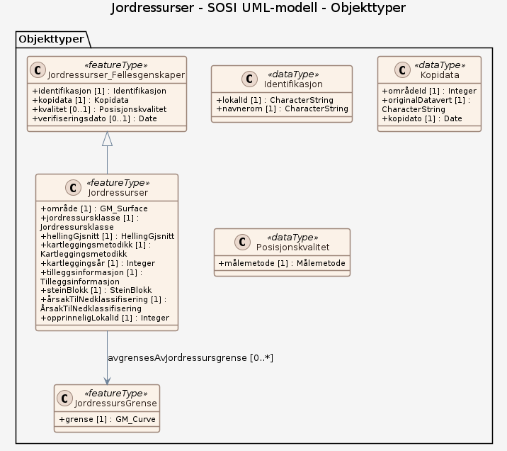

# Produktspesifikasjon: Jordressurser

***Datasettet er ikke publisert enda, og kan derfor ikke lastes ned** 

Kartet Jordressurser rangerer jordbruksareal ut ifra de naturlige betingelsene for jordbruk. 

Arealene har vært gjenstand for jordkartlegging og er delt inn i fire klasser basert på data om jordas egenskaper, helling, hyppige forekomster av fjell i dagen, samt innhold av stein- og blokk.  Det er ikke tatt hensyn til klima i rangeringen.

Det brukes en skala som går fra de aller beste egenskapene til de mindre gode egenskapene som påvirker plantedyrking og drifta på arealet.

Kartfigurer fra det nasjonale jordkartleggings-programmet utgjør enhetene i kartet.  Kartlegging utføres på fulldyrka og overflatedyrka jord. 
Kartfigurene er inndelt inn i fire klasser: 
1 = Svært gode jordressurser, 
2 = Gode jordressurser, 
3 = Middels gode jordressurser og 
4 = Mindre gode jordressurser.*

**Nøkkelord:** Jordsmonn, Jordressurser, Jordsmonkartlegging, arealplanlegging, plan- og bygningsloven (PBL), jord, egenskaper ved jord, Jordkartlagte areal, jordbruksareal, jordloven, Landbruk

**Emnekategorier:** Landbruk og havbruk

**Geografisk utstrekning**:

- **Vest**: 2.0
- **Øst**: 33.0
- **Sør**: 57.0
- **Nord**: 72.0

**Geografisk område**:
Norges fastland

**Tidsmessig utstrekning**:

- **Tidsperiode**:
  - **Fra**: 2026-09-17
  - **Til**: 2026-09-16

## Om spesifikasjonen

> **Denne versjonen av produktspesifikasjonen:**  
> **Opprettet dato:** 2026-09-17 
> **Endret dato:** 2026-09-16 
> **Språk:** nor 
> **Kontaktinformasjon:** Norsk institutt for bioøkonomi, [siri.svendgard-stokke@nibio.no](mailto:siri.svendgard-stokke@nibio.no)

## Om produktet Jordressurser

> **Romlig representasjonstype:** Vektor 
> **Unik identifikator:** 3690c283-a1f2-4e95-8cd4-2d6115eb28f7 
> **Kontaktinformasjon:** Norsk institutt for bioøkonomi, [siri.svendgard-stokke@nibio.no](mailto:siri.svendgard-stokke@nibio.no)
>
> **Romlig oppløsning:**
>
> **Ekvivalent målestokk**: 1:5000 - 1:20 000
>
> **Begrensninger:**
>
> **Juridiske begrensninger**:
>
> - **Tilgangsbegrensninger**: Åpne data
> - **Bruksbegrensninger**: Lisens
> - **Lisens**: Norsk lisens for offentlige data (NLOD)
> - **Lisenslenke**: <http://data.norge.no/nlod/no/1.0>
>
> **Sikkerhetsbegrensninger**:
>
> - **Klassifisering**: Ugradert

### Formål

I jordkartlegginga blir det lagt vekt på ni spesifikke egenskaper ved jordsmonnet, slik som tekstur, lagdeling og drenering. Dette er relativt stabile egenskaper ved jorda som lar seg bestemme ute i felt, in situ. En jordtype er en spesifikk, unik kombinasjon av disse ni egenskapene. Hver jordtype har et navn.

I noen kartfigurer kan det være avvikende egenskaper enn dem som framkommer fra jordkartleggingen. I tillegg til jordtypene innenfor hver kartfigur, registreres også andre relevante egenskaper, slik som eventuell høy frekvens av fjellblotninger og innhold av stein og blokk i øverste 50 cm. Dominerende hellingsklasse i hver kartfigur tilordnes i etterkant av feltarbeidet.

Klassene for innhold av stein og blokk påvirker klassetildelingen i Jordressurser. 

Helling er tilordnet som heltall, i prosent, og det er kartfigurenes gjennomsnittlige helling som brukes i dette kartet. 
Det er også ander tilleggsegenskaper om kartfiguren som påvirker klassetildelingen i Jordressurser.

### Bruksområde

Datasettet skal bidra til å løse kommunenes oppgaver med jordvern og jordbruk etter plan- og bygningsloven, samt annen arealforvaltning som berører jordbruksareal. Kartfigurer fra det nasjonale jordkartleggingsprogrammet utgjør enhetene i kartet.

## Omfang

### Hele datasettet

**Nivå**: dataset

**Nivåbeskrivelse**: Gjelder hele datasettet. Hvis omfang ikke er oppgitt under en overskrift, gjelder teksten for hele datasettet og alle leveranser

### SOSI UML-modell

**Nivå**: dataset

**Nivåbeskrivelse**: Modell basert på opplastet XMI

## Datainnhold og struktur

### Datamodell - SOSI UML-modell

➡️ [Se full datamodell for omfang "SOSI UML-modell" (diagram per pakke og objektkatalog)](sosi-uml-modell/objektkatalog.html)

## Referansesystem

| EPSG-kode | Navn på referansesystem |
| --- | --- |
| [EPSG:25832](https://epsg.io/25832) | [EUREF89 UTM sone 32, 2d](https://register.geonorge.no/epsg-koder) |
| [EPSG:25833](https://epsg.io/25833) | [EUREF89 UTM sone 33, 2d](https://register.geonorge.no/epsg-koder) |
| [EPSG:25835](https://epsg.io/25835) | [EUREF89 UTM sone 35, 2d](https://register.geonorge.no/epsg-koder) |

## Datakvalitet

**Nivå**: dataset

**Kvalitetsmål**: Prosentvis dekning i forhold til datasettets utstrekning

- **Målebeskrivelse**: Datasettets faktiske kartlagte areal i forhold til datasettets spesifiserte utstrekning
- **Resultat**: 100

**Kvalitetsmål**: Prosentvis oppfyllelse av FAIR-prinsipper

- **Målebeskrivelse**: Angir fullstendighet i forhold til krav fra FAIR-prinsippene (The FAIR Guiding Principles for scientific data management and stewardship)
- **Resultat**: 85

## Datafangst og produksjon

NIBIO Rapport 37/2025, «Det nasjonale programmet for jordkartlegging» (https://hdl.handle.net/11250/3185641) beskriver hvordan stedfesting og dokumentasjon av jordsmonnets egenskaper utføres (forarbeid, metodikk i felt og etterarbeid). Rapporten inneholder også informasjon om dataforvaltning og formidling av data fra programmet. 
Kartfigurenes helling hentes fra den nasjonale høydemodellen (hoydedata.no) og to av terrengmodellene derfra benyttes: en med 1 m oppløsning og en med 10 m oppløsning. Begge modellene endres over tid når nye og oppdaterte høydedataprosjekt er tilgjengelig. Det er kartfigurens gjennomsnittlige helling som benyttes i Jordressurser.
Informasjon om hvordan egenskaper ved jord, helling, hyppig forekommende fjell i dagen samt innhold av stein- og blokk påvirker klassetildeling i Jordressurser er publisert på produktsiden.

## Vedlikehold

**Vedlikeholdsfrekvens**: Ikke planlagt

**Status**: Under arbeid

## Leveranse

| Tjeneste | Endepunkt | Type | Format | Leveranseenheter |
| --- | --- | --- | --- | --- |
| Geonorge filnedlastning | [Lenke](https://kartkatalog.geonorge.no/metadata/jordressurser/3690c283-a1f2-4e95-8cd4-2d6115eb28f7) | GEONORGE:FILEDOWNLOAD | GeoPackage, GML | kommunevis, fylkesvis |
| OGC API-Features | [Lenke](https://ogcapi.nibio.no/felles/jordressurser) | OGC:API-Features | GeoJSON | landsfiler |
| WMS-tjeneste | [Lenke](https://wms.nibio.no/cgi-bin/jordressurser?service=wms&request=getcapabilities) | OGC:WMS | jpg, [{}] | landsfiler |

## Metadata

**Metadatastandard**: ISO19115

**Metadatastandardversjon**: 2003

**Metadatadato**: 2026-10-22

**språk**: nor

**Kontakt**:

- **Organisasjon**: Norsk institutt for bioøkonomi
- **Kontaktperson**: Christina Sogge
- **Logo**: <https://register.geonorge.no/data/organizations/988983837_NIBIO_liten.jpg>
- **Epost**: gisdrift@nibio.no
- **rolle**: pointOfContact

**Metadataidentifikator**:

- **Utsteder**: Geonorge
- **kode**: 3690c283-a1f2-4e95-8cd4-2d6115eb28f7
- **koderom**: <https://kartkatalog.geonorge.no/metadata/>
- **Metadatalenke**: <https://kartkatalog.geonorge.no/metadata/3690c283-a1f2-4e95-8cd4-2d6115eb28f7>

## Tilleggsinformasjon

Produktspesifikasjonen Jordressurser inneholder en beskrivelse av temakartet Jordressurser som er utviklet for arealplanlegging. Temakartet er blant annet tilgjengelige under fagområdet Jordsmonn og fagområde Arealinformasjon i NIBIOs karttjeneste Kilden. Andre temakart som har opphav i jorddata fra jordkartleggingsprogrammet, er beskrevet i produktspesifikasjonene Jordsmonn, Erosjonsrisiko og Dyrkingspotensial.

- **Produktside:** [https://nibio.no/tema/jord/jordkartlegging/jordsmonnkart/jordressurser](https://nibio.no/tema/jord/jordkartlegging/jordsmonnkart/jordressurser)
