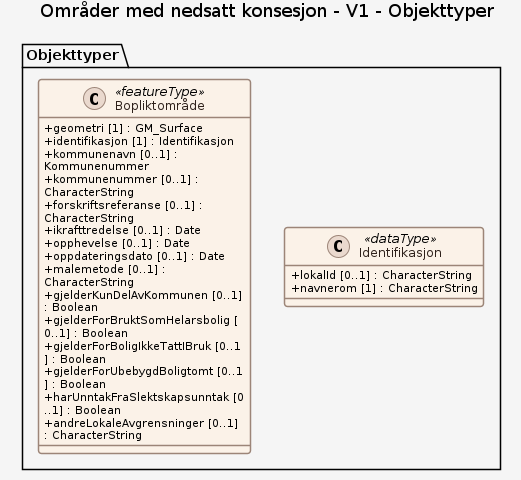
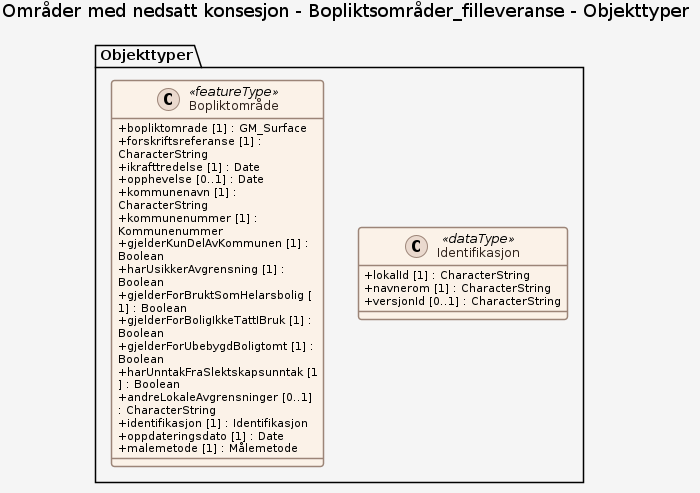

### Datamodell - V1

➡️ [Se full datamodell for omfang "V1" (diagram per pakke og objektkatalog)](v1/objektkatalog.html)

### Datamodell - Bopliktsområder_filleveranse

➡️ [Se full datamodell for omfang "Bopliktsområder_filleveranse" (diagram per pakke og objektkatalog)](bopliktsomrader-filleveranse/objektkatalog.html)
