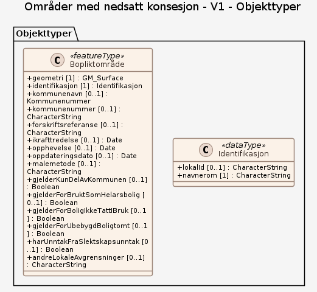

### Datamodell

**Kilde:** [JSON Schema](inputs/omrader-med-nedsatt-konsesjon/v1.feature_types.json)

#### Bopliktområde

Bopliktområder for landbrukseiendomer

Egenskaper

<table class="feature-attribute-table">
  <thead>
    <tr>
      <th>Egenskap</th>
      <th>Beskrivelse</th>
      <th>Type</th>
      <th>Multiplisitet</th>
    </tr>
  </thead>
  <tbody>
    <tr>
      <td>geometri</td>
      <td>Områder i datasettet</td>
      <td>GM_<wbr />Surface</td>
      <td>1</td>
    </tr>
    <tr>
      <td>identifikasjon</td>
      <td>Identifiserer objektet OGC-rolle: id</td>
      <td>Identifikasjon (datatype)</td>
      <td>1</td>
    </tr>
    <tr>
      <td>- lokal<wbr />Id</td>
      <td>Unik id</td>
      <td>Character<wbr />String</td>
      <td>0..1</td>
    </tr>
    <tr>
      <td>- navnerom</td>
      <td>Navnerom for objektet</td>
      <td>Character<wbr />String</td>
      <td>1</td>
    </tr>
    <tr>
      <td>kommunenavn</td>
      <td>kommunenavn</td>
      <td><a href="#kodeliste-kommunenummer">Kommunenummer</a> (enumerering)</td>
      <td>0..1</td>
    </tr>
    <tr>
      <td>kommunenummer</td>
      <td>kommunenummer</td>
      <td>Character<wbr />String</td>
      <td>0..1</td>
    </tr>
    <tr>
      <td>forskriftsreferanse</td>
      <td>forskriftsreferanse</td>
      <td>Character<wbr />String</td>
      <td>0..1</td>
    </tr>
    <tr>
      <td>ikrafttredelse</td>
      <td>ikrafttredelse</td>
      <td>Date<wbr />Time</td>
      <td>0..1</td>
    </tr>
    <tr>
      <td>opphevelse</td>
      <td>opphevelse</td>
      <td>Date<wbr />Time</td>
      <td>0..1</td>
    </tr>
    <tr>
      <td>oppdateringsdato</td>
      <td>oppdateringsdato</td>
      <td>Date<wbr />Time</td>
      <td>0..1</td>
    </tr>
    <tr>
      <td>malemetode</td>
      <td>malemetode</td>
      <td>Character<wbr />String</td>
      <td>0..1</td>
    </tr>
    <tr>
      <td>gjelder<wbr />Kun<wbr />Del<wbr />Av<wbr />Kommunen</td>
      <td>gjelderKunDelAvKommunen</td>
      <td>Boolean</td>
      <td>0..1</td>
    </tr>
    <tr>
      <td>gjelder<wbr />For<wbr />Brukt<wbr />Som<wbr />Helarsbolig</td>
      <td>gjelderForBruktSomHelarsbolig</td>
      <td>Boolean</td>
      <td>0..1</td>
    </tr>
    <tr>
      <td>gjelder<wbr />For<wbr />Bolig<wbr />Ikke<wbr />Tatt<wbr />IBruk</td>
      <td>gjelderForBoligIkkeTattIBruk</td>
      <td>Boolean</td>
      <td>0..1</td>
    </tr>
    <tr>
      <td>gjelder<wbr />For<wbr />Ubebygd<wbr />Boligtomt</td>
      <td>gjelderForUbebygdBoligtomt</td>
      <td>Boolean</td>
      <td>0..1</td>
    </tr>
    <tr>
      <td>har<wbr />Unntak<wbr />Fra<wbr />Slektskapsunntak</td>
      <td>harUnntakFraSlektskapsunntak</td>
      <td>Boolean</td>
      <td>0..1</td>
    </tr>
    <tr>
      <td>andre<wbr />Lokale<wbr />Avgrensninger</td>
      <td>andreLokaleAvgrensninger</td>
      <td>Character<wbr />String</td>
      <td>0..1</td>
    </tr>
  </tbody>
</table>

### Kodelister

#### «Enumeration» Kommunenummer

Profilparametre i tagged values

<table class="feature-attribute-table">
  <colgroup>
    <col style="width: 35%;" />
    <col style="width: 65%;" />
  </colgroup>
  <tbody>
    <tr>
      <th scope="row">asDictionary</th>
      <td>false</td>
    </tr>
  </tbody>
</table>

Koder

<table class="code-list-table">
  <thead>
    <tr>
      <th>Kodenavn:</th>
      <th>Definisjon:</th>
      <th>Kodeverdi:</th>
    </tr>
  </thead>
  <tbody>
    <tr>
      <td></td>
      <td>Ringerike</td>
      <td>3105</td>
    </tr>
  </tbody>
</table>
